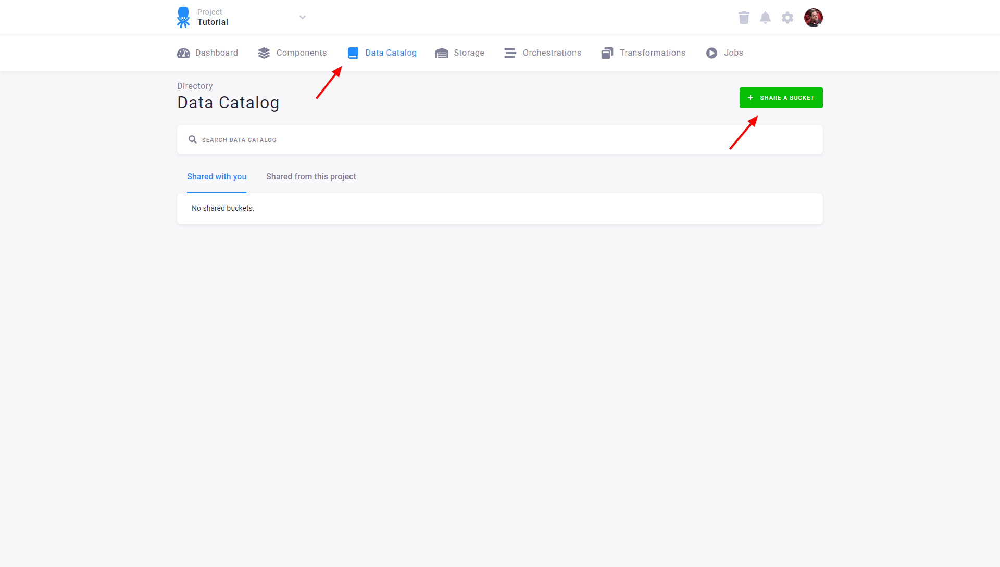
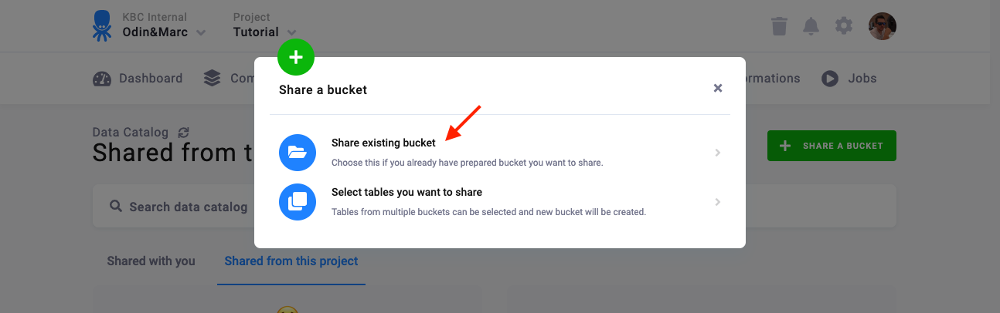
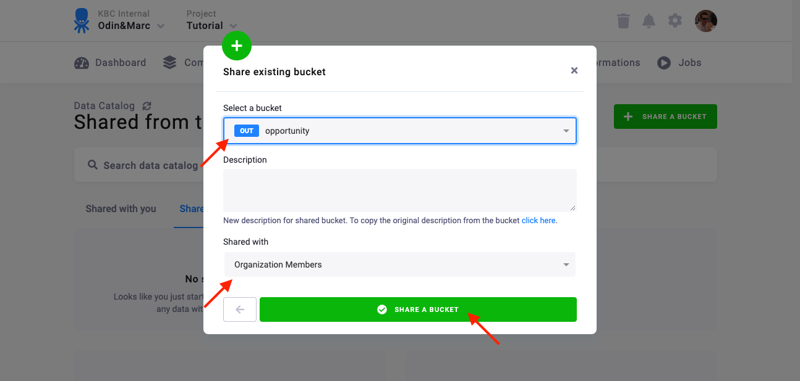
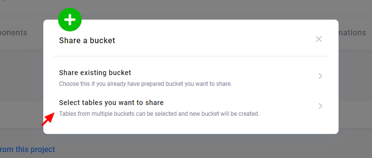
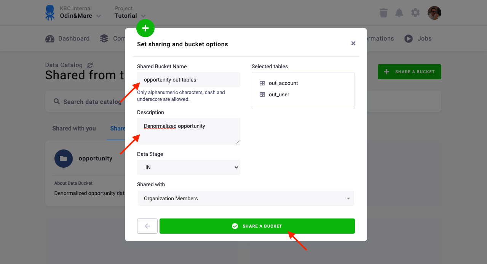
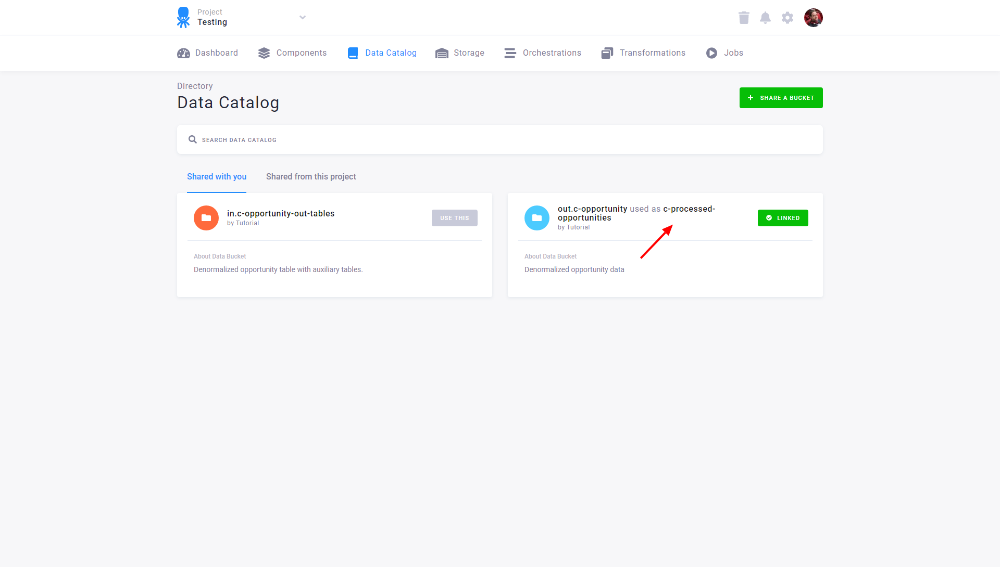
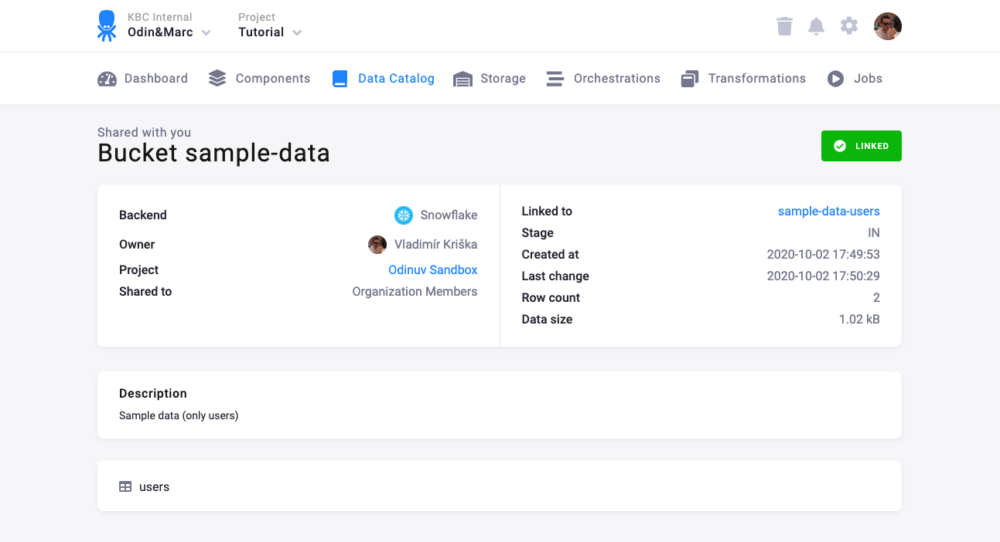

Each recipe on this page is self-contained: a goal, the steps and the result. For what shared and linked buckets are, who can manage them and which projects can take part, read the [Data Catalog](/catalog/) overview and its [constraints](/catalog/#constraints) first.

<!-- How-to-type page. Source: the former single Data Catalog page (keboola/connection-docs history), checked 2026-11-19. Steps are carried over from that page and not re-run in the product. -->

<!-- VERIFY(Nikita): the labels on this page (SHARE BUCKET, Share existing bucket, Select tables, Create Alias, Shared with you, Link, Edit Sharing, Disable) and all 14 screenshots come from the 2019 to 2020 UI. Check each label against the current Data Catalog. -->

## Share a bucket

**Goal:** make data from your project available to other projects in your organization.

1. Go to **Data Catalog** and click **SHARE BUCKET**.

   

2. Choose whether you want to share an existing bucket or create a new one. Both options are technically the same, the choice
   depends purely on whether you prepared the data in advance (an existing bucket) or not (create a new bucket).

Then follow one of the two variants below.

### Share an existing bucket

1. Choose the **Share existing bucket** option.

   

2. Select the bucket and a [sharing type](/catalog/#sharing-types). You can also assign a **Datashare Owner** who will be responsible for the bucket. Optionally, provide a description of the bucket and select a custom color so others know what to expect.

   

**Result:** the bucket is shared and instantly available to other projects in the organization depending on the [sharing type](/catalog/#sharing-types)
you have chosen.

### Share a new bucket

1. Choose the **Select tables** option.

   

2. Select the tables and/or buckets you want to share.

   

3. Enter the bucket name and a [sharing type](/catalog/#sharing-types). Assign a **Datashare Owner**, and optionally customize the bucket color and enter a description.

   

**Result:** a new bucket is created for you, and the selected tables are linked to it using [aliases](/storage/tables/#aliases).

To change sharing settings, share the newly [created bucket again](#share-an-existing-bucket). The newly selected settings will overwrite the old ones. <!-- VERIFY(Nikita): the Edit Sharing button is described as the way to change sharing settings for a bucket shared as existing. Confirm whether a bucket created with Select tables still has to be shared again, or whether Edit Sharing works for it too. -->

### Add tables to a shared bucket

To extend an existing shared bucket with additional tables, you don't need to delete the bucket and recreate it. Instead,
create an [alias](/storage/tables/#aliases) of the table and set the shared bucket as the destination. Here is how to do so:

1. Go to **Storage → Tables** and locate the table you want to add.

2. Click **Create Alias**.

3. **Select the shared bucket** as the destination. Ensure automatic synchronization of the columns is enabled.

**Result:** once created in the shared bucket, the alias will immediately appear in all linked projects.

## Link a shared bucket

**Goal:** bring a bucket that another project shares into your own project.

1. Go to **Data Catalog** and open the **Shared with you** tab. You link a shared bucket into your project from there.

   

2. Enter a name of the bucket as you'd like to see it in the current project and **Link** the bucket.

   

**Result:** the bucket is available in your project.

You can see the detail of the shared bucket with a link to the source project (if you have access to it). The bucket will inherit the color and description from the source bucket.

## Edit a shared bucket's metadata

**Goal:** edit the metadata of a shared bucket directly from the Data Catalog, or change its sharing settings.

1. Go to **Data Catalog** and locate the bucket you want to edit.
2. Click the bucket to view its details.
3. On the bucket detail page, click **Edit Sharing**. The same button changes the sharing settings.

   

4. Modify the metadata:
   - **Description**: Add or update the bucket description
   - **Color**: Change the bucket color from the default gray to a custom color
   - **Datashare Owner**: Assign or change the person responsible for the bucket

**Result:** these metadata changes will be propagated to all linked buckets, ensuring consistency across projects.

## Stop sharing a bucket

**Goal:** stop sharing a bucket from your project with other projects.

1. Go to **Data Catalog**.
2. Click **Disable** sharing on the bucket.

   

**Result:** the bucket is no longer shared. <!-- VERIFY(Nikita): the earlier page gave no result for this step. Confirm what Disable does while the bucket is still linked in other projects. The constraints say a linked bucket cannot be deleted until its links are removed. -->

---

**Next:** [Multi-project architecture →](/catalog/multi-project/)
