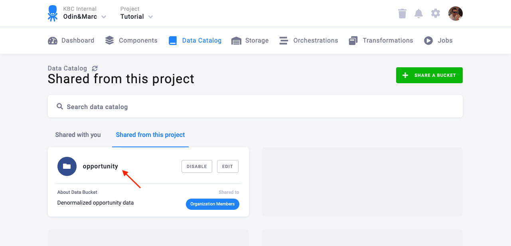
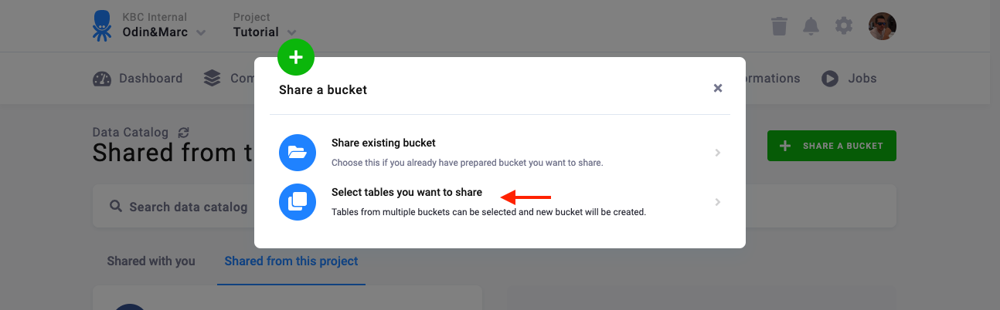
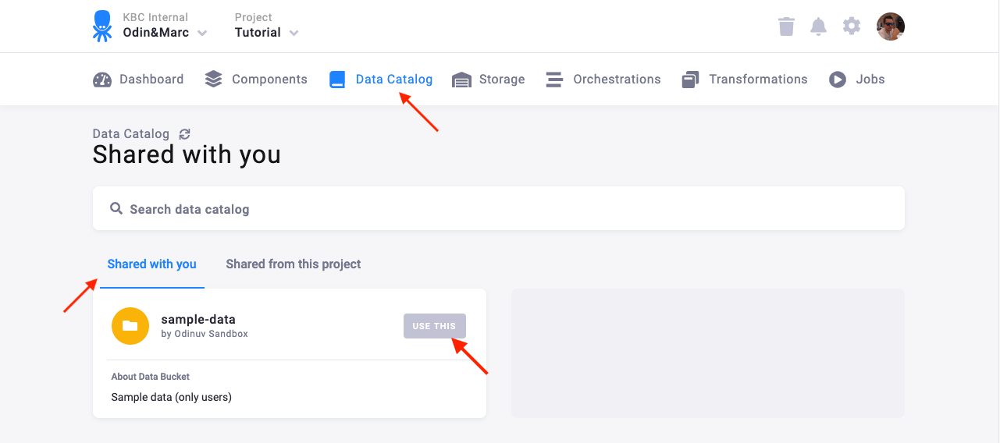
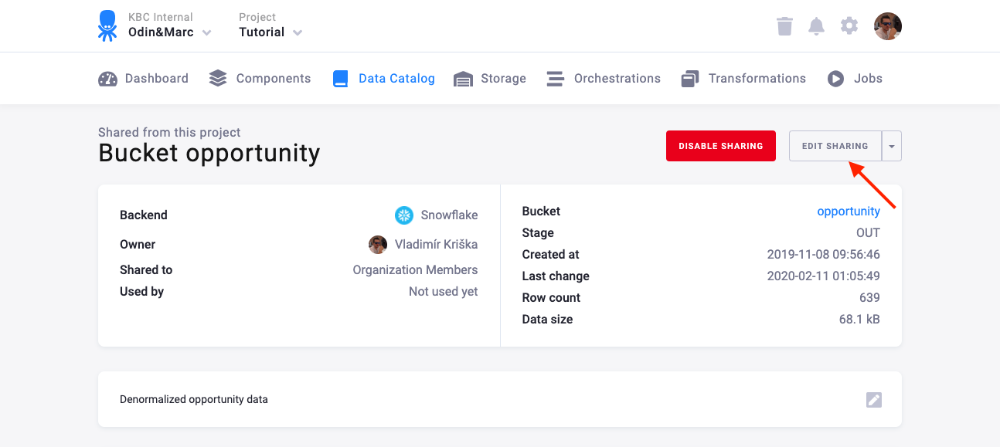

Each recipe on this page is self-contained: a goal, the steps and the result. For what shared and linked buckets are, and for the full list of [constraints](/catalog/#constraints), read the [Data Catalog](/catalog/) overview.

<!-- How-to-type page. Source: the former single Data Catalog page (keboola/connection-docs history), checked 2026-11-19. Steps are carried over from that page and not re-run in the product. -->

**Before you start:** to manage shared buckets, your user account must be an [organization member](/management/organization/) or a project administrator with the [share role](/management/project/users/#user-roles) assigned. Source and destination projects must belong to the same organization (and region).

<!-- VERIFY(Nikita): the labels on this page and all 14 screenshots come from the 2019 to 2020 UI. Check each label against the current Data Catalog: Data Catalog (the old page said "Catalog" in the share step and "Data Catalog" elsewhere), SHARE BUCKET, Share existing bucket, Select tables, Create Alias, Shared with you, Link, Edit Sharing, Disable. The old text names no control for the following actions, so the steps leave them out. Add them from the live UI: the button that confirms the share in both variants, the control that opens the link dialog, where Create Alias sits and how to turn on column synchronization, a save step after Edit Sharing, where Disable sits, and where each result can be checked. -->

## Share a bucket

**Goal:** make data from your project available to other projects in your organization.

1. Go to **Data Catalog** and click **SHARE BUCKET**.

   

2. Decide which option fits: **Share existing bucket** for a bucket you prepared in advance, or **Select tables** to have a new bucket created from the tables you pick.

Then follow the matching variant below.

### Share an existing bucket

1. Choose the **Share existing bucket** option.

   

2. Select the bucket and a [sharing type](/catalog/#sharing-types). You can also assign a **Datashare Owner** who will be responsible for the bucket. Optionally, provide a description of the bucket and select a custom color so others know what to expect.

   

**Result:** the bucket is shared and instantly available to other projects in the organization depending on the [sharing type](/catalog/#sharing-types)
you have chosen.

### Share selected tables

1. Choose the **Select tables** option.

   

2. Select the tables and/or buckets you want to share.

   

3. Enter the bucket name and a [sharing type](/catalog/#sharing-types). Assign a **Datashare Owner**, and optionally customize the bucket color and enter a description.

   

**Result:** a new bucket is created for you, and the selected tables are linked to it using [aliases](/storage/tables/#aliases).

To change sharing settings, share the newly [created bucket again](#share-an-existing-bucket). The newly selected settings will overwrite the old ones. For the **Edit Sharing** button, see [Edit a shared bucket's metadata](#edit-a-shared-buckets-metadata). <!-- VERIFY(Nikita): the old page contradicts itself here. This sentence says to share the bucket again to change its sharing settings, while the Edit Sharing sentence, now in "Edit a shared bucket's metadata", says that button changes them. Confirm which holds for a bucket created with Select tables. -->

## Add tables to a shared bucket

**Goal:** add more tables to a bucket you already share.

To extend an existing shared bucket with additional tables, you don't need to delete the bucket and recreate it. Instead,
create an [alias](/storage/tables/#aliases) of the table and set the shared bucket as the destination. Here is how to do so:

1. Go to **Storage → Tables** and locate the table you want to add.

2. Click **Create Alias**.

3. **Select the shared bucket** as the destination. Ensure automatic synchronization of the columns is enabled.

**Result:** once created in the shared bucket, the alias will immediately appear in all linked projects.

## Link a shared bucket

**Goal:** bring a bucket that another project shares into your own project.

1. Go to **Data Catalog** and open the **Shared with you** tab. You link a shared bucket into your project from there.

   

2. Find the bucket you want to link. To narrow the list, filter it with the **All**, **Linked** and **Mine** buttons (**Mine** shows the buckets you own), click a column header to sort by Name, Datashare Owner, Size, etc., or use the search box to find specific buckets by name or description. <!-- VERIFY(Nikita): the old page contradicts itself here. Its link steps and screenshots use a "Shared with you" tab, while its list-view passage describes All, Linked and Mine filter buttons. Confirm which of the two the current catalog has, the button labels, and that Name, Datashare Owner and Size are sortable columns. -->

3. Enter a name of the bucket as you'd like to see it in the current project and **Link** the bucket.

   

**Result:** the bucket is available in your project.

You can see the detail of the shared bucket with a link to the source project (if you have access to it). The bucket will inherit the color and description from the source bucket.

## Edit a shared bucket's metadata

**Goal:** edit the metadata of a shared bucket directly from the Data Catalog, or change its sharing settings.

1. Go to **Data Catalog** and locate the bucket you want to edit.
2. Click the bucket to view its details.
3. On the bucket detail page, click **Edit Sharing**. The same button changes the sharing settings.

   

4. Modify the metadata:
   - **Description**: Add or update the bucket description
   - **Color**: Change the bucket color from the default gray to a custom color
   - **Datashare Owner**: Assign or change the person responsible for the bucket

**Result:** these metadata changes will be propagated to all linked buckets, ensuring consistency across projects.

## Stop sharing a bucket

**Goal:** stop sharing a bucket from your project with other projects.

1. Go to **Data Catalog**.
2. Click **Disable** sharing on the bucket.

   

**Result:** the bucket is no longer shared. While other projects still link the bucket, sharing cannot be disabled: the links have to be removed first. See also the [constraints](/catalog/#constraints). <!-- Checked 2026-11-20: unsharing fails while linked buckets exist, per the Keboola CLI (kbagent sharing unshare) docs; whether the UI offers to remove the links itself was not checked. -->

---

**Next:** [Multi-project architecture →](/catalog/multi-project/)
