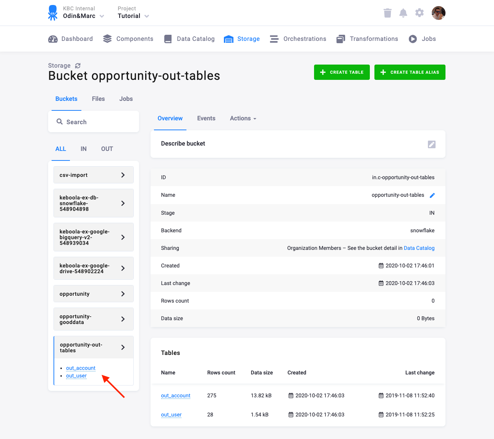
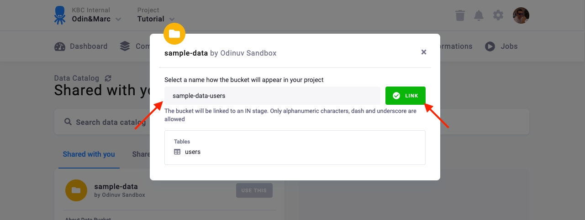
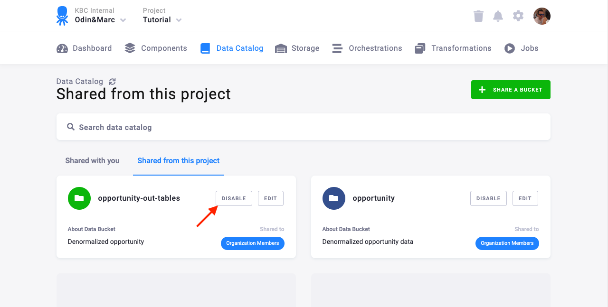

How to share a bucket through the [Data Catalog](/catalog/), link a shared bucket into your project, edit its metadata, and stop sharing it.

## Enable Sharing

To share data outside of your project, go to _Catalog_ and click **SHARE BUCKET**.

Next you can choose whether you want to share an existing bucket or create a new one. Both options are technically the same, the choice
depends purely on whether you prepared the data in advance (an existing bucket) or not (create a new bucket).

### Share an Existing Bucket

Choose the **Share existing bucket** option:

Then, select the bucket and a [sharing type](#sharing-types). You can also assign a **Datashare Owner** who will be responsible for the bucket. Optionally, provide a description of the bucket and select a custom color so others know what to expect.

The bucket is shared and instantly available to other projects in the organization depending on the [sharing type](#sharing-types)
you have chosen.

To change sharing settings, go to the bucket detail page and click the **Edit Sharing** button:

### Adding new tables to an existing shared bucket

To extend an existing shared bucket with additional tables, you don't need to delete the bucket and recreate it. Instead,
create an [alias](/storage/tables/#aliases) of the table and set the shared bucket as the destination. Here is how to do so:

1. Go to **Storage → Tables** and locate the table you want to add.

2. Click **Create Alias**.

3. **Select the shared bucket** as the destination. Ensure automatic synchronization of the columns is enabled.

Once created in the shared bucket, the alias will immediately appear in all linked projects.

### Share a New bucket

Choose the **Select tables** option:

Select the tables and/or buckets you want to share:

Enter the bucket name and a [sharing type](#sharing-types). Assign a **Datashare Owner**, and optionally customize the bucket color and enter a description:

A new bucket will be created for you, the selected tables will be linked to it using [aliases](/storage/tables/#aliases).

To change sharing settings, share the newly [created bucket again](#share-an-existing-bucket). The newly selected settings will overwrite the old ones.

## Link a Bucket

You can link a shared bucket into your project from the **Shared with you** tab in the Data Catalog:

Enter a name of the bucket as you'd like to see it in the current project and **Link** the bucket:

You'll see that the bucket is available in your project:

You can see the detail of the shared bucket with a link to the source project (if you have access to it). The bucket will inherit the color and description from the source bucket.

## Managing Bucket Metadata

You can edit the metadata of shared buckets directly from the Data Catalog:

1. Navigate to the **Data Catalog** and locate the bucket you want to edit
2. Click on the bucket to view its details
3. Click **Edit Sharing** to modify:
   - **Description**: Add or update the bucket description
   - **Color**: Change the bucket color from the default gray to a custom color
   - **Datashare Owner**: Assign or change the person responsible for the bucket

These metadata changes will be propagated to all linked buckets, ensuring consistency across projects.

## Stop Sharing a Bucket

To stop sharing a bucket, go to _Data Catalog_ and click **Disable** sharing:

**Next:** [Multi-Project Architecture →](/catalog/multi-project/)
