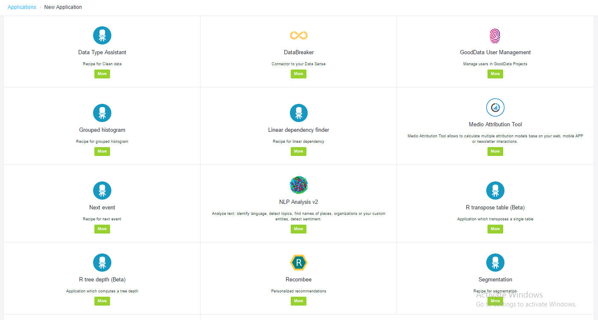

Applications are **predefined blocks with set functionality**, which can be customized or parametrized to some extent.
They further enrich your data and add value to it in new ways. 
At the same time, they are more difficult to create than [transformations](/transformations/).

<!-- Explanation-type page. Source: this page as it was before the 2026-11-19 rework, plus the ledes of its child pages for the section map. Older claims are kept and marked for the owner. -->

This page explains what applications are and how they compare with transformations. The applications that have a page of their own are listed in [This section](#this-section).

They can perform really advanced tasks, such as sentiment analysis, association discovery, or 
histogram grouping. They can also enhance data by calling on 3rd party services to bring in additional data 
such as Weather or Exchange Rates. 

All applications are **implemented as [components](/extend/)** 
and as such can be completely created by 3rd party developers. 
You can even create your own application. 
Applications can be created either for a particular end-user, or they may be offered 
to all Keboola customers; in that case they have to be registered in Keboola [Developer Portal](https://components.keboola.com/).

Applications may

- vary in terms and conditions.
- be billed extra; some are for free.
- send your data to 3rd party services outside of Keboola.
- extract data from outside sources.
- be created by you, Keboola, or third parties. 
- have support provided by their author. 

The following screenshot shows some of many Keboola applications (created by both, Keboola and 3rd parties): 

If you want to learn more about Applications or are interested in creating one, go to 
[Extending Keboola](/extend/).

If you want to see a short **demo on using a 3rd party app in Keboola** (analyzing text data), [click here](https://www.youtube.com/watch?v=dx03hlA7dTo). 
The video shows how to quickly extract text data from Twitter's API, process the data through Geneea's
natural language processing algorithm and visualise the results in Tableau.

<!-- VERIFY(Nikita): the demo video is old (Twitter's API, Geneea, Tableau). Check that it still plays and still shows the product as it is; keep, replace or remove. -->

## Applications vs. transformations
Application and Transformations share many common properties. However, they differ in certain important aspects.

**Shared Properties:**

- Both Transformations and Applications can be used in your [flows](/flows/) in exactly the same way.
- The code of most R and Python Transformations can be used in Applications and vice versa, with none or
very few modifications.
- The Keboola programming interfaces for Applications and Transformations are highly similar.

**Differences:**

- The code in Transformations is visible to everyone in the Keboola project. The application code can be hidden.
- The Transformation code is tied to a specific project. To share the code across different projects,
use Application.
- Transformations are versioned as changes in the configuration in the Keboola project.
Applications are versioned externally.
- Applications can be created for you by 3rd parties, with some or even no access to your Keboola project.
- How applications are built, and how their data interface compares with that of transformations, is described in [Components](/extend/component/) in the developer documentation.

When deciding between the two, consider your capabilities, available resources and the
complexity of the task you need to perform. For more details, go to [Extending Keboola](/extend/).

## This section

You create and run a configuration of an application like that of any other component; see [Create and manage configurations](/components/configurations/). These applications have their own pages:

- [Custom Python](/components/applications/custom-python/): run your own Python code in Keboola, written in the UI or loaded from a Git repository.
- [Data Gateway](/components/applications/data-gateway/): share Storage tables read-only with BI tools through a Snowflake reader account.
- [AI applications](/components/applications/ai/): generate, process or enrich data with AI models. [Generative AI](/components/applications/ai/generative-ai/) queries large language models with data from your project.
- [Trigger applications](/components/applications/triggers/): start an action in another service. There are triggers for [dbt Cloud jobs](/components/applications/triggers/dbt-cloud-job-trigger/), [Deepnote notebooks](/components/applications/triggers/deepnote-notebook-execution-trigger/), [Exasol clusters](/components/applications/triggers/exasol-cluster-starter/), [flows in other Keboola projects](/components/applications/triggers/orchestration-trigger-queue-v2/), [Power BI datasets](/components/applications/triggers/powerbi-refresh/) and [Tableau extracts](/components/applications/triggers/tableau-extract-refresh/).

The full list of applications is in the component directory of your project and in the [Keboola Developer Portal](https://components.keboola.com/components).

