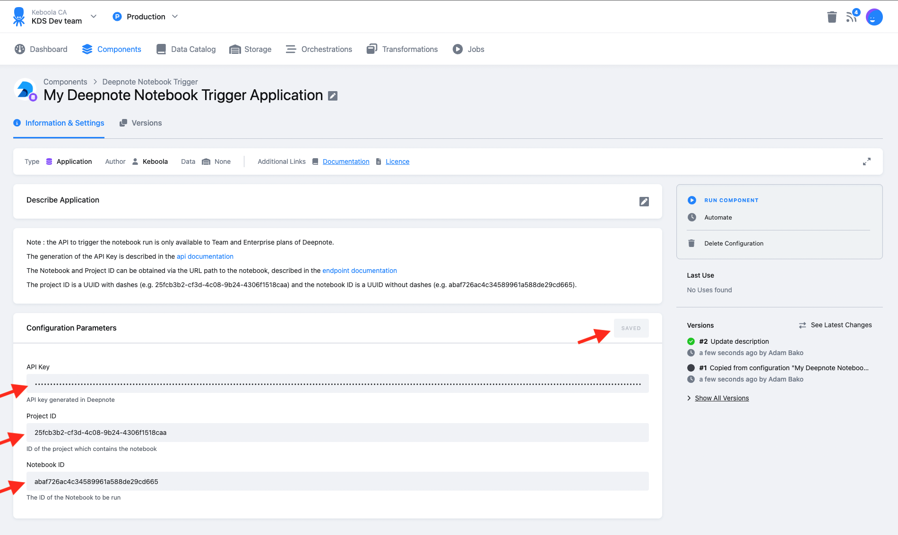

[Deepnote](https://deepnote.com/) is a collaborative data science notebook. This component enables you to trigger the running of a specified notebook in Deepnote. 
The application only triggers the execution, but does not have the capability of monitoring the execution.

<!-- How-to-type page. Type declared in the 2026-11-19 section rework; the content is unchanged and was not re-checked against the component. -->

## Creating an API key
The API is only available to Team and Enterprise plans of Deepnote. 
If you have one of these plans, then generate the API key by following the steps described in the [Deepnote API documentation](https://deepnote.com/docs/deepnote-api).

## Finding your Notebook and Project IDs
The Notebook and Project ID can be obtained via the URL path to the notebook, described in the [endpoint documentation](https://deepnote.com/docs/deepnote-api#execute-notebook). 
The project ID is a UUID with dashes (e.g. 25fcb3b2-cf3d-4c08-9b24-4306f1518caa) and the notebook ID is a UUID without dashes (e.g. abaf726ac4c34589961a588de29cd665).

## Create New Configuration
[Create a new configuration](/components/configurations/#create-a-configuration) of the **Deepnote Notebook Execution Trigger** Application.
Fill in your Deepnote **API key**, the **Notebook ID** of the notebook you wish to execute and the **Project ID** of 
the project the notebook is in. Once filled in click **Save** to save the configuration and click **Run Component** to execute the trigger.

