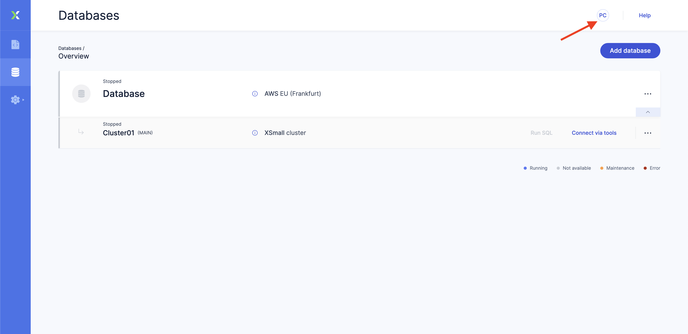
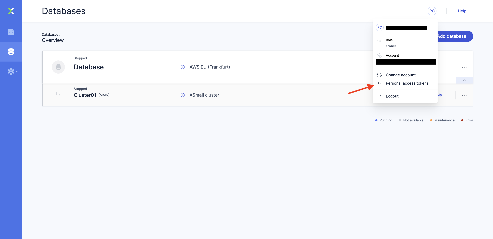
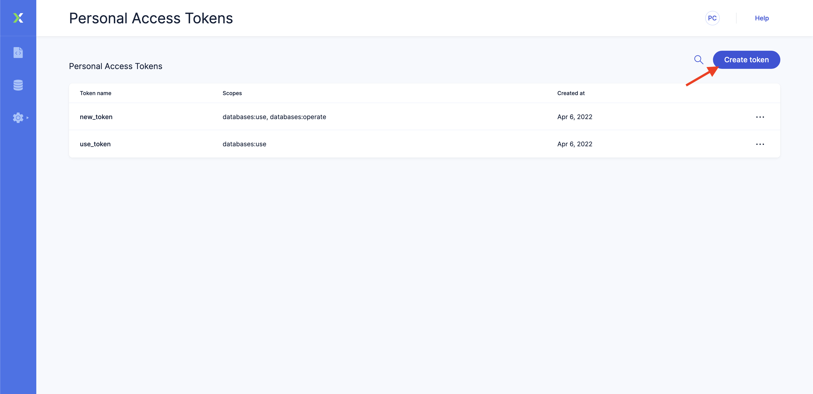
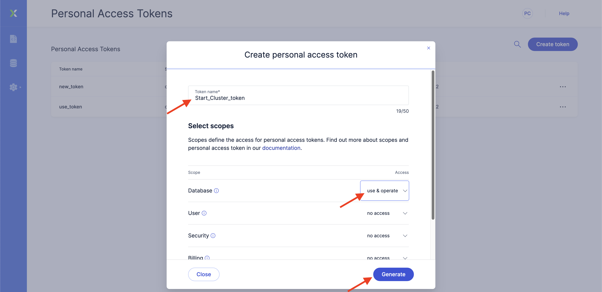
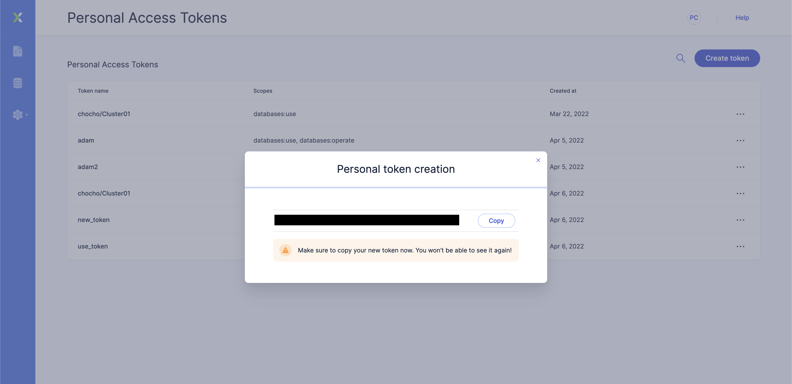
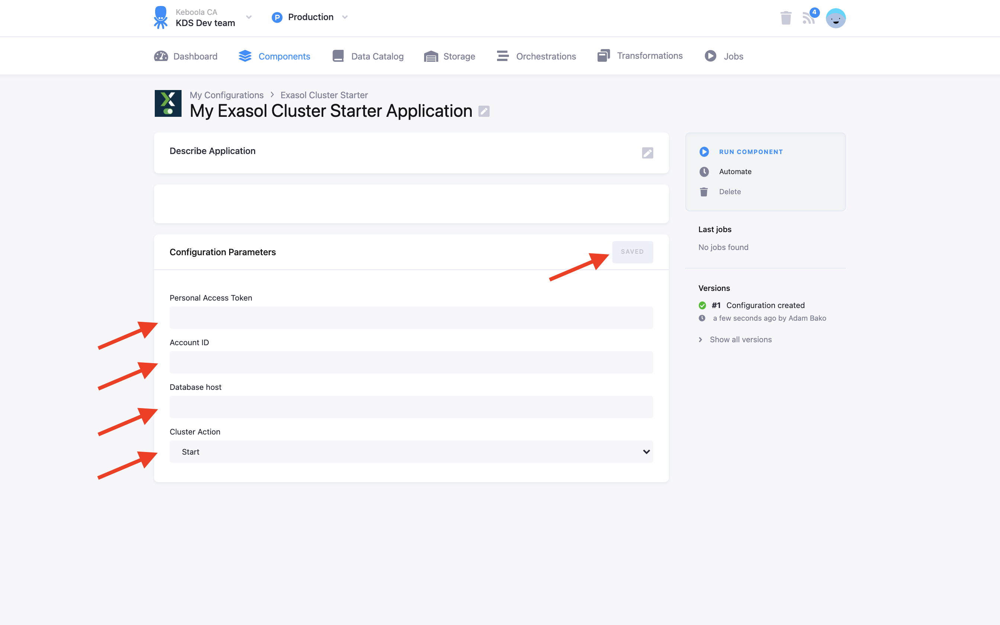

The Exasol Cluster starter is used for starting and stopping [Exasol Cloud](https://cloud.exasol.com) clusters.

<!-- How-to-type page. Type declared in the 2026-11-19 section rework; the content is unchanged and was not re-checked against the component. -->

## Getting a Personal Access Token

**Goal:** create the Personal Access Token that the application uses for authorization.

You can get a Personal Access Token for authorization by going to top right side of cloud.exasol.com and clicking the icon with your initials.

Then click **Personal access tokens**. 

Once on the Personal access token site, click **Create token**.

Fill in the Token name with a descriptive name, select the **use & operate scope for Database**, click **Generate**. 

Now just save the token to a secure location or just to the component configuration.

**Result:** you have a token with the **use & operate scope for Database** to enter in the configuration.

## Getting the cluster host

**Goal:** find the host of the cluster to start or stop.

You can get the host of the cluster you wish to start by clicking the three dots
on the right of the cluster name, clicking **Connect via tools** and going to the 3rd step. 
There you can see the host of the cluster.

**Result:** you have the host to enter in the configuration.

## Create New Configuration

**Goal:** start or stop an Exasol Cloud cluster from Keboola.

[Create a new configuration](/components/configurations/#create-a-configuration) of the **Exasol Cluster Starter** Application.
Then fill in your Personal Access token, your Account ID, the host of the cluster that you wish to start/stop, and select the 
action you wish to perform on the cluster; either **Start** or **Stop**. Then save the configuration and run it.

**Result:** when the configuration runs, the cluster starts or stops, as you selected.

### Functionality notes

If the cluster you wish to start is not the main cluster of the database, the application will first start the main cluster and after 
that the cluster that you entered. This is necessary as the main cluster must be started before you start any other clusters.

If any errors occur while starting a cluster please contact Exasol support.
