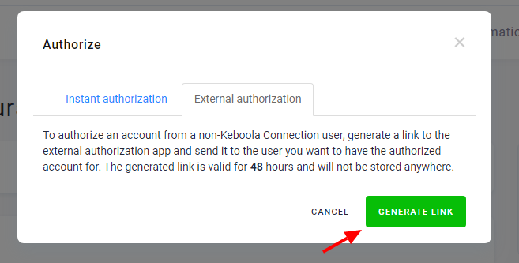
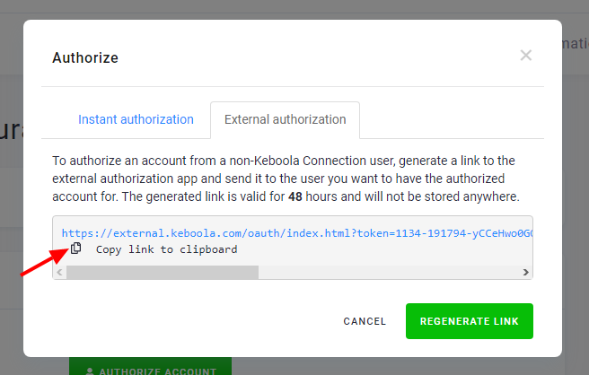
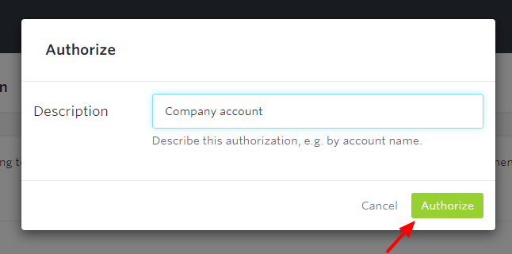
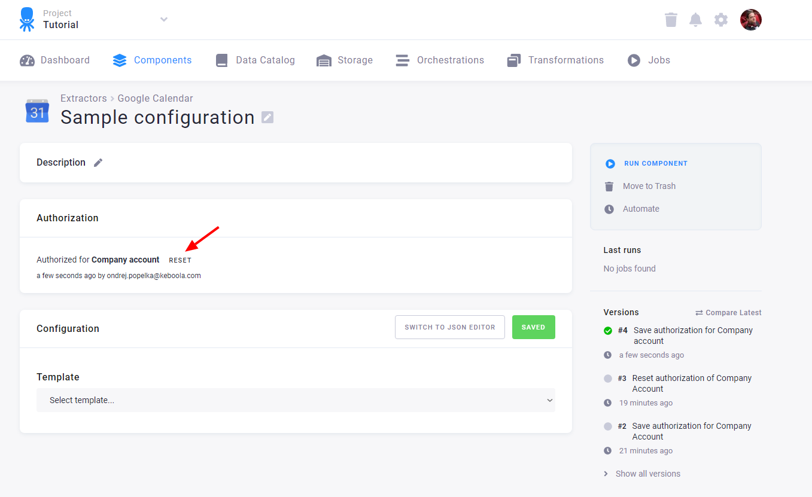

This page shows how to authorize a [component](/components/) configuration against an external service: with your own account, through a link you send to the account owner, and how to reset an authorization. The authorization is only valid for the configuration in which it was created and its **copies**. To create the configuration first, see [Create and manage configurations](/components/configurations/); to edit its JSON, see [Debug mode](/components/debug-mode/).

<!-- How-to-type page. Source: the Components page as it was before the 2026-11-19 split. Text and screenshots carried over; facts not re-checked against the product. -->

Many services support authorization using the [OAuth protocol](https://en.wikipedia.org/wiki/OAuth). For you (as the end user),
this means that the service does not require entering credentials (username, password, token, etc.). Instead, you are
redirected to the service itself, where you authorize the Keboola component. Then, you are redirected back to
Keboola, where you can set other parameters and run the configuration. OAuth authorization is a very secure authorization method in which you don't have to hand over the
credentials to your account. The consumer—the Keboola component—obtains only the minimal required
access.

The OAuth authorization process begins with the **Authorize** button (in this example, the
[Google Calendar data source connector](/components/extractors/communication/google-calendar/) is shown):

In the next step, you can choose the authorization method:

- **Instant**: Use this method if you have direct access to the account; the authorization will be done immediately.
- **External**: If you need to authorize access to the service from someone who does not have an account in Keboola, you can generate an external link, which will guide them through this process.

## Authorize with your own account

**Goal:** authorize a configuration with an account you can log in to yourself (instant authorization).

Instant authorization requires you to log in to the service you want to use.

1. In the configuration, click **Authorize** and choose **Instant** authorization.
2. With instant authorization, you have to enter a name describing the account you're going to use:

   

3. Next, you are taken to the actual authorization screen. This is provided by the service itself and varies widely.
   In the example below, the authorization for Google Calendar is shown.

   

**Result:** the service sends you back to Keboola with the configuration authorized.

## Ask the account owner to authorize

**Goal:** get a configuration authorized by someone who has no account in Keboola (external authorization).

An external account can be used in cases where you do not have direct access to the service and the
service *account owner* can't share the credentials with you. For example,
they may belong to a different company or department, or sharing the credentials would leak some permissions.
In such cases, you can ask the account owner to authorize the component configuration for you.

1. In the configuration, click **Authorize** and choose **External** authorization.
2. The first step is to generate the authorization link:

   

3. Then, you can copy the link and send it to the account owner. The link is valid for 48 hours. If it expires, you must
   regenerate and resend it.

   

4. When the *account owner* clicks the link, they're taken to a special page. There, they can confirm what
   they are authorizing and who requested the action. Then, they can click **Authorize Account** to proceed:

   

5. In the next step, the account owner has to enter the account name:

   

6. Then they are taken to the actual authorization screen. This is provided by the service itself and varies widely.
   In the example below, the authorization for Google Calendar is shown.

   

**Result:** the configuration is authorized with the owner's account, and the owner never had to share the credentials.

<!-- VERIFY(Nikita): name the button that generates the link (step 2 shows it only in a 2019 screenshot), and say how the person who sent the link sees that the owner has finished. -->

## Reset an authorization

**Goal:** drop the current authorization so that you can authorize the configuration again.

1. You can reset an existing authorization by clicking the **Reset** button.

   

2. Authorize the configuration again, with either method above.

**Result:** this invalidates the authorization obtained from the service and allows you to reauthorize the configuration.
Note that if you reset the authorization of a configuration that was copied, all the copies will lose the authorization.

The authorization can also be revoked from within the service. In that case the configuration will stop working,
and you will have to reset and reauthorize it.

---

**Next:** [Debug mode →](/components/debug-mode/)
