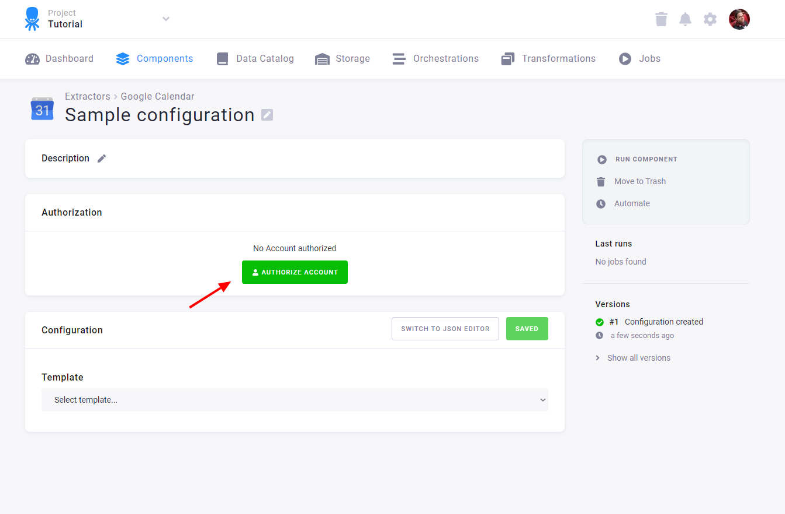
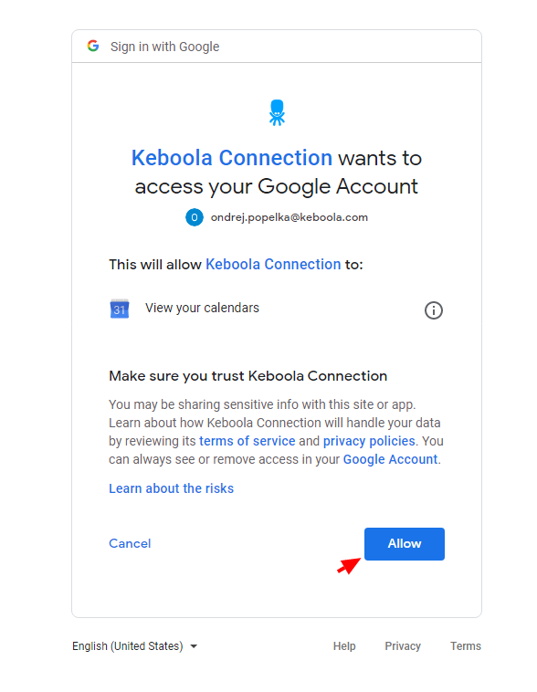
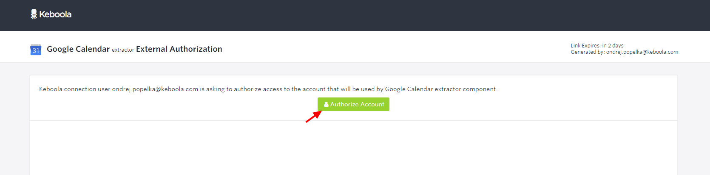

This page shows how to authorize a [component](/components/) configuration against an external service.

## Authorization
Many services support authorization using the [OAuth protocol](https://en.wikipedia.org/wiki/OAuth). For you (as the end user),
this means that the service does not require entering credentials (username, password, token, etc.). Instead, you are 
redirected to the service itself, where you authorize the Keboola component. Then, you are redirected back to 
Keboola, where you can set other parameters and run the configuration. 

The OAuth authorization process begins with the **Authorize** button (in this example, the
[Google Calendar data source connector](/components/extractors/communication/google-calendar/) is shown):

In the next step, you can choose the authorization method:

- **Instant**: Use this method if you have direct access to the account; the authorization will be done immediately.
- **External**: If you need to authorize access to the service from someone who does not have an account in Keboola, you can generate an external link, which will guide them through this process.

OAuth authorization is a very secure authorization method in which you don't have to hand over the 
credentials to your account. The consumer—the Keboola component—obtains only the minimal required 
access. The authorization is only valid for the configuration in which it was created and its **copies**.

### Instant Authorization
Instant authorization requires you to log in to the service you want to use.
With instant authorization, you have to enter a name describing the account you're going to use:

Next, you are taken to the actual authorization screen. This is provided by the service itself and varies widely. 
In the example below, the authorization for Google Calendar is shown.

### External Authorization
An external account can be used in cases where you do not have direct access to the service and the 
service *account owner* can't share the credentials with you. For example, 
they may belong to a different company or department, or sharing the credentials would leak some permissions.
In such cases, you can ask the account owner to authorize the component configuration for you.

The first step is to generate the authorization link:

Then, you can copy the link and send it to the account owner. The link is valid for 48 hours. If it expires, you must
regenerate and resend it.

When the *account owner* clicks the link, they're taken to a special page. There, they can confirm what
they are authorizing and who requested the action. Then, they can click **Authorize Account** to proceed:

In the next step, the account owner has to enter the account name:

Then they are taken to the actual authorization screen. This is provided by the service itself and varies widely. 
In the example below, the authorization for Google Calendar is shown.

### Resetting Authorization
You can reset an existing authorization by clicking the **Reset** button.

This invalidates the authorization obtained from the service and allows you to reauthorize the configuration.
Note that if you reset the authorization of a configuration that was copied, all the copies will lose the authorization.
The authorization can also be revoked from within the service. In that case the configuration will stop working,
and you will have to reset and reauthorize it.

**Next:** [Debug mode →](/components/debug-mode/)
