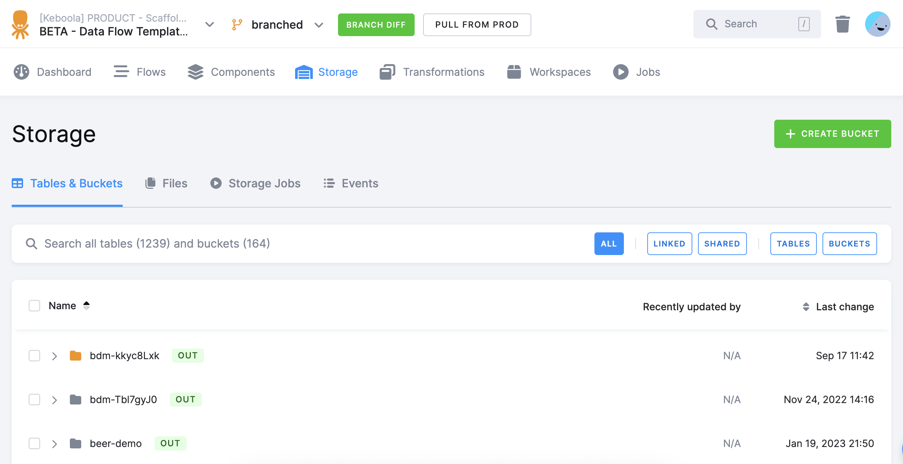

Development Branches allow you to modify [component configurations](/components/) without interfering with running
configurations or entire [automated pipelines](/flows/). They are ideal to use when making bigger changes
to a project or when you need to be extra careful about performing your changes safely.

<!-- Explanation-type page. Source: the Development Branches and Merge Requests pages as they were before the 2026-11-19 split. Text carried over; facts not re-checked against the product. -->

This page explains how branches work. If you already know that and want to create and start using your first branch,
go to our [Getting Started tutorial](/getting-started/branches/). The steps to create, switch and close a branch are on
[Manage development branches](/components/branches/manage/), and reviewing and merging changes is on
[Merge requests](/components/branches/merge-requests/).

To give an example, let's say that you have an ordinary flow that extracts, transforms and writes data
to a target system, and you need to remove a column from the source. To do that, you must modify several configurations,
and ideally, also perform a dry run to check that the data in the target system is correct. However, modifying a pipeline
that runs, e.g., every ten minutes, is difficult without an outage of the pipeline. Development Branches are designed
to help in such situations.

## How branches work

When you create a development branch in your project, you obtain an exact copy of the project and all its current
configurations. You can then modify these configurations without ever touching the original ones in production,
and these will keep running in flows.

When you run a configuration in a branch, it can **read** the [tables](/storage/tables/) and [files](/storage/files/)
from Storage as if it were a normal configuration. However, when your branch configuration attempts to **write** data
(tables or files), the data is written to the branch's isolated storage layer. This means that production data and branch data
are completely separated. There is no need to duplicate your entire project's data when creating a new branch.

## Branched storage

Branched Storage is an improved storage isolation model for development branches. Instead of cluttering your project
with prefixed bucket names (like `in.c-1234-bucket`), each branch gets its own fully isolated storage namespace.
Production data is never touched, and no data is copied up front — a copy is created only when you actually write to or modify a table within the branch.

:::tip
Branched Storage is available for projects running on <strong>Snowflake</strong> and <strong>BigQuery</strong>. Projects without Branched Storage enabled, and projects on other backends, use the classic prefix-based model.
:::

To turn it on, see [Enable branched storage](/components/branches/manage/#enable-branched-storage).

### Why it matters

Without Branched Storage, every write in a branch produced new buckets with prefixed names that were visible in
production Storage and cluttered the namespace. You had to be careful about what you ran and where.

With Branched Storage:

- **Production is safe** — writes in a branch never affect production data.
- **No data duplication up front** — creating a branch is instant and doesn't copy your storage. Tables are only materialized when you write to them.
- **Reads are transparent** — if a table hasn't been modified in the branch, you're reading live production data, with no extra cost.
- **Clean Storage** — the branch has its own storage namespace. No prefixed buckets visible in production.

### How it behaves in practice

When you create a branch and run a job:

- **Reading** from a table that hasn't been modified → the branch reads directly from production. Nothing is copied.
- **Writing** to a table for the first time → the table is cloned into the branch's isolated storage. All subsequent reads and writes for that table within the branch use this isolated copy.
- **Production is never touched** — regardless of how many times you write in a branch.

When you delete or merge the branch, the branched storage is cleaned up accordingly.

## Data pipelines in branches

In production, you might have a data source connector that extracts data into a bucket `in.c-requests`, and a transformation
that reads from it and writes results to `out.c-visits`.

When you switch to a branch in a **project with Branched Storage enabled**, no data is copied immediately.
The branch reads from production Storage until you run a job that writes data — at that point, only the affected tables
are materialized in the branch's own storage. Your production `out.c-visits` remains untouched throughout.

This allows you to test the entire pipeline with real data, in complete isolation from production, without duplicating
all storage content at branch creation.

## The merge request lifecycle

A branch ends in one of two ways: you delete it, or you merge it into production
(see [Close a branch](/components/branches/manage/#close-a-branch)). In projects with Branches 2.0 enabled, the merge goes
through a [merge request](/components/branches/merge-requests/).

***Important:** All of this happens within the same project, enabling collaboration with other project members on the modifications.*

Every merge request moves through a set of states, shown as filters at the top of the
**Merge Requests** list:

- **In Review** — submitted and waiting for the required number of approvals.
- **Ready to Merge** — approved and ready to be merged into production (either manually or automatically).
- **Merged** — the changes have been applied to production.
- **Rejected** — a reviewer requested changes; go back to the branch, adjust, and resubmit.
- **Closed** — the request was cancelled without merging.

You can reach the list at any time from the branch switcher (**Merge Requests**) or from the project menu.

Each row shows the request name and description, its status, who created it and when, a link to the
changed configurations, and the reviews collected so far.

## After a merge

When you merge a branch, all changes in the configurations are brought back to the respective production configurations.
All the changes are applied at once (after you approve them) and produce new
[versions](/components/configurations/#see-the-version-history) of the respective configurations.

Because a merge produces new [configuration versions](/components/configurations/#see-the-version-history) in production,
no configuration change is lost: if a merged change causes problems, you can open the affected configuration
and roll it back to its previous version, restoring the pre-merge state.

What happens to the branch depends on how you merge:

- In a direct merge, you choose in the merge dialog whether to delete the branch or keep it for further reference after merging.
- In projects with [Branches 2.0](/components/branches/merge-requests/), the merge goes through a merge request, which lets you review
  the configuration diff and, if the project requires it, collect approvals before the changes reach production. A merged
  request always deletes the branch: a successful merge **deletes the development branch**, including its buckets, tables,
  and workspaces. Only the configuration changes reach production; if you still need data from the branch, export it before
  you merge. The merged request is kept in the [list](#the-merge-request-lifecycle) with the **Merged** status, and you
  can **Download Changelog** from its row for a record of exactly what was applied.

## Component considerations

Certain components are not allowed to run in development branches. There are following special cases where components' functionality is limited in the development branches.

### Working with external resources

Some components, like writers, can write to a destination that is external to Keboola. Those components'
configs are first marked as *unsafe* in development branch.

You will not be able to run an unsafe config. You need to first observe the config and verify that it's either OK to
write to the destination, or change the destination accordingly.

### OAuth authorized components

Components using OAuth do not allow authorizing nor changing the OAuth in a development branch. The OAuth authorization tokens are shared with production so changing them might break the production pipeline.

***Important:** Development branches are for development and testing only, so setting up status notifications on Flows is not supported.*

---

**Next:** [Manage development branches →](/components/branches/manage/)
