This page shows how to create a configuration of a [component](/components/) and manage it afterwards.

## Creating Component Configuration
To create a new component configuration, select *Components* from the top navigation and then select one of the component categories:

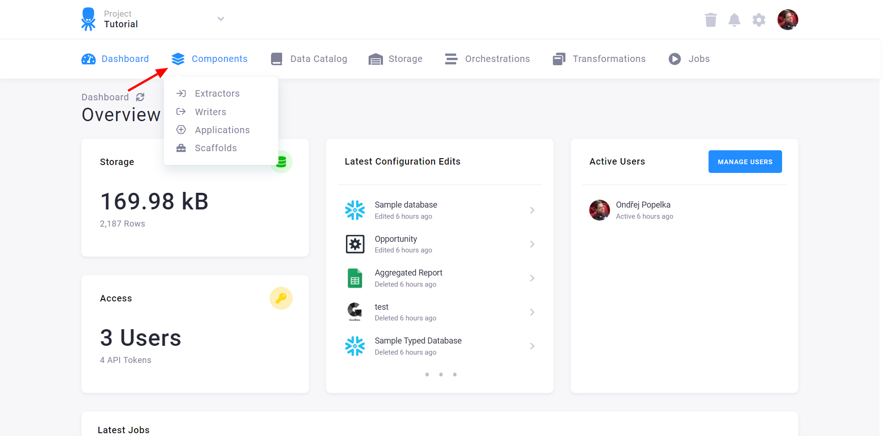

The following page lists the project's current configurations (e.g., data source connectors). To create a new configuration of a new component, 
use the **Directory** or the **Add New Data Source** button.

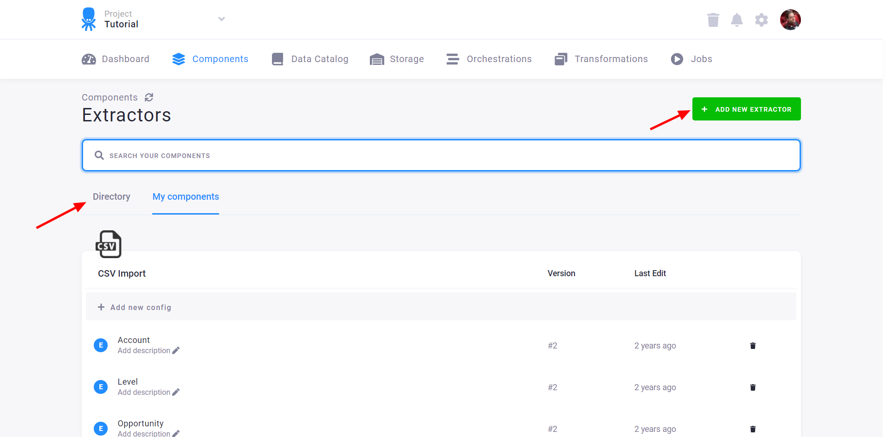

Use the search field to find the component you want to use (the Currency Rates data source connector in this case) and then click the component tile to add it:

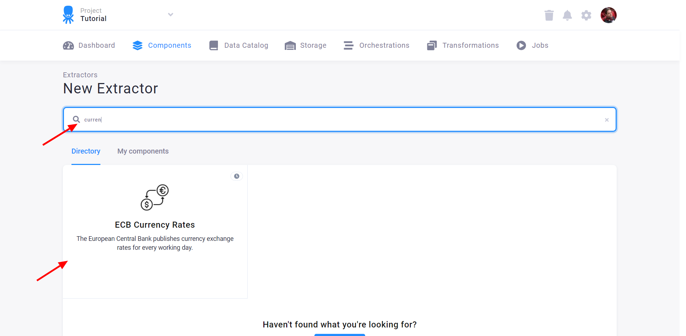

The following page describes what the component does in detail and allows you to create a new configuration using the **New Configuration** button.

In the dialog, enter a name for the configuration. The name is unimportant if a component has a single configuration in your project. However, the names should meaningfully distinguish one configuration from another for components with multiple configurations (e.g., configured with different credentials).

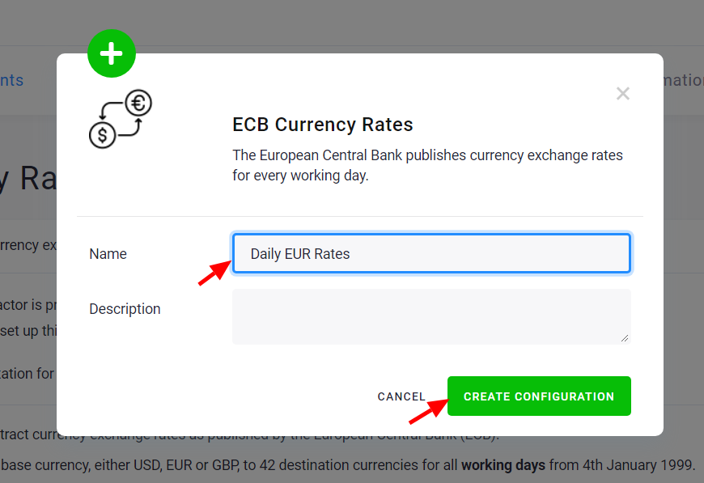

The next page shows a form for configuring the component, this varies heavily between different components.
Component configuration can range from trivial (as in the [Currency Rates data source connector](/components/extractors/other/currency-rates/)) to very complex ones 
(e.g., [Google Ads data source connector](/components/extractors/marketing-sales/google-ads/)). The configuration complexity badge shown in the component list gives you a rough idea of what to expect.

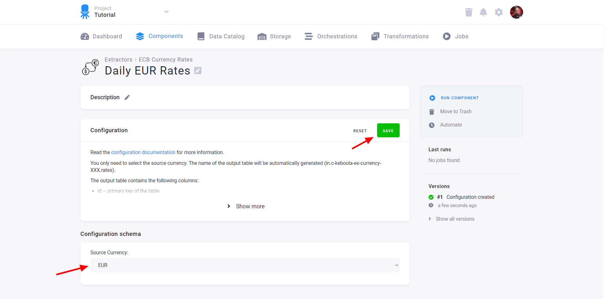

When you set the parameters and **Save** them, you can run the component using the **Run Component** button:

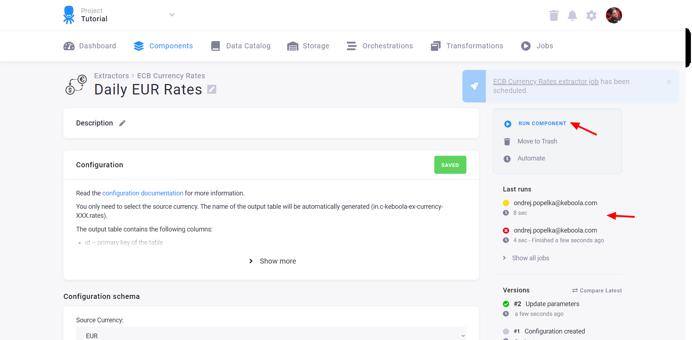

When you run a component, a [job](/management/jobs/) is created and subsequently executed. The right panel shows the last executed jobs with an indication of their status:

- Yellow – Running
- Red – Failed
- Green – Successful

You can click each job to view its [details](/management/jobs/), including the tables it reads from your project and 
the tables it produced in your project. Its active version (the one with the green tick mark) will be used when running the configuration.

### Configuration Description
After configuring the component, it is a good practice to describe what it does.

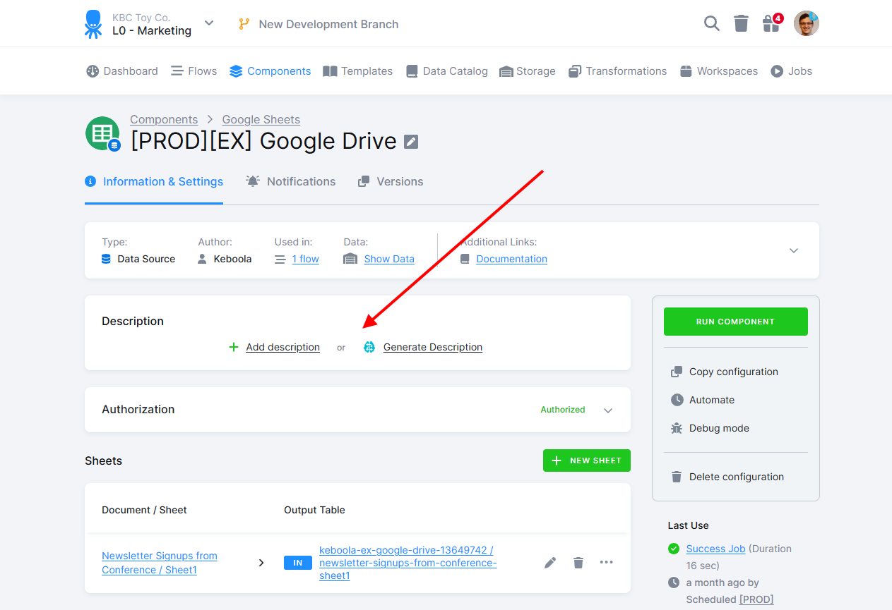

Click the **Add description** button to write the description manually. You can also click the **Generate description** button to have our AI service write a suggestion for you that you can modify. 
Note that the configuration will be sent to the Microsoft Azure OpenAI service when using the [AI service](/overview#ai-assistance). Even though the contents are not used to train the model, as a best practice, 
you should not store unencrypted secrets such as API keys and passwords in the configuration (for example, in Python transformation code). Variables and encrypted configuration parameters are automatically 
obfuscated.

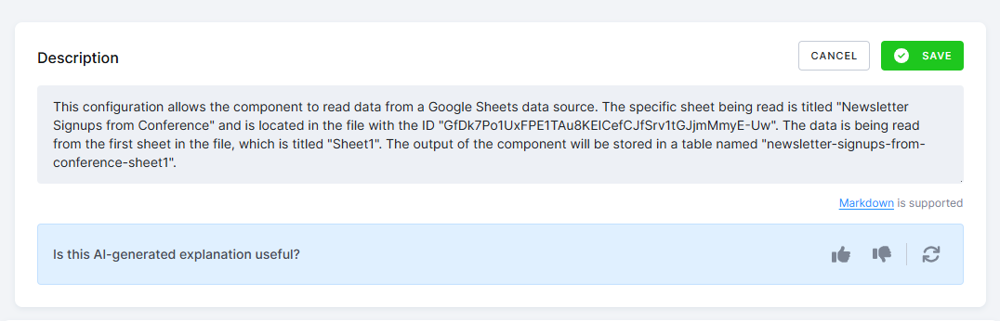

### Configuration Versions
Configuration parameters can be changed at any time. Every change to a configuration is recorded 
in the history of **versions**. You can also change the configuration's name and description at any time. 
The configuration description supports rich text formatting using [Markdown](https://www.markdownguide.org/cheat-sheet/).

The bottom right panel shows a list of the configuration versions. Use the list to

- copy any version.
- compare any two successive versions.
- roll back to an older version.

All of the operations can be [accessed via an API](https://api.keboola.com/?service=storage#post-/v2/storage/branch/-branchId-/components/-componentId-/configs).
The [developer guide](https://developers.keboola.com/integrate/storage/api/configurations/) explains how to work with configurations.

**Important**: Component configurations do not count towards your project quota.

The version list is unlimited. Configuration versions are also created when the configurations are manipulated 
programmatically using [the API](/overview/api/). In other words, all configuration modifications are recorded.

### Compare Versions
You can compare adjacent versions by clicking the *compare* icon:

The differences between the raw JSON configurations are displayed when you compare the two versions. 

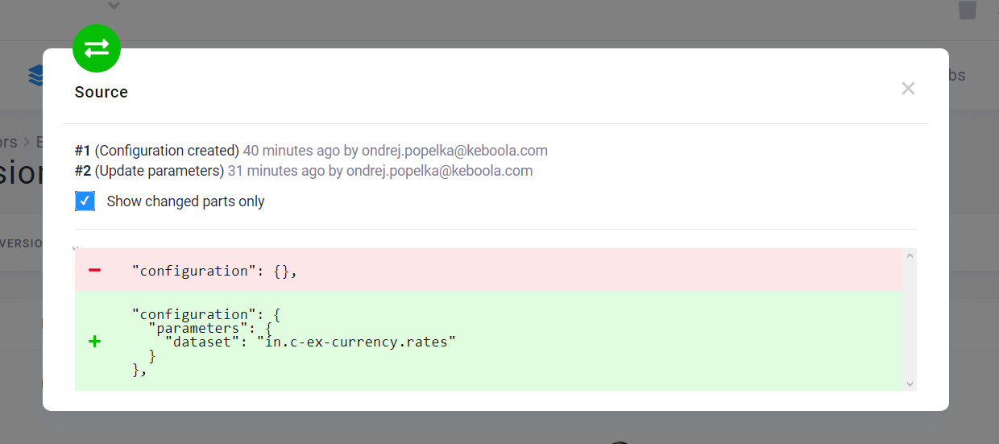

When you roll back a configuration, a new version is created. This means you never lose any version of
a configuration, and there is always an option to get back to it. Configuration versions are also created when 
the configurations are manipulated programmatically via [the API](/overview/api/).

### Rollback Version
If you need to return to an older version of the configuration, you can also roll back to it (the other option is to make its copy).
Rolling back a configuration version means that a new configuration version is created (and marked as active) 
with the contents of the selected version. A rollback is, therefore, quite a safe operation.

Click the **rollback* icon next to the version you want to return to:

Confirm the rollback and see the result:

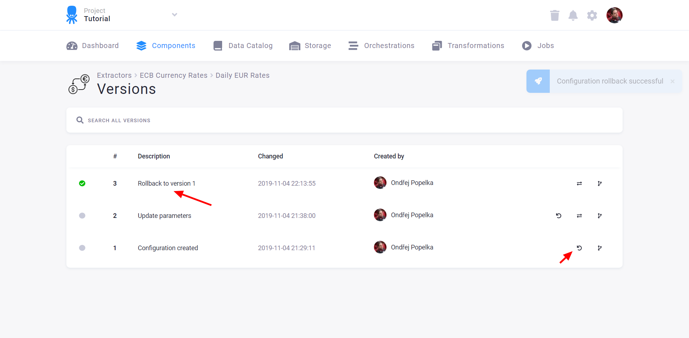

### Copy Configuration
You can also use the version list to create a **copy of the configuration**:

You can customize the name of the configuration copy:

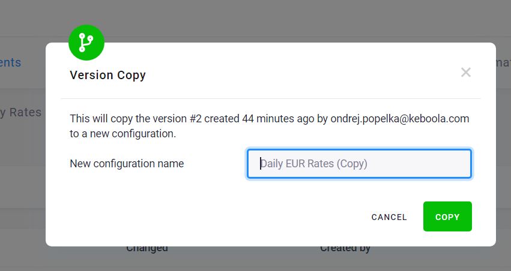

The copy of the configuration is created as a new isolated configuration—i.e., there is no link 
between the original configuration and the copy, and changes to one have no effect on the other.
The new configuration is completely independent of the old one. You may modify or delete 
either of them without affecting the other one.

### Delete Configuration
To delete and move a configuration to Trash, click the *bin* icon in the configuration list 
or the **Move to Trash** button in the configuration detail. 

Each configuration moved to Trash acts as deleted: it is removed from flows, cannot be run, and is not displayed.
You can undo the delete operation immediately, or you can restore the configuration from Trash, which is accessible from 
the main menu.

You can restore a deleted configuration or permanently remove it. Once deleted from Trash, no configuration can be recovered. 
If your Trash is filled with many configurations and you want to quickly find the one you need to restore or permanently remove, 
use the filter and search options in the upper part of the page.

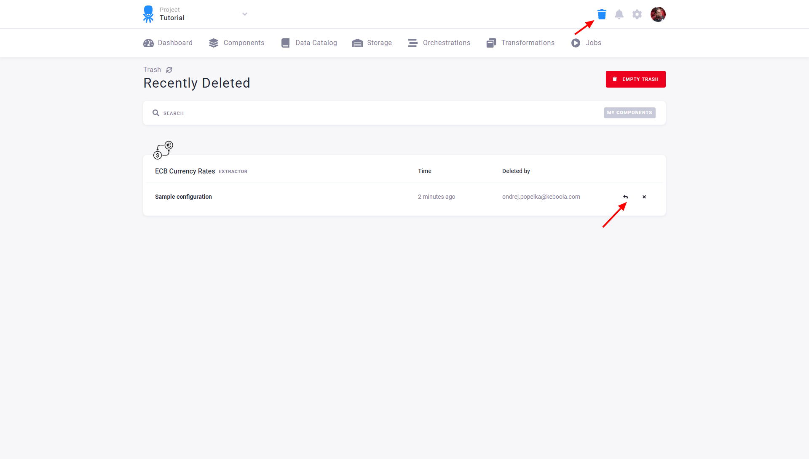

When you restore a configuration, its new version is created. Therefore, you can see the complete history in the configuration versions:

For technical reasons, configurations of the Orchestrator component cannot be restored when deleted. They will still be shown in Trash
but cannot be restored:

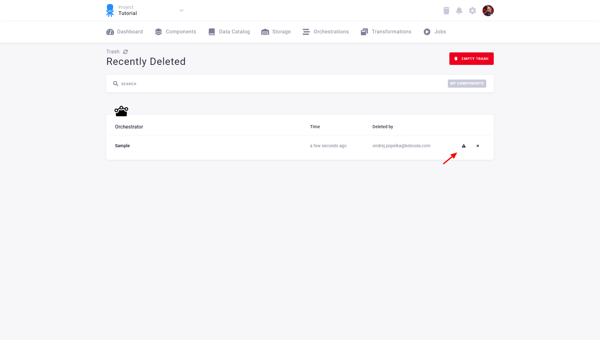

**Next:** [Authorize a component →](/components/authorization/)
