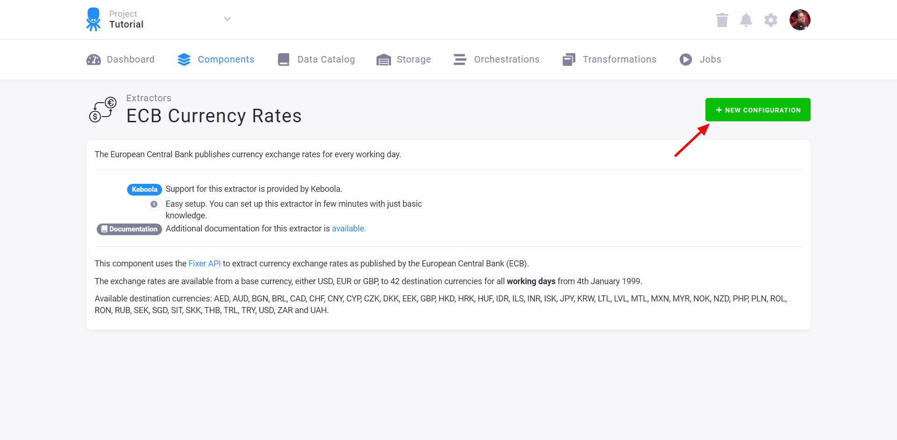
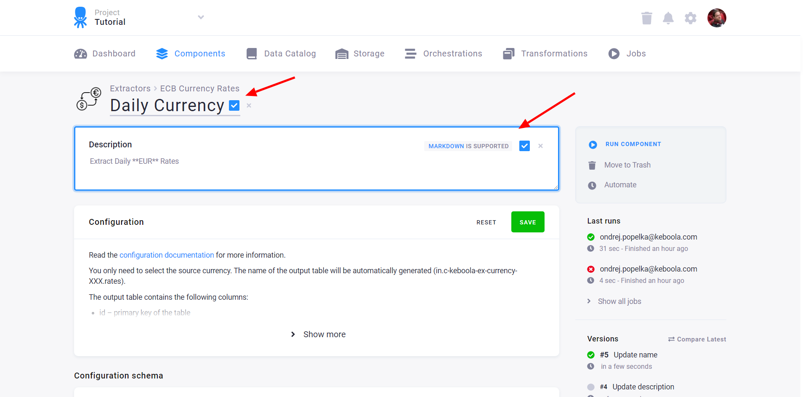
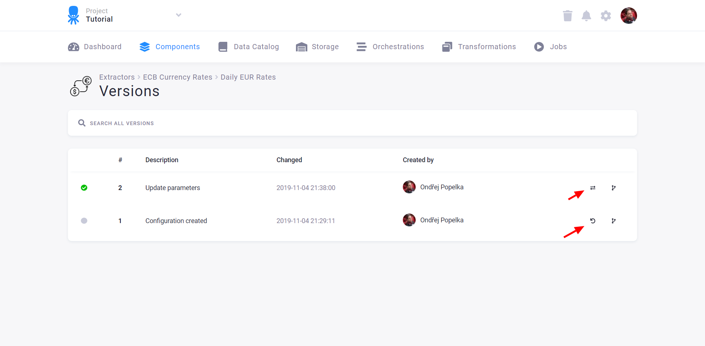
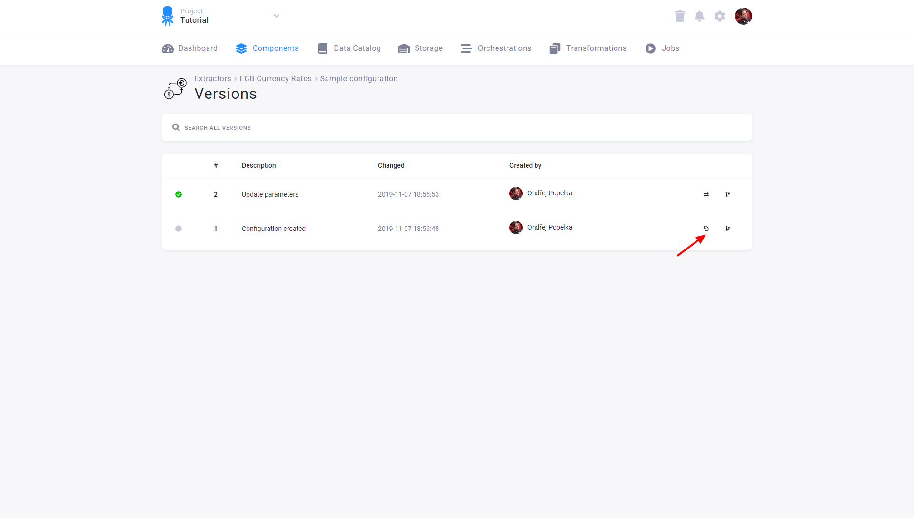
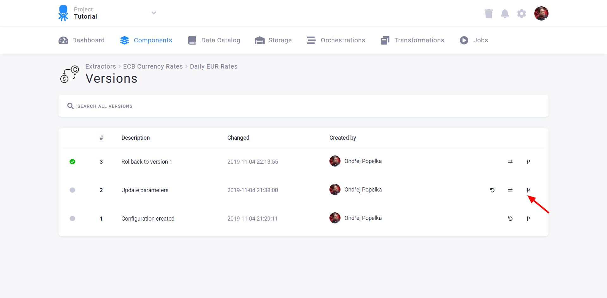
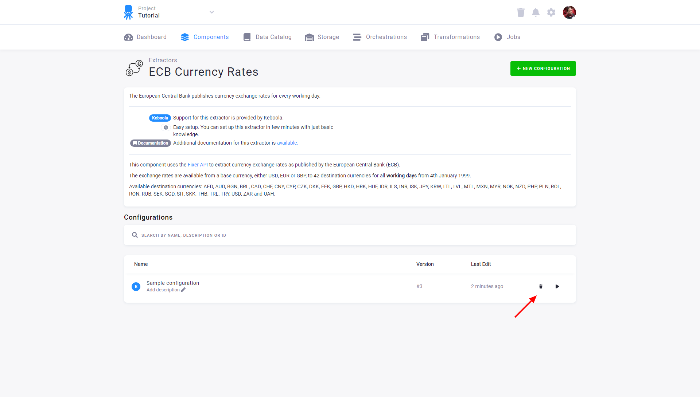
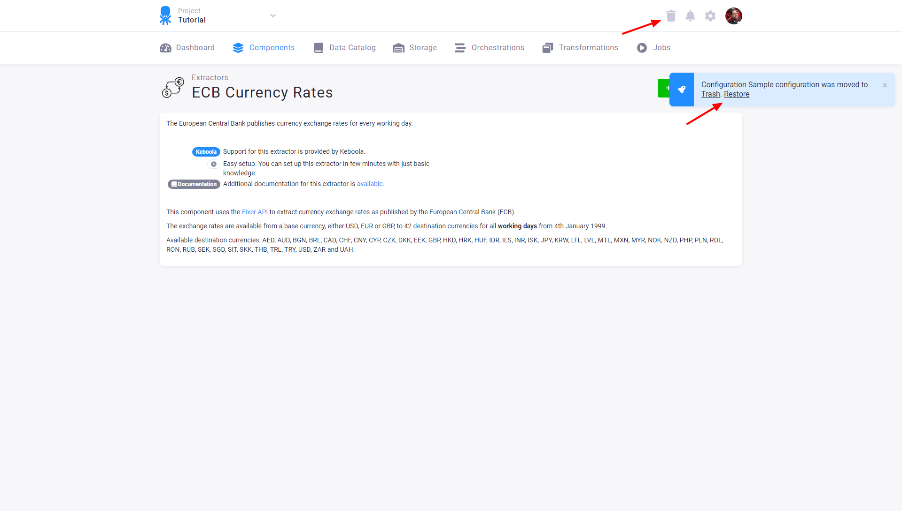
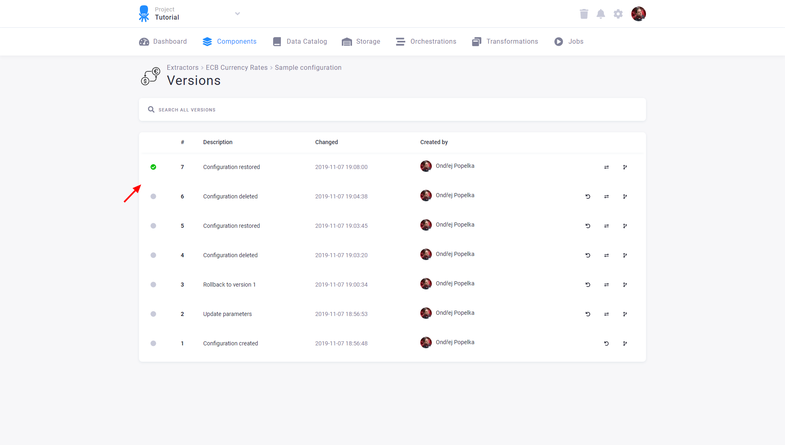

To use a [component](/components/), you create a configuration of it and run it. This page has the steps for that and for the tasks that follow. Signing in to an external service is on [Authorize a component](/components/authorization/); editing the raw JSON is on [Debug mode](/components/debug-mode/).

<!-- How-to-type page. Source: the Components page as it was before the 2026-11-19 split. Text and screenshots carried over; facts not re-checked against the product. -->

## Create a configuration

**Goal:** add a component to your project and set its parameters.

1. Select **Components** from the top navigation.

   

2. The following page lists the project's current configurations (e.g., data source connectors). To create a new configuration of a new component,
   click **Add Component**.

   

3. Use the search field to find the component you want to use (the Currency Rates data source connector in this case) and then click the component tile to add it:

   

4. The following page describes what the component does in detail and allows you to create a new configuration using the **New Configuration** button.

   

5. In the dialog, enter a name for the configuration. The name is unimportant if a component has a single configuration in your project. However, the names should meaningfully distinguish one configuration from another for components with multiple configurations (e.g., configured with different credentials). Then click **Create Configuration**.

   

6. The next page shows a form for configuring the component, this varies heavily between different components.
   Component configuration can range from trivial (as in the [Currency Rates data source connector](/components/extractors/other/currency-rates/)) to very complex ones
   (e.g., [Google Ads data source connector](/components/extractors/marketing-sales/google-ads/)). The configuration complexity badge shown in the component list gives you a rough idea of what to expect.

   

7. Set the parameters and **Save** them.

<!-- Checked 2026-11-20 in the UI of project 264: clicking the configuration name in the header opens the inline field Configuration name with Save and Cancel. TODO(human-review, Nikita): screenshots configuration-1.png and configuration-2.png show the older UI and need replacing. -->

**Result:** the configuration is saved, and you can run the component.

## Run a configuration

**Goal:** run the component with the parameters you saved.

1. Open the saved configuration and click the **Run Component** button:

   

   <!-- Checked 2026-11-20: the configuration page's run button is Run Component (getting-started/load/05-run.png); debug mode's label is tracked on the Debug mode page. -->

2. When you run a component, a [job](/management/jobs/) is created and subsequently executed. The right panel shows the last executed jobs with an indication of their status:

   - Yellow – Running
   - Red – Failed
   - Green – Successful

3. You can click each job to view its [details](/management/jobs/), including the tables it reads from your project and
   the tables it produced in your project.

**Result:** the job does the work the configuration describes. Its active version (the one with the green tick mark) will be used when running the configuration.

## Describe a configuration

**Goal:** give the configuration a name and a description that say what it does.

After configuring the component, it is a good practice to describe what it does.

1. Open the configuration. While it has no description, the **Description** box offers two links:

   

2. Click the **Add description** link to write the description manually. You can also click the **Generate description** link to have our AI service write a suggestion for you that you can modify.

   

3. You can also change the configuration's name and description at any time. To rename it, click the configuration name in the header, edit it in the **Configuration name** field and click **Save**.
   The configuration description supports rich text formatting using [Markdown](https://www.markdownguide.org/cheat-sheet/).

   

:::caution
Note that the configuration will be sent to the Microsoft Azure OpenAI service when using the [AI service](/overview/#ai-assistance). Even though the contents are not used to train the model, as a best practice,
you should not store unencrypted secrets such as API keys and passwords in the configuration (for example, in Python transformation code). Variables and encrypted configuration parameters are automatically
obfuscated.
:::

<!-- VERIFY(Nikita): which AI provider Generate description sends the configuration to. This page says Microsoft Azure OpenAI; other pages name a different provider for Kai. -->

**Result:** the name and the description show on the configuration.

## See the version history

**Goal:** find the list of versions of a configuration.

Configuration parameters can be changed at any time. Every change to a configuration is recorded
in the history of **versions**.

1. Open the configuration.
2. Open the **Versions** tab, which lists the configuration versions. Use the list to

   - copy any version.
   - compare any two successive versions.
   - roll back to an older version.

**Result:** you see every recorded change. The version list is unlimited. Configuration versions are also created when the configurations are manipulated
programmatically using [the API](/overview/api/). In other words, all configuration modifications are recorded.

All of the operations can be [accessed via an API](https://api.keboola.com/?service=storage#post-/v2/storage/branch/-branchId-/components/-componentId-/configs).
The [Component Configurations API](/storage/api/configurations/) page explains how to work with configurations.

**Important**: Component configurations do not count towards your project quota.

## Compare two versions

**Goal:** see what changed between two versions of a configuration.

1. You can compare adjacent versions by clicking the *compare* icon:

   

2. Read the differences in the dialog:

   

**Result:** the differences between the raw JSON configurations are displayed when you compare the two versions.

## Roll back to an earlier version

**Goal:** return a configuration to the state of an older version.

If you need to return to an older version of the configuration, you can also roll back to it (the other option is to make its copy).
Rolling back a configuration version means that a new configuration version is created (and marked as active)
with the contents of the selected version. A rollback is, therefore, quite a safe operation.

1. Click the *rollback* icon next to the version you want to return to:

   

2. Confirm the rollback and see the result:

   

**Result:** when you roll back a configuration, a new version is created. This means you never lose any version of
a configuration, and there is always an option to get back to it.

## Copy a configuration

**Goal:** create an independent copy of a configuration from one of its versions.

1. On the **Versions** tab, click the **Copy to new configuration** icon at the end of a version's row to create a **copy of the configuration** from that version. To copy the current version, you can also click **Copy configuration** in the right-hand panel of the configuration.

   

2. In the **Version Copy** dialog, set **New configuration name** and optionally a **Folder**, then click **Copy configuration**:

   

   <!-- Checked 2026-11-20 in the UI of project 264: the Versions row icon Copy to new configuration opens the dialog Version Copy with New configuration name and Folder (optional), confirmed by Copy configuration. The row also has Show raw configuration, Compare with previous and Restore this version. -->

**Result:** the copy of the configuration is created as a new isolated configuration—i.e., there is no link
between the original configuration and the copy, and changes to one have no effect on the other.
The new configuration is completely independent of the old one. You may modify or delete
either of them without affecting the other one.

## Delete and restore a configuration

**Goal:** move a configuration to Trash, and bring it back or remove it for good.

1. To delete and move a configuration to Trash, click the *bin* icon in the configuration list
   or the **Move to Trash** button in the configuration detail.

   

   Each configuration moved to Trash acts as deleted: it is removed from flows, cannot be run, and is not displayed.

2. You can undo the delete operation immediately, or you can restore the configuration from Trash: in the sidebar, click **Trash**. The **Recently Deleted** page opens, with the filters **All** and **Created by me**.

   

3. In a configuration's row, click **Restore Configuration** to restore it, or **Delete Forever** to remove it permanently (confirm with **Delete**). To act on several at once, select them and use **Restore** or **Delete Forever** in the bulk bar; **Empty Trash** (top right) removes everything. Once deleted from Trash, no configuration can be recovered.
   If your Trash is filled with many configurations and you want to quickly find the one you need to restore or permanently remove,
   use the filter and search options in the upper part of the page.

   

   <!-- Checked 2026-11-20 in the UI of project 264: the sidebar item Trash opens Recently Deleted (filters All and Created by me, button Empty Trash); rows have Restore Configuration and Delete Forever, the bulk bar has Restore and Delete Forever, and the Delete Forever dialog has Cancel and Delete. -->

**Result:** when you restore a configuration, its new version is created. Therefore, you can see the complete history in the configuration versions:

Deleted conditional flows can be restored from Trash like any other configuration. Legacy flows are listed in Trash in their own **Flow** section, but they cannot be restored: **Restore Configuration** is disabled there, because legacy flows can no longer be created in the project, and the section's bulk bar offers only **Delete Forever**. The screenshot below, from 2019, shows the older Trash:

<!-- Checked 2026-11-20: live in project 264, a keboola.flow configuration deleted with the API was listed in Trash and restored with the API. In the UI of project 264, the legacy Flow section of Trash has Restore Configuration disabled, with the tooltip "Legacy Flows can no longer be created in this project, so a deleted one cannot be restored.", and its bulk bar has only Delete Forever. TODO(human-review, Nikita): the screenshot is from 2019 and needs replacing. -->

---

**Next:** [Authorize a component →](/components/authorization/)
