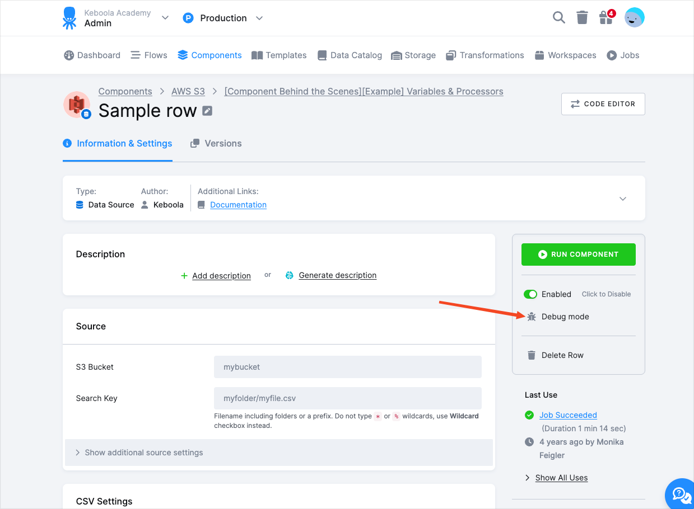

This page shows how to use debug mode on a [component](/components/) configuration.

## Debug Mode
Clicking the **Debug mode** link allows you to access the JSON configuration directly, along with some advanced options on how to run the component.

By editing the full JSON configuration, you can set up the component (all options are
described in the component repository) and the processors (to learn more about processors, 
see the [Developers Docs](https://developers.keboola.com/extend/docker-runner/processors/)).

Changing the JSON configuration may render the visual form unable to represent the configuration, and switching back may be disabled. Reverting such changes will re-enable the visual form. But the JSON will translate back
to the visual form whenever possible and vice versa.

### Run custom tag 
When in Debug Mode, the **Run Custom Tag** option allows you to execute a specific version of a component.

  
  &nbsp;&nbsp;
  

In most cases, you will not need to use this option directly. However, our team may occasionally ask you to run a component under a custom tag — either as part of troubleshooting an issue you have reported to our [support](https://help.keboola.com/management/support/) team, or as part of the release management process to test a new version before its official release.

You can confirm that the job ran under the custom tag in the job's Parameters & Results section.

**Next:** [Running jobs in parallel →](/components/running-jobs-in-parallel/)
