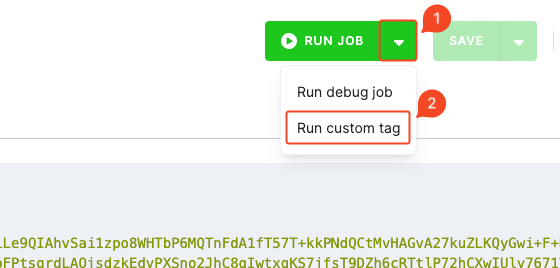
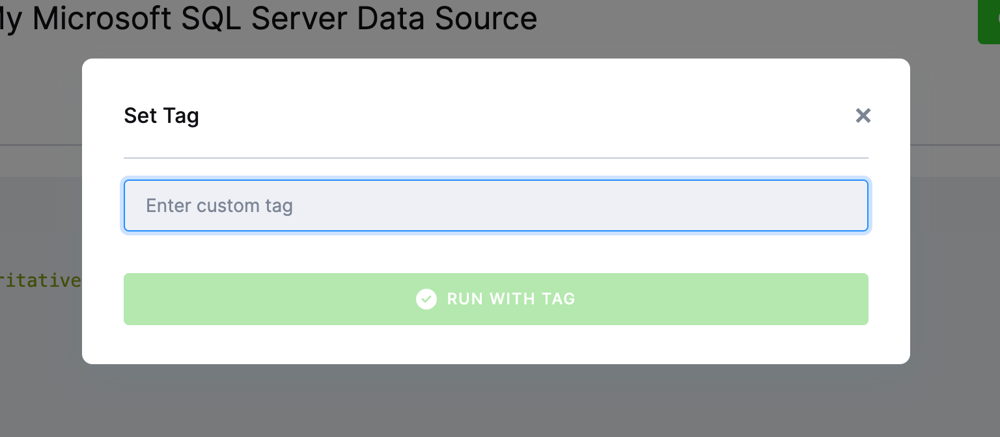
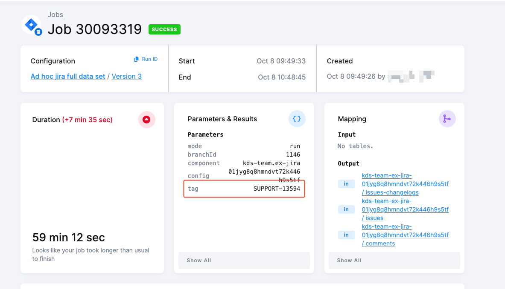

Debug mode shows the JSON behind a [component configuration](/components/configurations/) and adds some advanced options on how to run the component. This page shows how to edit the JSON there and how to run a specific version of a component.

<!-- How-to-type page. Source: the Components page as it was before the 2026-11-19 split. Text and screenshots carried over; the custom tag steps are read from the page's own screenshots. Facts not re-checked against the product. -->

## Edit the JSON configuration

**Goal:** set parameters or processors that the visual form does not offer.

1. Open the configuration and click **Debug mode** in its right-hand panel. Clicking the **Debug mode** link allows you to access the JSON configuration directly, along with some advanced options on how to run the component.

   

2. By editing the full JSON configuration, you can set up the component (all options are
   described in the component's documentation, linked as **Documentation** under **Additional Links** at the top of the configuration) and the processors (to learn more about processors,
   see [Processors](/extend/component/processors/)).
3. Save the configuration.

**Result:** the component runs with the JSON you saved. Changing the JSON configuration may render the visual form unable to represent the configuration, and switching back may be disabled. Reverting such changes will re-enable the visual form. But the JSON will translate back
to the visual form whenever possible and vice versa.

## Run a custom tag

**Goal:** run a specific version of a component once.

When in Debug Mode, the **Run Custom Tag** option allows you to execute a specific version of a component.

In most cases, you will not need to use this option directly. However, our team may occasionally ask you to run a component under a custom tag — either as part of troubleshooting an issue you have reported to our [support](https://help.keboola.com/management/support/) team, or as part of the release management process to test a new version before its official release.

1. In debug mode, open the menu next to **Run Job** and select **Run custom tag**.
2. In the **Set Tag** dialog, enter the tag and click **Run With Tag**.

<!-- Checked 2026-11-20 in the UI of project 264: Debug mode (right panel) opens a full-screen editor with the tabs Update Configuration and Update State; its run button is Run Job, with Run debug job and Run custom tag in the dropdown, next to a Save split button. Outside debug mode the button is Run Component (Run transformation for transformations). -->

  
  &nbsp;&nbsp;
  

**Result:** the job runs under the tag you entered. You can confirm that the job ran under the custom tag in the job's Parameters & Results section.

---

**Next:** [Running jobs in parallel →](/components/running-jobs-in-parallel/)
