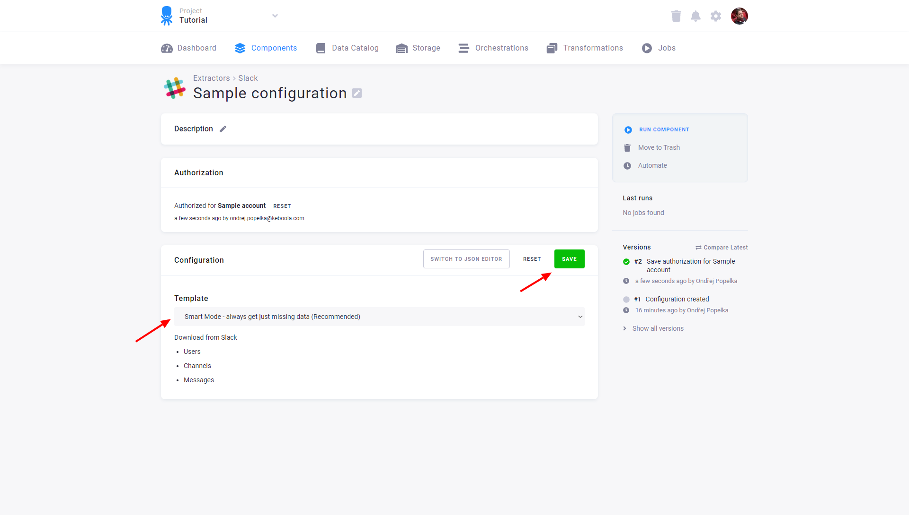

The connector calls the [Slack API](https://api.slack.com/methods).

<!-- How-to-type page. Source: keboola/connection-docs history; classified 2026-10-13. -->

## Before you start

- A Slack account in the workspace you want to read. You sign in with it when you authorize the
  configuration. The connector reads the workspace's users, its public channels and their messages.
  <!-- VERIFY(Nikita): the OAuth scopes Keboola's Slack app requests, and whether a workspace admin must approve the app first. -->
- The [Slack API documentation](https://api.slack.com/methods) at hand if you plan to change the template
  in the JSON editor.

## Create New Configuration
[Create a new configuration](/components/configurations/#create-a-configuration) of the **Slack** connector.
Then click **Authorize Account** to [authorize the configuration](/components/authorization/). 

Select the template you wish to use:

- Smart Mode -- using this mode you always get just missing data (recommended), loads data [incrementally](/storage/tables/incremental-loading/#incremental-loading).
- Full Mode -- using this mode you always get everything.

You can download:

- Users
- Channels
- Messages

After you select one of the two templates, remember to **save** the configuration.

You can also [switch to the JSON editor](/components/extractors/generic-extractor/#template-mode).

Click **Run Component**.

**Check:** the job ends with status **Success** and Storage has the tables `users`, `channels` and `messages`.
