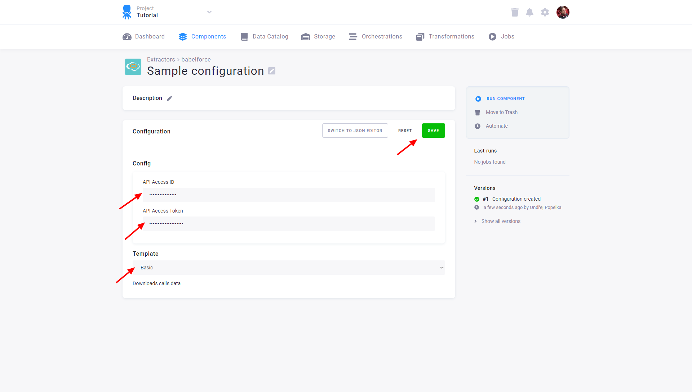

The connector calls the [Babelforce](https://www.babelforce.com/) [REST API](https://www.babelforce.com/rest-api-power/).

<!-- How-to-type page. Source: keboola/connection-docs history; classified 2026-10-13. -->

## Before you start

- A Babelforce account with API access, and its API **Access ID** and **API token**.
  <!-- VERIFY(nikita): where in Babelforce a user finds or creates the Access ID and token, and which user role may do it. -->

## Configuration
[Create a new configuration](/components/configurations/#create-a-configuration) of the **Babelforce** connector.

To configure this connector, you need to provide an API **Access ID**, and an **API token**.
Select the **configuration template** and save the configuration. 
There is only one Babelforce template available so far -- *Basic*. This option downloads all call data from your Babelforce profile.
You can also [switch to the JSON editor](/components/extractors/generic-extractor/#template-mode).

**Important:** Data are always imported incrementally.

Click **Run Component**.

**Check:** the job ends with status **Success** and Storage has the table `calls_export` with your call data.
