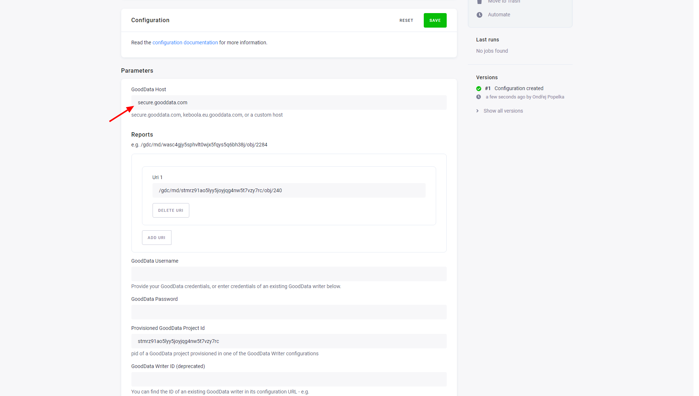
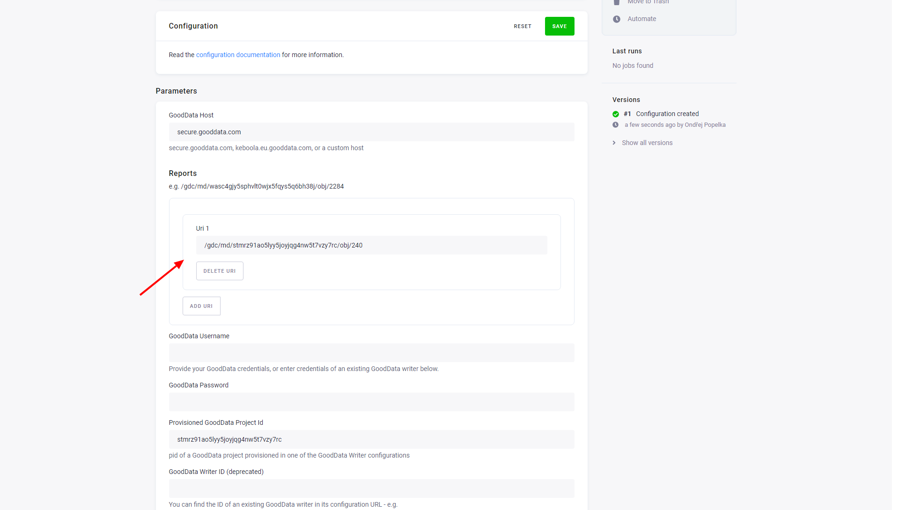
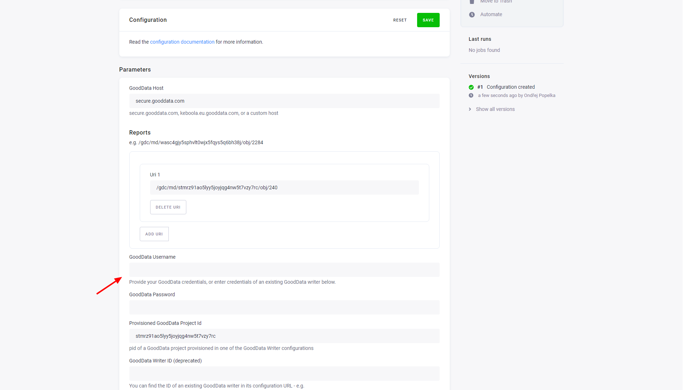
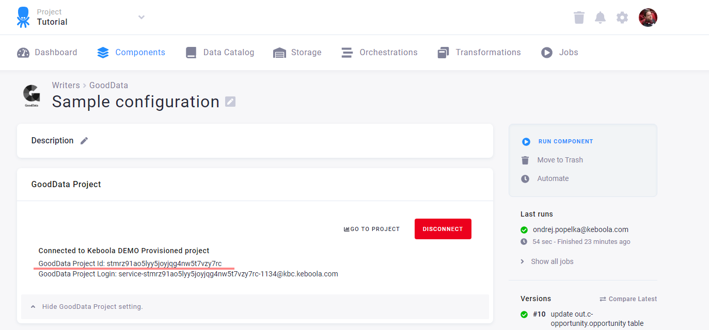
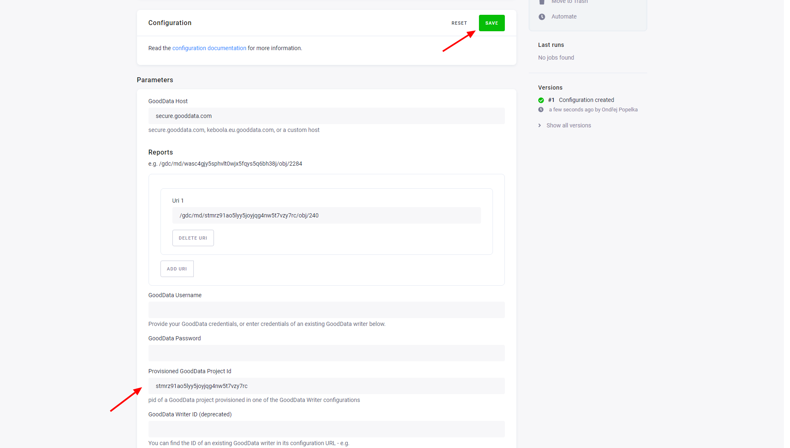

The GoodData Reports data source connector uses the [GoodData API](https://help.gooddata.com/display/API/API+Reference#/reference/dashboards-and-reporting/export-a-large-report/export-a-raw-report) to import
reports from the [GoodData](https://www.gooddata.com/) business intelligence platform and stores the data in Keboola Storage.

<!-- How-to-type page. Source: keboola/connection-docs history; classified 2026-10-13. -->

## Before you start

- A GoodData user name and password for a user who can open the reports you want to export.
- Your GoodData host, for example `secure.gooddata.com`, and the URI of each report. Both are in the
  report's URL; see [Reports](#reports).

## Configuration
[Create a new configuration](/components/configurations/#create-a-configuration) of the **GoodData Reports** connector.
Type in your GoodData host: secure.gooddata.com, keboola.eu.gooddata.com, or a custom host. Find the host
by opening the report you wish to extract.

### Reports
To select which reports to download, set one or multiple Uniform Resource Identifiers (URI).

When you open a report in your browser, the URL in the address field will look similar to this:

    https://secure.gooddata.com/#s=/gdc/projects/wasxxxxxxxxxxxxxxxxxxxxxxxxxmox|analysisPage|head|/gdc/md/zggxxxxxxxxxxxxxxxxxxxxxxxxxmox/obj/71

The part in form `/gdc/md/zggxxxxxxxxxxxxxxxxxxxxxxxxxmox/obj/71` is the report URI.

### Credentials
Continue by providing your own GoodData **credentials**.

<!-- VERIFY(nikita): this option no longer works; keboola/gooddata-extractor reads only host, username, #password and reports, and the configSchema marks pid and writer_id "deprecated, ignored". Delete the paragraph and its screenshots, and the "provisioned project" part of the description, once the owner agrees. -->
You can also choose an ID of the **GoodData Project** provisioned in one of the existing GoodData data destination connector configurations 
and use its credentials. The project ID (PID) of the provisioned project can be found in a GoodData data destination connector configuration.

Copy the project ID from the data destination connector to the data source connector:

When finished, remember to **Save** the configuration before you run the extraction. The data source connector will download the report contents as a
CSV file and store it as a table in Keboola Storage.

**Check:** the job ends with status **Success** and Storage has one table per report, named after the report's
object ID, the number at the end of its URI (`71` in the example above).
