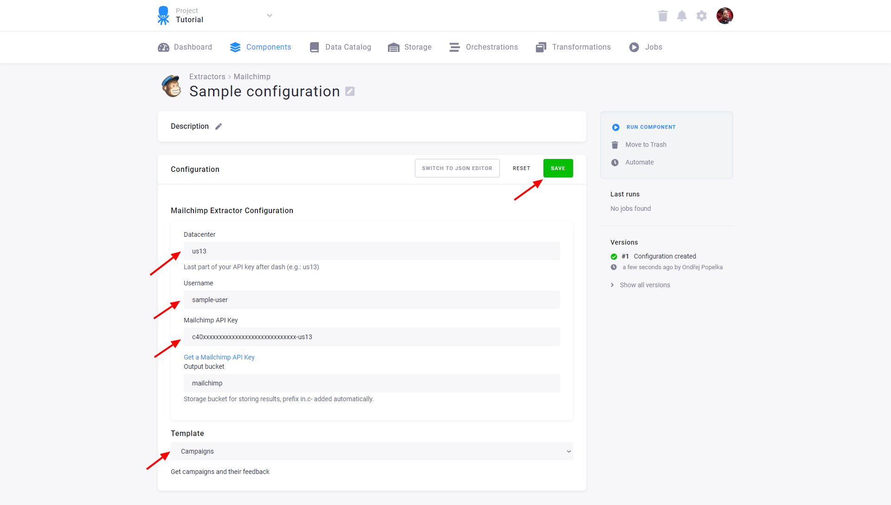

The Mailchimp data source connector uses the [Mailchimp API](https://mailchimp.com/developer/) to extract data from
mailing lists sent by the [Mailchimp](https://mailchimp.com/) service. It downloads configured reports for all specified accounts,
importing data such as list and members, campaigns, automations, reports, reports with click details, member activity, etc.

<!-- How-to-type page. Source: keboola/connection-docs history; classified 2026-10-13. -->

## Before you start

- A working [Mailchimp](https://login.mailchimp.com/signup/) account filled with
  [data](https://us13.admin.mailchimp.com/campaigns/).
- Your account username, its data center and an API key. The data center is the last part of the key,
  `us13` in the example below.

### Get API key
To gain access to the Mailchimp API, log in to [Mailchimp](https://mailchimp.com/), go to your Account detail, and under Extras find the option to [generate your API Key](https://mailchimp.com/help/about-api-keys/).
It will look like this: c40xxxxxxxxxxxxxxxxxxxxxxxxxxxxx-us13.

## Configuration
[Create a new configuration](/components/configurations/#create-a-configuration) of the **Mailchimp** connector.

Fill in the **data center** for your account, your account **username** and the **API key**:
Optionally name the **storage bucket** where your results will be stored.

To configure what data you want to extract, select the **configuration template** you want to use.

Available templates:

- Lists and members -- get lists and their members.
- Campaigns -- get campaign and their feedback.
- Automations -- get automations and the associated emails.
- Reports -- get reports and domain performance.
- Reports with click details -- get reports and domain performance with member click details.
- List member activity -- get lists, their members and activity of each individual member. This template may take some hours to complete.
- All campaigns (all status) -- get campaigns (draft, sent, scheduled, paused).

**Save** the configuration before you run the extraction, then click **Run Component**.

**Check:** the job ends with status **Success** and Storage has the tables of the template you picked, for example
`lists` and `members` for **Lists and members**.

You can also [switch to the JSON editor](/components/extractors/generic-extractor/#template-mode).

## API Limits
Each user account is permitted up to 10 simultaneous connections, and you’ll receive an error message if you reach the limit.
Mailchimp does not throttle based on volume.

*Note: currently there are no options to raise that limit on a per-customer basis.*

