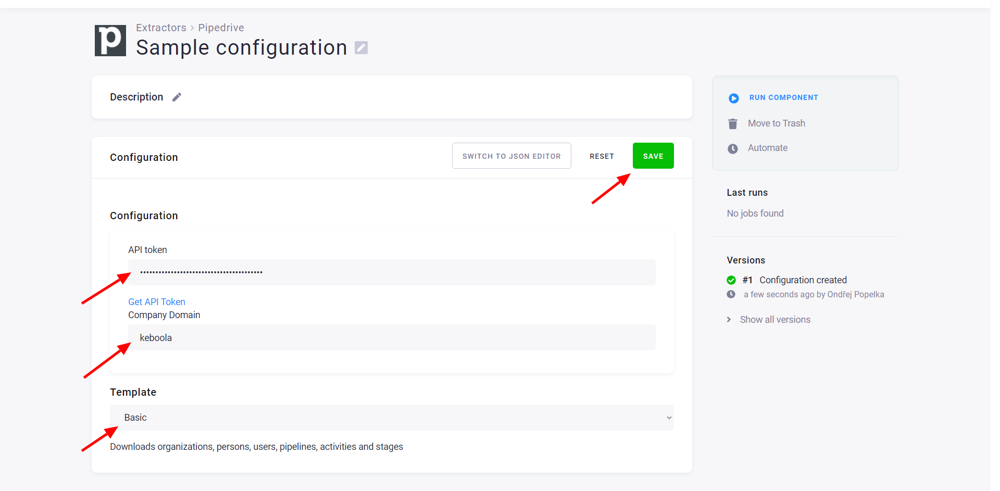

The connector calls the [Pipedrive API](https://developers.pipedrive.com/docs/api/v1).

<!-- How-to-type page. Source: keboola/connection-docs history; classified 2026-10-13. -->

## Before you start

- A Pipedrive API token. Pipedrive explains [where to find it](https://pipedrive.readme.io/docs/how-to-find-the-api-token).
  The connector sees what the token's user can see.
- Your company domain, the first part of your Pipedrive URL: `keboola` for `https://keboola.pipedrive.com`.

## Configuration
[Create a new configuration](/components/configurations/#create-a-configuration) of the **Pipedrive** connector.

To configure this connector, you need to provide an **API token**. You can get it by clicking the *Get API Token* link. 
Then enter your **company domain** (if your Pipedrive is at https://keboola.pipedrive.com, your company domain is **keboola**).

To configure what data you want to extract, select one of the configuration templates. 
There are two templates available:

- **Basic** -- downloads organizations, persons, users, pipelines, activities, stages, etc.
- **Extended** -- downloads also deals and additional fields to the above.

When done, **save** the configuration. You can also [switch to the JSON editor](/components/extractors/generic-extractor/#template-mode).

**Important:** Data is always imported incrementally.

Click **Run Component**.

**Check:** the job ends with status **Success** and Storage has tables such as `organizations`, `persons`, `users`,
`pipelines`, `activities` and `stages`.
