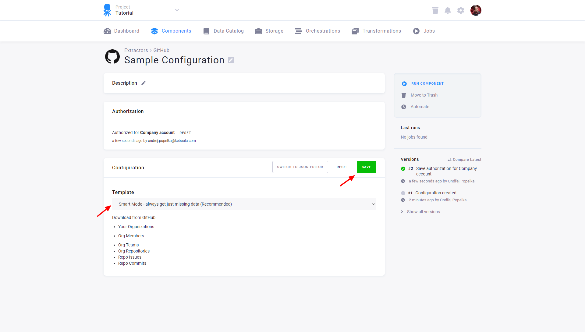

The connector calls the [GitHub API](https://developer.github.com/v3/).

<!-- How-to-type page. Source: keboola/connection-docs history; classified 2026-10-13. -->

## Configuration
[Create a new configuration](/components/configurations/#create-a-configuration) of the **GitHub** connector.
Then click **Authorize Account** to [authorize the configuration](/components/authorization/), and
select the template you wish to use. There are two configuration templates available:

- `Smart Mode` -- always gets missing data only, loads data [incrementally](/storage/tables/incremental-loading/#incremental-loading).
- `Full Mode` -- always gets everything.

You can download:

- Your Organizations
- Organization Members
- Organization Teams
- Organization Repositories
- Repository Issues
- Repository Commits

After you select the template, remember to **save** the configuration.
You can also [switch to the JSON editor](/components/extractors/generic-extractor/#template-mode).
