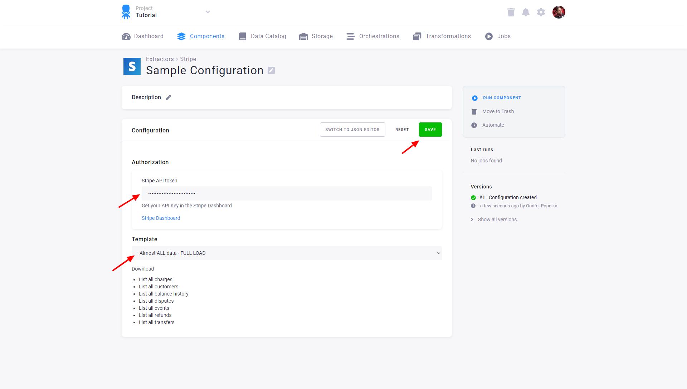

The connector calls the [Stripe API](https://stripe.com/docs/api).

<!-- How-to-type page. Source: keboola/connection-docs history; classified 2026-10-13. -->

## Before you start

- A Stripe [API key](https://stripe.com/docs/api#authentication) from the
  [Stripe dashboard](https://dashboard.stripe.com/login?redirect=%2Faccount%2Fapikeys).
  <!-- VERIFY(Nikita): whether a restricted key with read-only access to the objects in the templates works, so readers don't have to hand over the full secret key. -->

## Configuration
[Create a new configuration](/components/configurations/#create-a-configuration) of the **Stripe** connector.
Enter your API key.

To configure what data you want to extract, you can select one of the configuration templates:

- Only Charges -- FULL LOAD
- Almost ALL Data -- FULL LOAD

When done, **Save** the configuration. 

You can also [switch to the JSON editor](/components/extractors/generic-extractor/#template-mode).

Click **Run Component**.

**Check:** the job ends with status **Success** and Storage has a `charges` table. **Almost ALL Data** also adds
tables for customers, balance history, disputes, events, refunds and transfers.
