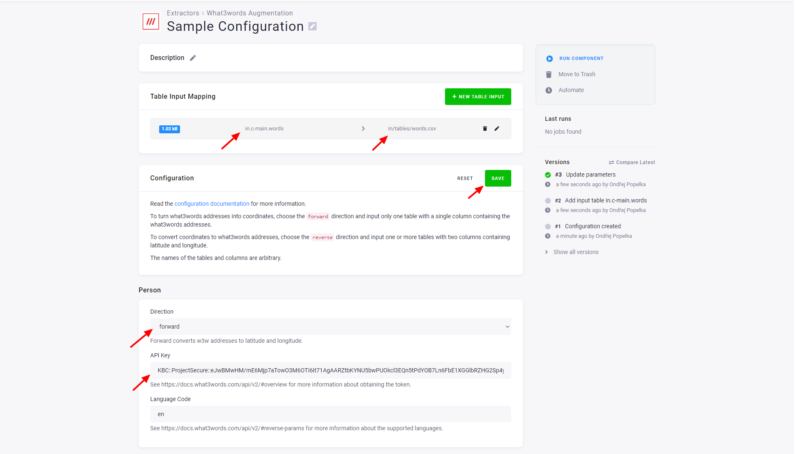
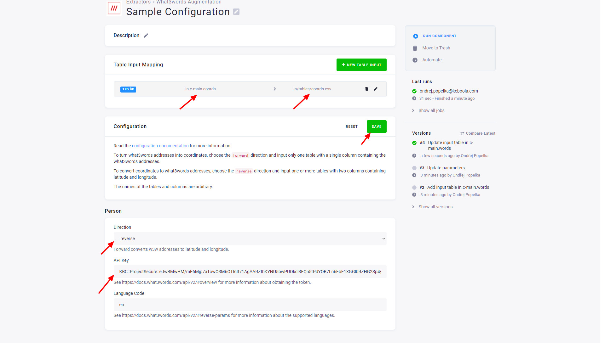

This data source connector allows you to translate [what3words](https://what3words.com/) addresses to coordinates and vice versa.
Each translated address requires one API call.

<!-- How-to-type page. Source: keboola/connection-docs history; classified 2026-10-13. -->

## Before you start

- A what3words API key. [Obtain one](https://developer.what3words.com/public-api/docsv2#overview) from
  what3words. Each translated address uses one API call, so check your plan's limit.
- A table in Storage with the input: one column with what3words addresses, or two columns with latitude and
  longitude. The sample files below work for a first test.

## Configuration
[Create a new configuration](/components/configurations/#create-a-configuration) of the **What3words Augmentation** connector.

## Augment What3words Address
In this mode of operation, you identify [what3words](https://what3words.com/about) addresses, and the connector
then fetches the geographical latitude and longitude coordinates for the places. 
Specify a single table which has exactly one column with what3words addresses.
If the source table does not meet this requirement, 
edit the [input mapping](/transformations/mappings/input/) details accordingly. 

You can test the extraction on this [sample file](/components/extractors/other/what3words/words.csv). 
Upload it to the `in.c-w3w` bucket in Storage first, and call it *words*.
After that, specify the table in the [input mapping](/transformations/mappings/input/) as the source table, 
and select the **forward** method in the configuration.
(The names of the columns and the CSV file in the input mapping are not important, use any names you like.)

## Augment Coordinates
In this case, you specify geographical latitude and longitude coordinates, and the data source connector fetches their what3words addresses.
Select one or more tables which have exactly two columns: the first column with a latitude, the second one with a longitude. 
If the source table does not meet these requirements, edit the [input mapping](/transformations/mappings/input/) 
details accordingly. 

You can test the extraction on this [sample file](/components/extractors/other/what3words/coords.csv). 
Upload it to the `in.c-w3w` bucket in Storage first, and call it *coords*.
Specify the table in the [input mapping](/transformations/mappings/input/) as the source, 
and select the **reverse** method in the configuration.
(The names of the columns and the CSV file in the input mapping are not important, use any name you like.)

Save the configuration and click **Run Component**.

**Check:** the job ends with status **Success** and Storage has a `result` table in the connector's output bucket:
coordinates for the **forward** method, what3words addresses for the **reverse** method.
