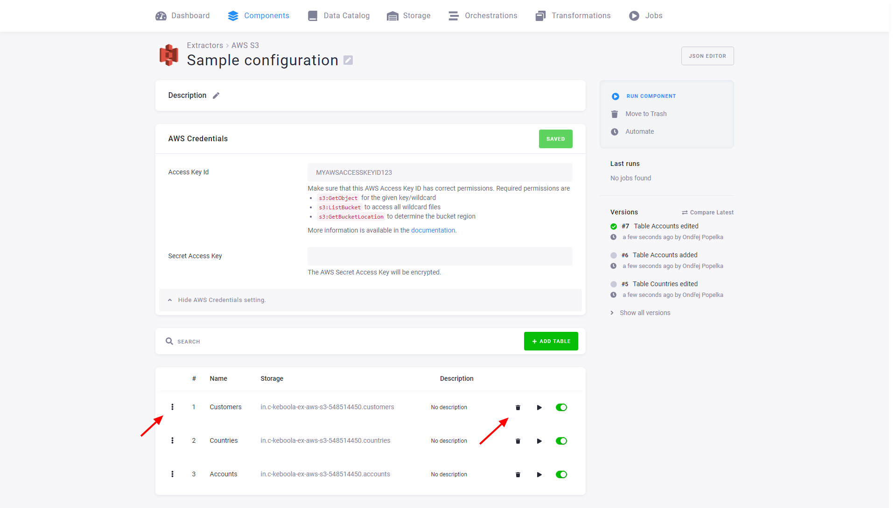
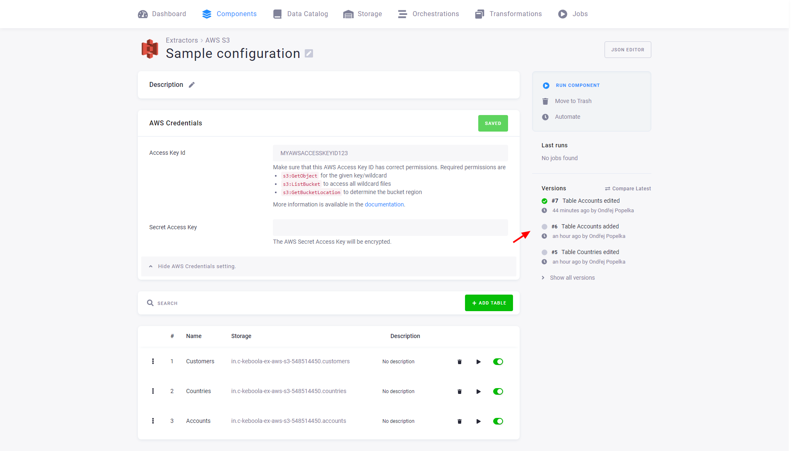
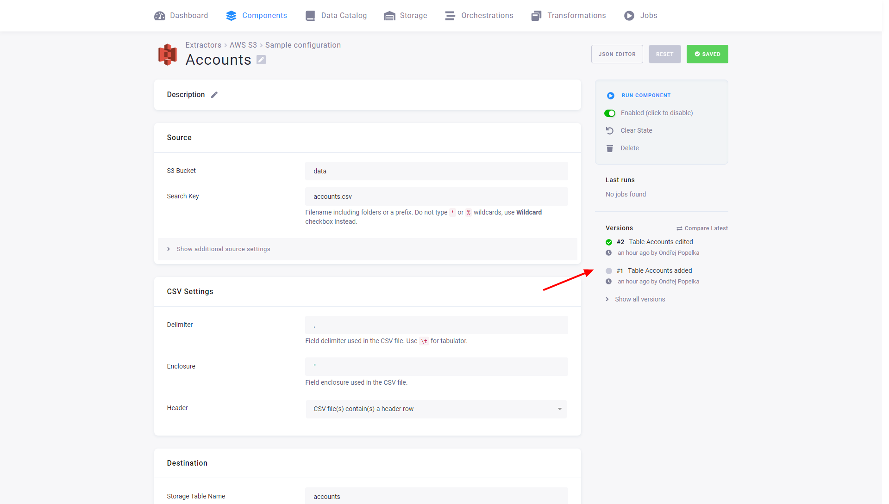

In the Keboola platform, most of the data processing functions are implemented in **Components**. 
Components are divided into the following categories:

- [**Data source connectors** (formerly known as extractors)](/components/extractors/) – bring data into a Keboola project.
- [**Data destination connectors** (formerly known as writers)](/components/writers/) – send processed data into a target system.
- [**Applications**](/components/applications/) – process complex data.

All components, regardless of their category, behave the same way. To use a component, you have to create a **configuration** first. A configuration sets the necessary parameters for each 
component (e.g., credentials and other specifications of what to do). Then, it can be run — a **job** is created and does the actual work.

## Finding a Component

To see the components available to you and add one to your project, follow [Creating Component Configuration](#creating-component-configuration). To browse the catalog outside your project, see the [Keboola Developer Portal](https://components.keboola.com/components). You do not need the portal to use components.

If no component connects to the system you need, you have several options:

- Write your own Python code in the [Custom Python](/components/applications/custom-python/) component to call external APIs or push data to third-party systems.
- Connect to a REST API without code using the [Generic Extractor](/components/extractors/generic-extractor/).
- Ask [Kai](/kai/), the AI assistant in your project, to help you set up the integration or use your own AI assistant through the [Keboola MCP Server](/ai/mcp-server/).
- Build your own component and register it in the [Developer Portal](https://components.keboola.com/); see the [developer guide](/extend/component/).

To adjust a component's input or output files without changing its code, use [processors](/extend/component/processors/).

## Component Release Stages
Our components are released at different stages and labeled to indicate the quality and production readiness level. We strive to deliver the highest-quality components. 
Our goal is to unlock as many interesting integrations as possible, benefiting all our customers. The component release grades allow us to manage the release process effectively 
and align expectations accurately.

|   | Experimental | Beta | Production (GA) |
|---|---|---|---|
| **Availability** | Available either in the UI or per request | Listed in the official component list and available to all customers | Listed in the  official component list and available to all customers |
| **Support & SLA** | No or limited SLA | Officially supported by Keboola's Standard SLA – in active development | Officially supported by Keboola's Standard SLA |
| **Production-ready** | Functional, but only for limited use cases  Experimental component, not advisable for business-critical processes  May not ever move to Beta/GA | Yes – with limitations  Will eventually move to GA (e.g., still in the process of fine-tuning, tested on fewer production use cases, may contain less robust documentation) | Yes  Stable version, tested on many production use cases  Fully documented |
| **Updates & Maintenance** | Breaking changes may be introduced (It is still possible to fix certain versions to avoid BC issues)  Maintenance may end at any time → may be deprecated | Monitored via standard processes  Always backward-compatible changes  In active development | Monitored via standard processes  Always backward-compatible changes, announced via standard channels |

### Production (GA)
This version is stable and has been well-tested by numerous customers in many production scenarios. GA (General Availability) versions feature comprehensive documentation 
and components with a low error rate, making them suitable for mission-critical production use cases. 

All potential updates to the component are guaranteed to be backward compatible.

### Beta
Components are available to all customers. These components are usually early additions and may still be in rapid development.

All changes are backward compatible. 

**Limitations:**

- Because in the early stages, these components are used in fewer projects. Minor bugs, though promptly fixed within the standard SLA, may appear more frequently.
- The range of features might not be exhaustive and will likely expand through backward-compatible updates.
- Documentation may be less comprehensive than in the GA version, often given as README.md files.
- These components may pose limitations, like pending Google verification, verification status-related rate limits, etc.

### Experimental
Developed for specific use cases but not tested in various scenarios, these highly experimental components are functional. When used in untested scenarios, 
they may contain undiscovered bugs and impose other limitations, such as rate limiting, reliance on less stable proprietary libraries, dependency on the source website structure (scraping),
and others. 

Experimental components may not progress to the Beta and GA stages.

Nevertheless, these components can address obscure use cases and deliver unique integrations. Their code is public so they can serve as a foundation for custom forks, 
including Generic Extractor configurations.

Many of these components also serve our internal purposes, and we decided to share them publicly to benefit our community.

### Private / Unlisted
Some components are still unlisted for various reasons. Each stack's full list of components is accessible via the public [Storage API index call](https://api.keboola.com/?service=storage#get-/v2/storage). 
Many of these are 3rd-party components. Users can add these components via their ID, but we cannot guarantee their functionality. 

We may share our pre-release versions that exist in private Beta with our test user groups. In such a case, you will receive a component ID, which you can use to create the configuration. 
These components will eventually transition to a public Beta.

### Configuration Rows
Some components support the concept of multiple configurations sharing some of their parameters. A typical
example is database data source connectors, where multiple tables are extracted and share the same credentials.
In such components, the configuration contains only the credentials and tables stored in **configuration rows**.
The *configuration* acts as an envelope for the *configuration rows*.

The following example shows a configuration of the [AWS S3 data source connector](/components/extractors/storage/aws-s3/)
with three configuration rows:

Each row can individually be modified or deleted. You can also disable a row, which means that if the entire 
configuration is run, the row will be skipped. You can also run a single row explicitly. Jobs that run only
a single row have the label **partial**. Therefore, you can, for example, create a configuration 
that, on a scheduled run, extracts all the enabled tables and also contains tables that
share the same credentials but are updated manually (or in a different flow).

You can add as many rows as you like; the list of configuration rows is fully searchable. You can also change the order of the
rows. The order is maintained during processing, so you can use this to extract the large tables first, for example. The
order of rows does not affect your project because a Job is only finished after each row is processed.

### Configuration Rows Versions
Changes to configuration rows are part of the [configuration versioning](#configuration-versions). The following image shows that
the versions in the configuration page list changes to the configuration rows – both that a table was added and that it was modified.

That means that each configuration version contains a complete set of its rows. This is important when copying or rolling back a 
version – you can do these operations safely without worrying about rows.

When you edit a configuration row, a list of **row versions** appears. Row versions show changes only to the single
row. You can roll back a row to a previous version without interacting with the other rows.

***Note:** You cannot copy a configuration row to a new configuration. You always have to copy the entire
configuration.*

For a full explanation of how parallelism interacts with system limits, billing, and when it actually helps, see [Running Jobs in Parallel](/components/running-jobs-in-parallel/).
