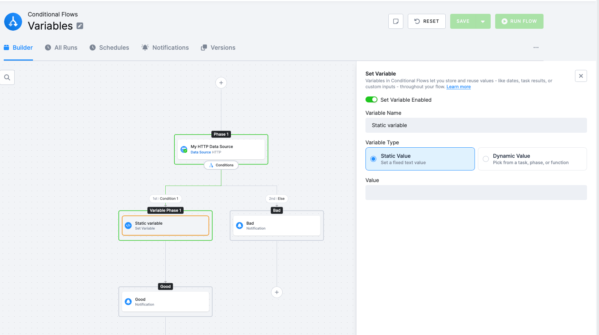
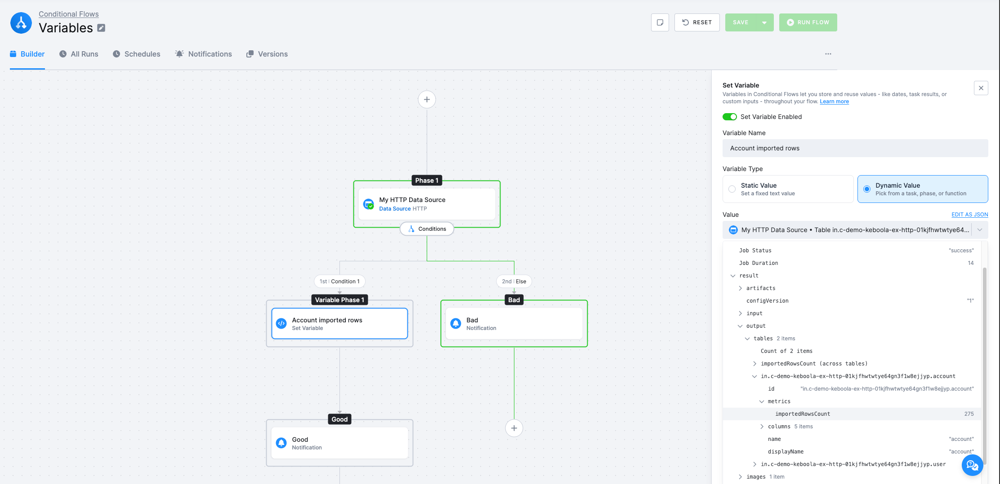
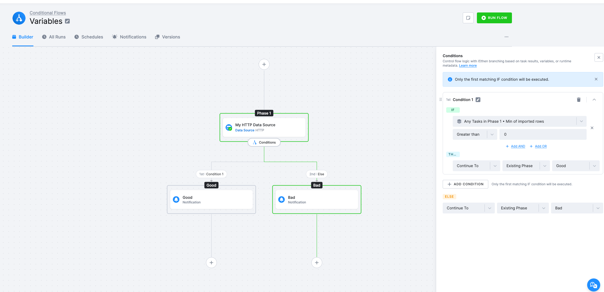

This page has the steps for both kinds of [variables](/components/variables/) in the UI: a placeholder in a configuration, and a variable in a flow. What the two kinds are and how a flow fills a configuration variable is explained on [Variables](/components/variables/). The API calls are on [Variables Through the API](/components/variables/api/).

<!-- How-to-type page. Source: the Variables page as it was before the 2026-11-19 split. Text and screenshots carried over; facts not re-checked against the product. -->

The flow sections below walk through how to set up and use variables from the UI. The JSON shape generated behind the scenes, for template authors and API users, is in [Flow variable tasks](/components/variables/api/#flow-variable-tasks).

## Parametrize a configuration with a variable

**Goal:** replace a fixed value in a configuration with a variable that has a default and can be overridden for one run.

1. Consider the following transformation:

   ```sql
   CREATE OR REPLACE TABLE "result" AS
   	SELECT "first", "second" * 42 AS "larger_second" FROM "source";
   ```

2. To parametrize the multiplier value (42), you can change it to a variable `{{ multiplier }}`:

   ```sql
   CREATE OR REPLACE TABLE "result" AS
   	SELECT "first", "second" * {{ multiplier }} AS "larger_second" FROM "source";
   ```

3. In the configuration's **Variables** section, click **New variable**. In the new row, fill in **Variable name** (`multiplier`) and **Default value**, then click **Save**:

   

4. Click **Run transformation**. In the dialog, expand the **Variables** block to override the default value for this run, then click **Run**:

   

   <!-- Checked 2026-11-20 in the UI of project 264: the Variables section has Import and New variable; a new variable is an inline row with Variable name, Default value, Discard and Save, not a modal. Run transformation opens a dialog with a collapsible Variables block, one field per variable, and Run. Compared on 2026-11-20 with the current UI: both screenshots show the old UI (top navigation with Orchestrations, upper-case RUN COMPONENT and NEW VARIABLE, a tick-and-cross input instead of Discard and Save, no Import; the run screenshot shows Run Component and RUN). -->
   <!-- TODO(human-review, Nikita): replace variables-setting.png and variables-run.png with shots of the inline New variable row and the Run transformation dialog. -->

**Result:** the transformation runs with the default value, or with the override you entered for that run.

When a variable is referenced in the code but not defined, or its value is missing,
you'll get an error:

    Missing values for placeholders: "multiplier"

or

    No value provided for variable "multiplier".

## Set a variable in a flow

**Goal:** store a value in a flow so that later tasks and conditions can read it.

1. In a phase, click the **+** icon and choose **Variable** in the **ADD TASK** menu. The variable panel opens on the right.
2. Enter a **Variable Name** — this is the identifier other tasks will use to reference the value.
3. Choose a **Variable Type** — either [Static Value](#static-value) or [Dynamic Value](#dynamic-value).

**Result:** the phase has a **Set Variable** task, and tasks in later phases can reference the variable by its name.

### Static value

A **Static Value** is a fixed text or number you enter directly. Useful for thresholds, IDs, or labels that don't change between runs.



### Dynamic value

A **Dynamic Value** is computed at run time from a task result, an earlier phase, or a built-in function (see [Date & time function](/components/variables/api/#date--time-function)). When you pick this type, the value picker lets you browse the outputs of tasks that ran earlier in the flow. You can pick any field from the job's result tree — for example `result.output.tables`, `result.artifacts`, `result.images`, `result.configVersion`, `result.errorMessage`, and many more.



If a task produces **multiple output tables**, the picker also offers aggregations across all of them: **Sum**, **Minimum**, **Maximum**, and **Average** of a numeric field. For example, `Sum of importedRowsCount` returns the total number of rows imported by an HTTP data source across every output table.


## Use a variable in a condition

**Goal:** send a flow down one path or another, depending on a variable or a task result.

Once a variable has been set in an earlier phase, any later **Condition** can compare its value against a constant, against another variable, or against a task result.

1. In the flow builder, click **+** under a phase and select **Conditions** in the **ADD TASK** menu. (**Conditions** appears only once the flow has its first phase.)
2. In the **Conditions** sidebar, click **Add Condition**. **Condition 1** opens with an **If** row.
3. In the **If** row, click **Select condition subject** and choose a variable, a task result, or a phase result from an earlier phase (tabs **Phases / Tasks**, **Variables** and **Functions**).
4. Choose an operator (**Is**, Greater than, Contains, …).
5. In the field to the right of the operator, provide the comparison value: a constant, or another value picked from the tree (for a job status, **Select status**). Use **Add AND** or **Add OR** to combine more comparisons.
6. Set **Then** and **Else**: **Continue To** an existing phase or a **New phase name**, or **End Flow**.
7. Click **Save** in the header to save the flow.

<!-- Checked 2026-11-20 in the UI of project 264: + under a phase opens the ADD TASK menu with Component, Conditions, Notification and Variable; Conditions shows only after the first phase exists. The Conditions sidebar has Add Condition, which adds Condition 1 with an If row (Select condition subject, operator, value field), Add AND and Add OR, Then (Continue To a phase or New phase name) and Else (End Flow). The flow is saved with Save in the header, next to Cancel changes. -->



**Result:** when the flow runs, it continues to the phase you set for THEN or ELSE, or ends. Only the first matching IF condition is executed; subsequent IFs in the same Conditions block are skipped.

See also the [Conditions](/flows/#conditions) section for the full list of operators and condition types.

## Override a variable on one flow task

**Goal:** set the value of a configuration variable for one specific task of a flow.

To set a value on one specific task instead, use its **Task Parameters**:

1. Select the task in the
   flow's Builder to open its settings, and click **Set advanced parameters**. The editor opens pre-filled with the task's `type`, `mode`, `componentId` and
   `configId`.

   

2. Add `variableValuesData`
   to the task payload. The `variableValuesData` shape is the
   same one [running a job](/components/variables/api/tutorial/#step-4-run-a-job) takes, but the surrounding fields are
   the task's own (`componentId` / `configId`), not the job API's `component` / `config`:

   ```json
   {
     "componentId": "keboola.snowflake-transformation",
     "configId": "0123abc",
     "mode": "run",
     "variableValuesData": {
       "values": [
         {
           "name": "multiplier",
           "value": "1000"
         }
       ]
     }
   }
   ```

3. Click **Set**.

**Result:** the task runs with the value you set. This path does not
depend on the variable also being declared as a flow variable. The other way, a flow variable with the same name as the configuration variable, is explained in [Driving a configuration variable from a flow](/components/variables/#driving-a-configuration-variable-from-a-flow).

---

**Next:** [Variables Through the API →](/components/variables/api/)
