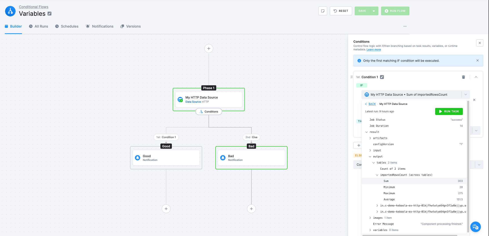

This page has the steps for both kinds of [variables](/components/variables/) in the UI: a placeholder in a configuration, and a variable in a flow. What the two kinds are and how a flow fills a configuration variable is explained on [Variables](/components/variables/). The API calls are on [Variables Through the API](/components/variables/api/).

<!-- How-to-type page. Source: the Variables page as it was before the 2026-11-19 split. Text and screenshots carried over; facts not re-checked against the product. -->

The flow sections below walk through how to set up and use variables from the UI; each step also shows the JSON shape generated behind the scenes for template authors and API users.

## Parametrize a configuration with a variable

**Goal:** replace a fixed value in a configuration with a variable that has a default and can be overridden for one run.

1. Consider the following transformation:

   ```sql
   CREATE OR REPLACE TABLE "result" AS
   	SELECT "first", "second" * 42 AS "larger_second" FROM "source";
   ```

2. To parametrize the multiplier value (42), you can change it to a variable `{{ multiplier }}`:

   ```sql
   CREATE OR REPLACE TABLE "result" AS
   	SELECT "first", "second" * {{ multiplier }} AS "larger_second" FROM "source";
   ```

3. When you define a variable, you have to provide its default value:

   

4. When you run a transformation, you can provide a runtime override of the default value:

   

**Result:** the transformation runs with the default value, or with the override you entered for that run.

When a variable is referenced in the code but not defined, or its value is missing,
you'll get an error:

    Missing values for placeholders: "multiplier"

or

    No value provided for variable "multiplier".

## Set a variable in a flow

**Goal:** store a value in a flow so that later tasks and conditions can read it.

1. In a phase, click the **+** icon and choose **Set Variable**. The Set Variable panel opens on the right.
2. Enter a **Variable Name** — this is the identifier other tasks will use to reference the value.
3. Choose a **Variable Type** — either [Static Value](#static-value) or [Dynamic Value](#dynamic-value).

**Result:** the phase has a **Set Variable** task, and tasks in later phases can reference the variable by its name.

### Static value

A **Static Value** is a fixed text or number you enter directly. Useful for thresholds, IDs, or labels that don't change between runs.


**JSON equivalent** (useful when authoring a flow as a template or via the API). The `value` field is
a string in the flow schema, so quote numbers — an unquoted `3600` fails validation:

```json
{
  "type": "variable",
  "name": "max_duration",
  "value": "3600"
}
```

### Dynamic value

A **Dynamic Value** is computed at run time from a task result, an earlier phase, or a built-in function (see [Date & Time function](#date--time-function) below). When you pick this type, the value picker lets you browse the outputs of tasks that ran earlier in the flow. You can pick any field from the job's result tree — for example `result.output.tables`, `result.artifacts`, `result.images`, `result.configVersion`, `result.errorMessage`, and many more.


If a task produces **multiple output tables**, the picker also offers aggregations across all of them: **Sum**, **Minimum**, **Maximum**, and **Average** of a numeric field. For example, `Sum of importedRowsCount` returns the total number of rows imported by an HTTP data source across every output table.



:::caution
**Aggregations are not functions.** The Sum / Minimum / Maximum / Average options are not built-in functions — the `function` enum only accepts `COUNT` and `DATE`. The picker implements each aggregation as a [JMESPath](https://jmespath.org/) expression placed in the task `value` field rather than a `function` block. When authoring a flow via the API or as a template, write the aggregation directly in `value`:

- **Sum** → `sum(job.result.output.tables[].importedRowsCount)`
- **Minimum** → `min(job.result.output.tables[].importedRowsCount)`
- **Maximum** → `max(job.result.output.tables[].importedRowsCount)`
- **Average** → `avg(job.result.output.tables[].importedRowsCount)`
:::

**JSON equivalent** — behind the scenes the aggregation is stored as a `source` definition. For example, `Sum of importedRowsCount` can be expressed as a JMESPath aggregation in the task `value`. Note that the picker tree displays paths rooted at `result.*` (for example `result.output.tables`), while the generated `value` expression is rooted at `job.result.*`:

```json
{
  "type": "variable",
  "name": "total_imported_rows",
  "source": {
    "type": "task",
    "task": "extract-data",
    "value": "sum(job.result.output.tables[].importedRowsCount)"
  }
}
```

`COUNT` and `DATE` are the only functions exposed via the `function` block (see [Date & Time function](#date--time-function) below); they take their inputs as `operands`. `COUNT` counts the items a JMESPath expression returns — for example, the number of output tables a task produced:

```json
{
  "type": "variable",
  "name": "table_count",
  "source": {
    "type": "function",
    "function": "COUNT",
    "operands": [
      {
        "type": "task",
        "task": "extract-data",
        "value": "job.result.output.tables"
      }
    ]
  }
}
```

The `value` field accepts [JMESPath](https://jmespath.org/) expressions, so you can filter and extract specific items from the task result instead of just walking the tree. For example, picking the name of a particular output table by its ID:

```json
{
  "type": "task",
  "task": "97288",
  "value": "job.result.output.tables[?id=='out.c-test.example'][].name | [0]"
}
```

### Date & time function

Returns the date/time formatted according to the specified format string, available formats:
[https://www.php.net/manual/en/datetime.format.php](https://www.php.net/manual/en/datetime.format.php).

This example returns the full textual representation of the current month, such as "July" or "August".

```json
{
 "type": "function",
 "function": "DATE",
 "operands": [
   {
     "type": "const",
     "value": "F"
   }
 ]
}
```

**Example of creating a variable with the current timestamp:**

```json
{
 "id": "set-timestamp",
 "name": "Set Timestamp Variable",
 "phase": "init",
 "task": {
   "type": "variable",
   "name": "current_timestamp",
   "source": {
     "type": "function",
     "function": "DATE",
     "operands": [
       {
         "type": "const",
         "value": "U"
       }
     ]
   }
 }
}
```

## Use a variable in a condition

**Goal:** send a flow down one path or another, depending on a variable or a task result.

Once a variable has been set in an earlier phase, any later **Condition** can compare its value against a constant, against another variable, or against a task result.

1. In the IF row, click the value picker and choose a variable, a task result, or a phase result from an earlier phase.
2. Choose an operator (Greater than, Equals, Contains, …).
3. Provide a comparison value — a constant, or another value picked from the tree.
4. Set the THEN and ELSE actions: **Continue To** an existing phase, or end the flow.


**Result:** when the flow runs, it continues to the phase you set for THEN or ELSE, or ends. Only the first matching IF condition is executed; subsequent IFs in the same Conditions block are skipped.

See also the [Conditions](/flows/#conditions) section for the full list of operators and condition types.

## Override a variable on one flow task

**Goal:** set the value of a configuration variable for one specific task of a flow.

To set a value on one specific task instead, use its **Task Parameters**:

1. Select the task in the
   flow's Builder to open its settings, and click **Set advanced parameters**. The editor opens pre-filled with the task's `type`, `mode`, `componentId` and
   `configId`.

   

2. Add `variableValuesData`
   to the task payload. The `variableValuesData` shape is the
   same one [running a job](/components/variables/api/tutorial/#step-4-run-a-job) takes, but the surrounding fields are
   the task's own (`componentId` / `configId`), not the job API's `component` / `config`:

   ```json
   {
     "componentId": "keboola.snowflake-transformation",
     "configId": "0123abc",
     "mode": "run",
     "variableValuesData": {
       "values": [
         {
           "name": "multiplier",
           "value": "1000"
         }
       ]
     }
   }
   ```

3. Click **Set**.

**Result:** the task runs with the value you set. This path does not
depend on the variable also being declared as a flow variable. The other way, a flow variable with the same name as the configuration variable, is explained in [Driving a configuration variable from a flow](/components/variables/#driving-a-configuration-variable-from-a-flow).

---

**Next:** [Variables Through the API →](/components/variables/api/)
