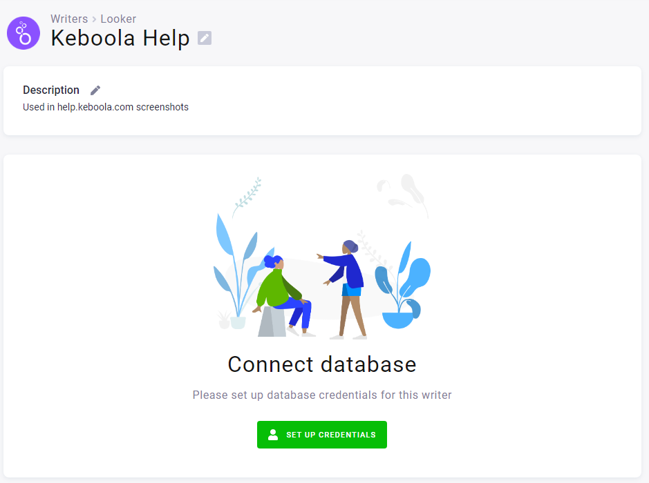
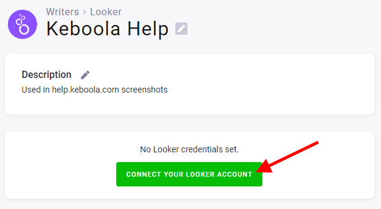
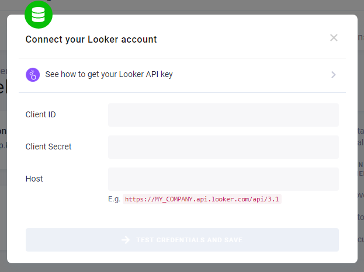
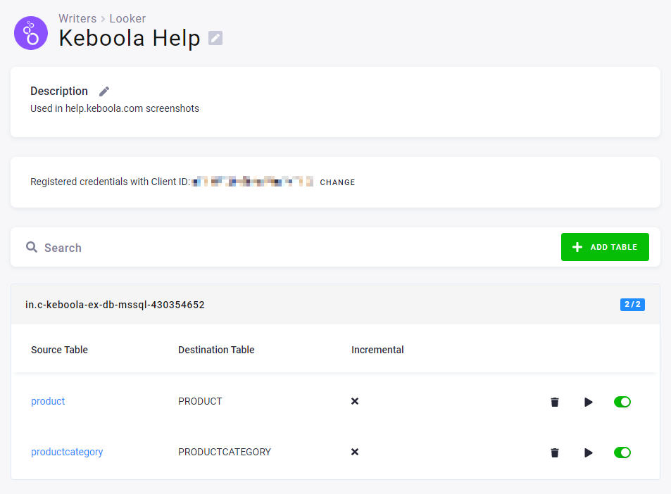
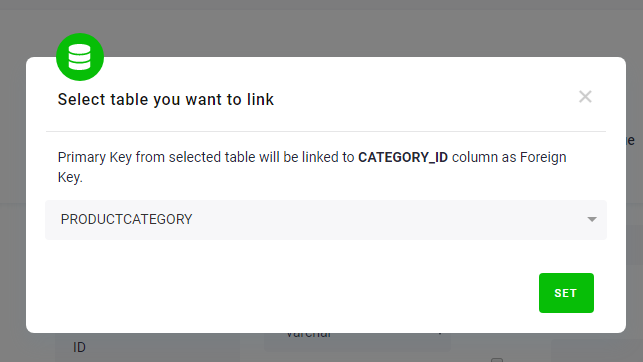
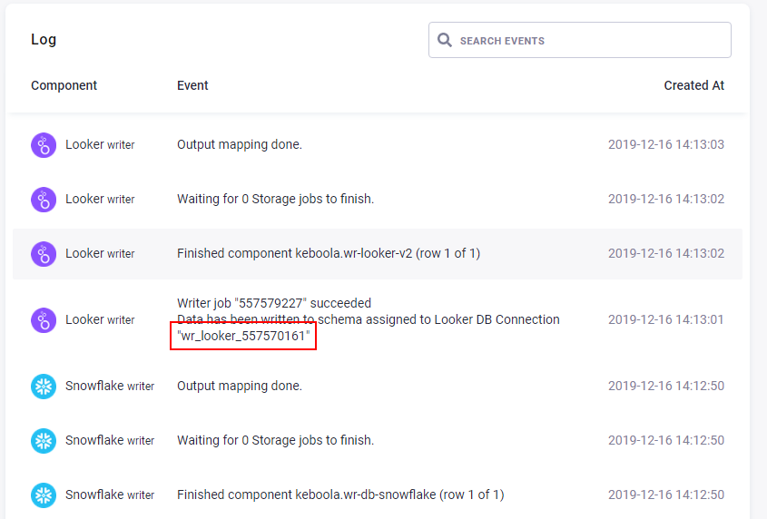
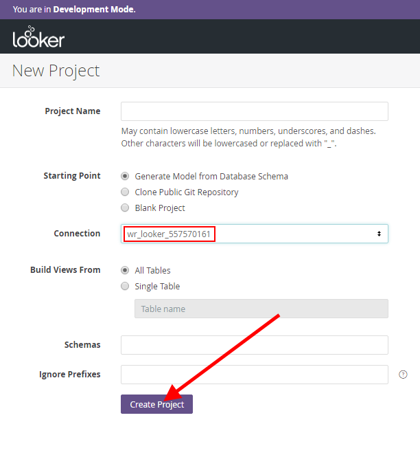

This data destination connector pushes data to your Looker instance where it creates a new LookML project.
The column names are changed so that Looker can automatically understand data relations.
The connector currently uses Snowflake as its backend. 

<!-- How-to-type page. Source: keboola/connection-docs history; classified 2026-10-13. -->

## Before you start

- A Looker instance and its API host.
- Looker API credentials: the `Client ID` and `Client secret` of a Looker user, which an admin creates in Looker
  administration ([Looker documentation](https://cloud.google.com/looker/docs/api-auth)). The connector creates a
  Looker connection with them, so the user needs a role that can manage connections.
  <!-- VERIFY(Nikita): check which Looker permission the API user needs for the connector to create the connection (for example manage_connections or the Admin role). -->
- If your Looker instance accepts API calls only from known addresses, allow the
  [Keboola IP addresses](/components/ip-addresses/) of your stack.
- A Snowflake database for the data: a Keboola-generated workspace or your own Snowflake database (see below).
- Run the connector in the production branch: its jobs are blocked in [development branches](/components/branches/).

## Configuration

Create a [new **Looker data destination connector** configuration](/components/configurations/#create-a-configuration) in your project. 

Continue by setting up a Snowflake workspace to use with Looker. You can either supply your own or use 
a Keboola generated workspace. 

When your workspace is set up and tested, go back to the configuration. The next step is to set up your Looker credentials. 

Fill in the client ID and the client secret you obtained from Looker. 

Now the preparation phase is done and it's time to set up the data you want to make available to your Looker 
project. Add tables to the configuration as needed. For further information, refer 
to the [Snowflake data destination documentation](/components/writers/database/snowflake/#table-configuration). 

Each table you add can have relations set up. For that the dependent table needs to have the primary key set up. 

When you click "Set Foreign key", you can select to which table's primary key should the foreign key point to. 

The column is renamed upon saving (this is required for Looker to understand the relation automatically) 
and the FK badge is shown next to it. 

When you run the configuration, you'll see the connection name in the log. 

In Looker, when creating a new LookML project, you select the connection name from the configuration log. 

You're done. The LookML project with automatically created relations is prepared for you. 

**Check:** the job ends with **Success** and its log names the Looker connection. In Looker, the new LookML project
generated from that connection has a view for each table you added, with the relations from your foreign keys.
