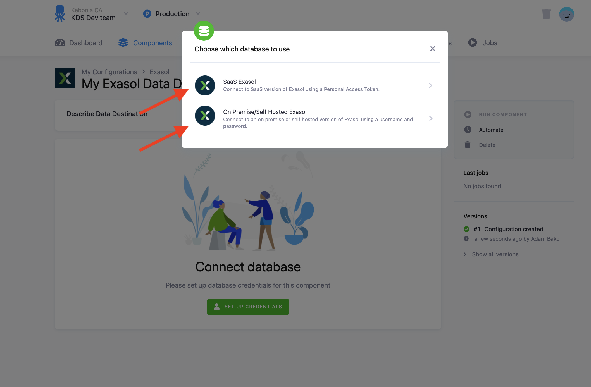
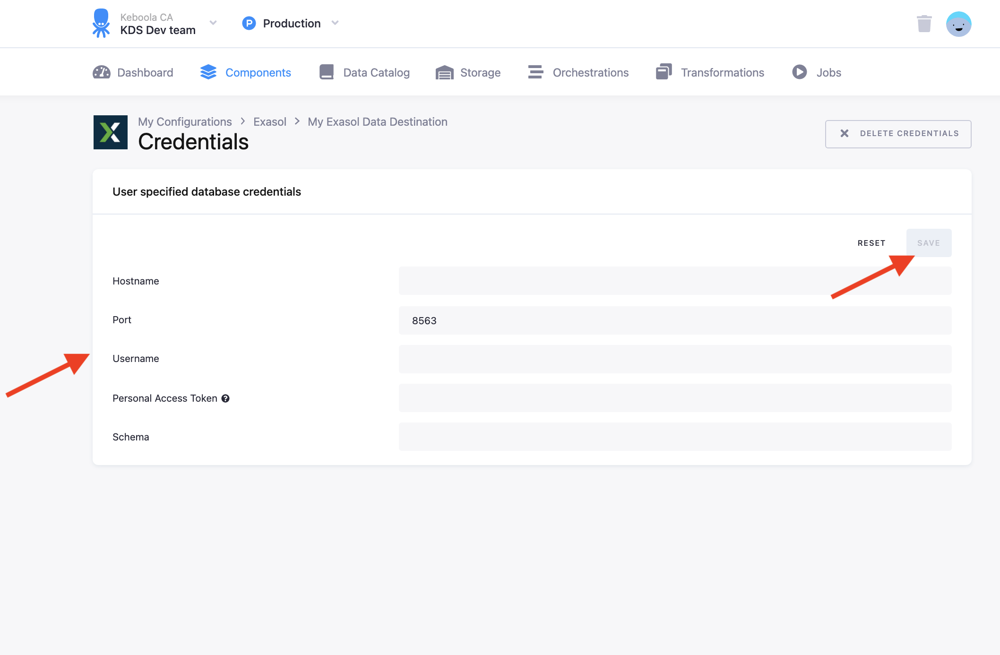
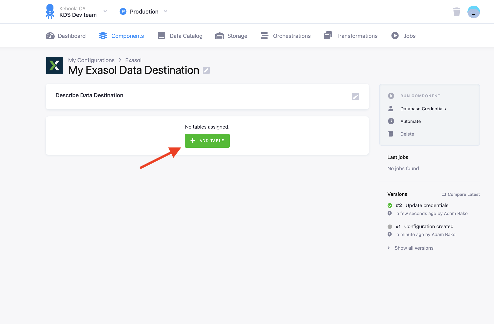
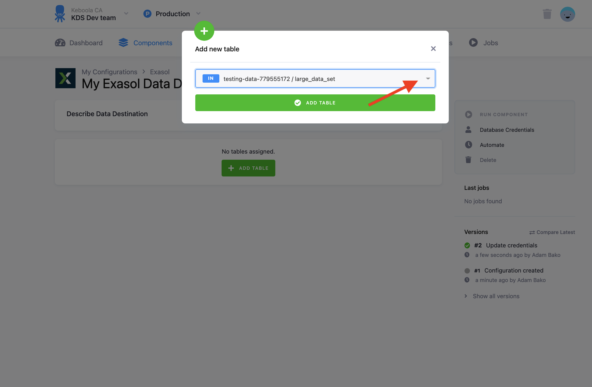
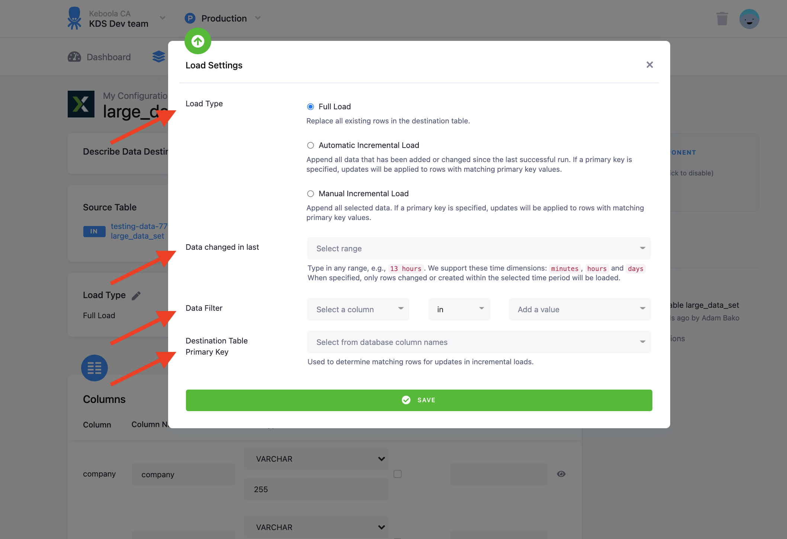
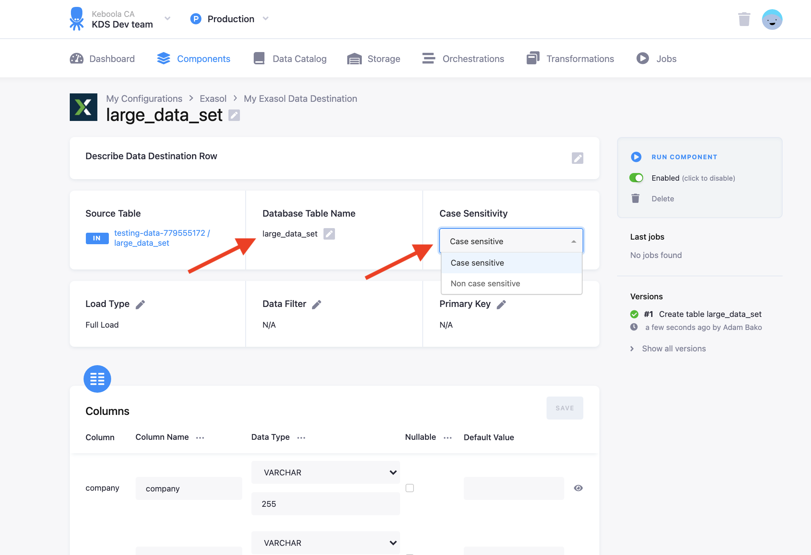

This data destination connector sends data to a [Exasol](https://www.exasol.com/) database.

<!-- How-to-type page. Source: keboola/connection-docs history; classified 2026-10-13. -->

## Before you start

- An Exasol database: [Exasol SaaS](https://cloud.exasol.com/) or a self-hosted (on-premise) Exasol.
- The host name and port of the database. The default port is `8563`.
- A user to log in with:
    - on Exasol SaaS, a user name and a [personal access token](https://docs.exasol.com/saas/administration/access_mngt/access_token.htm);
    - on a self-hosted Exasol, a user name and password.
- The schema to write to. It must exist; the connector creates tables in it but not the schema itself.
- A user that can create, rename, drop and merge into tables in that schema and import data into them.
  <!-- VERIFY(nikita): kds-team.wr-exasol runs CREATE TABLE, RENAME TABLE, DROP TABLE, MERGE INTO and IMPORT (pyexasol import_from_file); check which Exasol system and object privileges that takes, in particular whether IMPORT needs the IMPORT system privilege. -->
- Network access from Keboola to the database. On Exasol SaaS, add the [Keboola IP addresses](/components/ip-addresses/)
  of your stack to the allow list on the **Security** page of the web console
  ([Exasol docs](https://docs.exasol.com/saas/connect_exasol.htm)); on a self-hosted Exasol, allow them in your firewall.

## Configuration
[Create a new configuration](/components/configurations/#create-a-configuration) of the **Exasol** data destination connector.

The first step is to **set up credentials**:

You must select either [SaaS Exasol](https://cloud.exasol.com/) and log in with a personal access token. Or connect to an on-premise or self hosted version of Exasol using a username and password. 

Once selected fill in the hostname and port of your Exasol database. Next fill in your username and personal access token or username and password. Finally, fill in the schema to which you wish to write to and click the **Save** button.

## Table Configuration
The next step is to configure the tables you want to write. Click **Add New Table** and select an existing table from Storage:

Then specify table configuration. Use the **preview** icon to peek at the column contents.

For each column you can specify its

- **name** in the destination database; you can also use the select box in the table header to bulk convert the case of all names.
- **data type** (one of [Exasol data types](https://docs.exasol.com/sql_references/data_types/datatypesoverview.htm)); you can also use the select box in the table header to bulk set the type for all columns. Setting the data type to `IGNORE` means that the column will not be present in the destination table.
- **nullable**; when checked, the column will be marked as nullable and empty values (`''`) in that column will be converted to `NULL`. Use this for non-string columns with missing data.

The Exasol connector can take advantage of the [column metadata](/storage/tables/#metadata). If they are available, the
column types are pre-filled automatically. Make sure to verify the suggested types, however. These data types are taken
from the data source and may not be the best choice for the data destination.

When you are done configuring the columns, don't forget to **save** the settings.

### Load Settings
At the top of the page, you can specify the target table name and additional load options. There are three main loading options — **Full Load**, **Automatic Incremental Load**, and **Manual Incremental Load**.

In the **Full Load** mode you replace all existing rows in the destination table.

In the **Automatic Incremental Load** mode, you append all data that has been added or changed since the last successful run. A primary key must be specified

In the **Manual Incremental Load** mode, you can select which data will be uploaded based on setting data filters on columns or specify 
a specific date range of when data was changed to upload. A primary key must be specified.

You can specify the Destination Table Primary Key in the Load settings on the bottom of the load settings pop up.

## Exasol table settings

The name of the table in the Exasol database can be set in the Database Table Name box on the top of the configuration by clicking on the pencil icon, naming the table and pressing the blue checkmark icon.

The Case sensitivity of the table can be set using the drop down selector in the case sensitivity box. Case sensitivity makes table objects and their columns case sensitive, just as if you were to use double quotes in SQL statements.

**Check:** click **Run Component**. The job ends with **Success**, and the table appears in the Exasol schema with the
rows from the Storage table.

