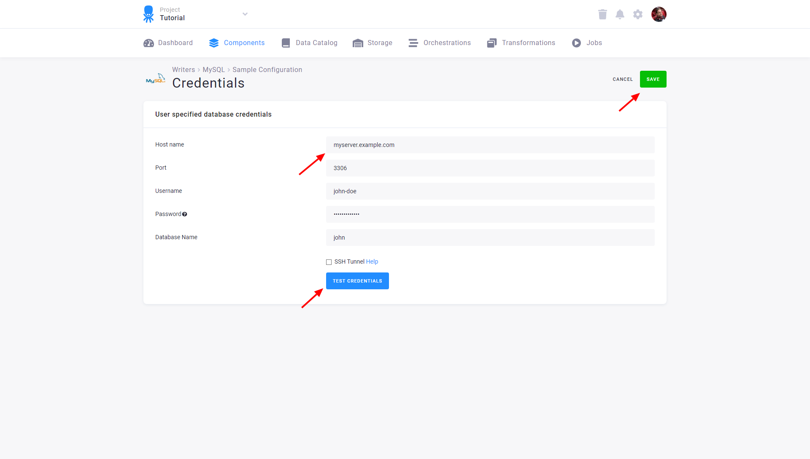
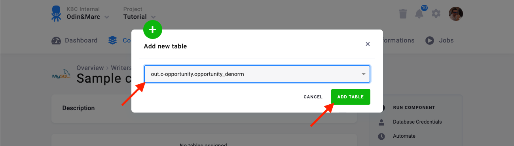
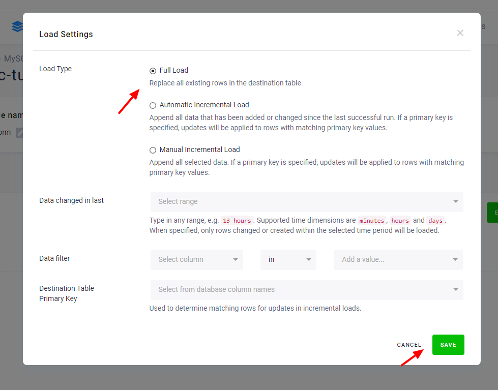

This data destination connector sends data to a [MySQL](https://www.mysql.com/products/) or [MariaDB](https://mariadb.org/) database.

<!-- How-to-type page. Source: keboola/connection-docs history; classified 2026-10-13. -->

## Before you start

- A MySQL or MariaDB database to write to.
- A user for the connector with `CREATE`, `DROP`, `CREATE TEMPORARY TABLES`, `SELECT`, `INSERT` and `UPDATE` on that
  database. The SQL below creates the database and the user. Without `ALTER`, the connector can't write Storage
  descriptions as table and column comments; the job logs a warning and still succeeds.
- Network access from Keboola to the database: allow the [Keboola IP addresses](/components/ip-addresses/) of your stack
  in your firewall, or connect through an [SSH tunnel](/components/extractors/database/#connecting-to-database).

We highly recommend that you create dedicated credentials for the connector in your database. You can use the following SQL code to get started:

```sql
CREATE DATABASE writer_sample;
CREATE USER 'writer_sample' IDENTIFIED BY 'Writer_sample1';
GRANT CREATE TEMPORARY TABLES, CREATE, DROP, SELECT, INSERT, UPDATE ON writer_sample.*
    TO writer_sample;
```

## Configuration
[Create a new configuration](/components/configurations/#create-a-configuration) of the **MySQL** data destination connector.

The first step is to **Set Up Database Credentials**.
You need to provide a *host name*, *user name*, *password*, and a *database name* (MySQL [*schema*](https://dev.mysql.com/doc/refman/8.0/en/glossary.html#glos_schema)).



## Table Configuration
The next step is to configure the tables you want to write. Click **Add New Table** and select an existing table from Storage:



Then specify table configuration. Use the **preview** icon to peek at the column contents.


For each column you can specify its

- **name** in the destination database; you can also use the select box in the table header to bulk convert the case of all names.
- **data type** (one of [MySQL data types](https://dev.mysql.com/doc/refman/8.0/en/data-types.html)); you can also use the select box in the table header to bulk set the type for all columns. Setting the data type to `IGNORE` means that the column will not be present in the destination table.
- **nullable**; when checked, the column will be marked as nullable and empty values (`''`) in that column will be converted to `NULL`. Use this for non-string columns with missing data.
- **default value**; the provided value will be set as the [default value of the column](https://dev.mysql.com/doc/refman/8.0/en/data-type-defaults.html) in the target table.

When done configuring the columns, don't forget to **save** the settings.

### Load Options
At the top of the page, you can specify the target table name and additional load options. There are two main options how the connector
can write data to tables — **Full Load** and **Incremental Load**.



In the **Incremental Load** mode, the data are bulk inserted into
the destination table and the table structure must match (including the data types). That means the structure of the target table
will not be modified. If the target table doesn't exist, it will be created. If a primary key is defined on the table, the
data is [upserted](https://en.wikipedia.org/wiki/Merge_(SQL)). If no primary key is defined, the data is inserted.

In the **Full Load** mode, the table is completely overwritten including the table structure. The table is removed
using the [`DROP`](https://dev.mysql.com/doc/refman/8.0/en/drop-table.html) command and recreated. The
`DROP` command needs to acquire a [table-level lock](https://dev.mysql.com/doc/refman/8.0/en/lock-tables.html).
This means that if the database is used by other applications which acquire table-level locks, the connector may
freeze waiting for the locks to be released.

Additionally, you can specify a **primary key** of the table, a simple column **data filter**, and a filter for
[incremental processing](/storage/tables/incremental-loading/#incremental-processing).

**Check:** click **Run Component**. The job ends with **Success**, and the table appears in the target database with
the rows from the Storage table.
