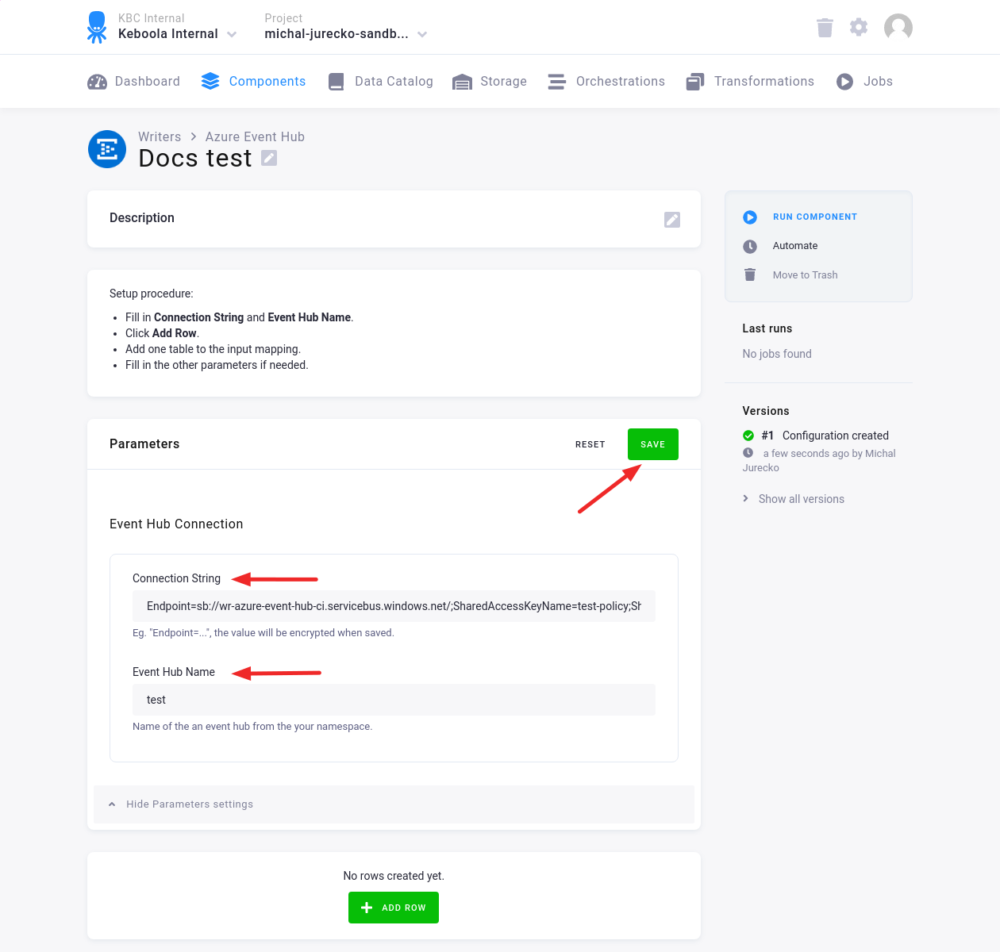
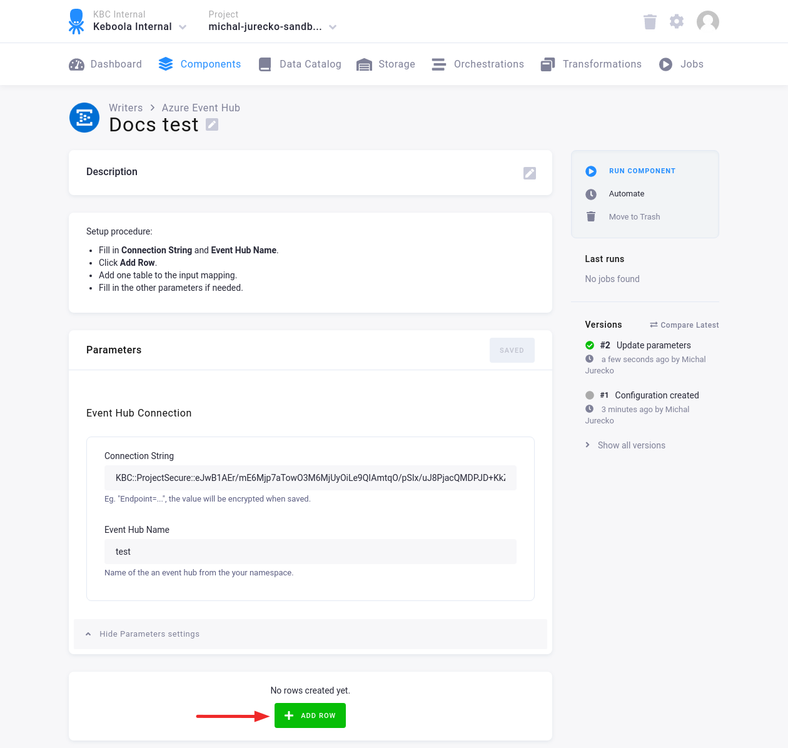
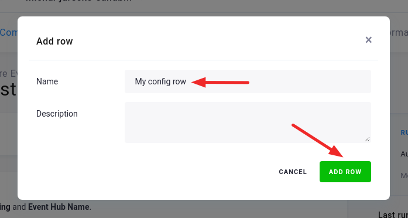
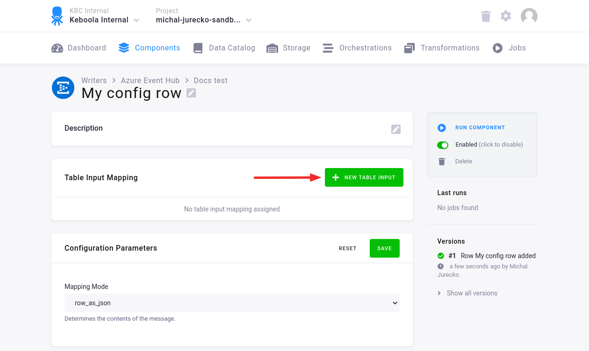
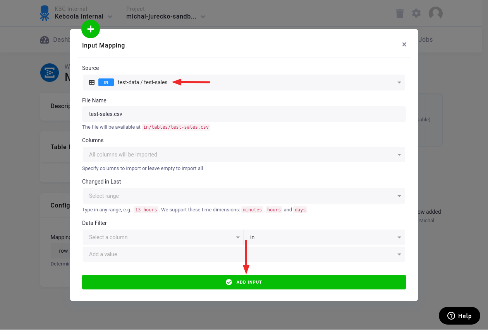
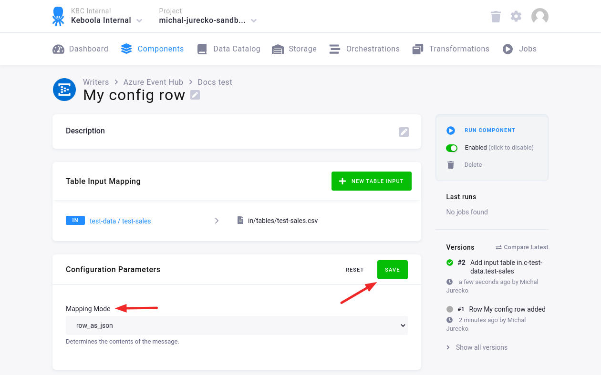

This data destination connector allows you to publish events to the [Azure Event Hubs](https://azure.microsoft.com/en-us/services/event-hubs/).

<!-- How-to-type page. Source: keboola/connection-docs history; classified 2026-10-13. -->

## Before you start

- An Event Hubs namespace with the event hub to publish to. The connector takes the name of the event hub, not of
  the namespace.
- A [connection string](https://learn.microsoft.com/en-us/azure/event-hubs/event-hubs-get-connection-string) from a
  shared access policy ([Azure docs](https://learn.microsoft.com/en-us/azure/event-hubs/authorize-access-shared-access-signature)).
  The connector reads the event hub's properties and then sends the events.
  <!-- VERIFY(Nikita): check with a live run which rights the policy needs. Writer.js calls getEventHubProperties before sending, so a Send-only policy may not be enough; name the minimum rights here once confirmed. -->
- If the namespace accepts traffic only from selected networks, allow the [Keboola IP addresses](/components/ip-addresses/)
  of your stack in its [IP firewall](https://learn.microsoft.com/en-us/azure/event-hubs/event-hubs-ip-filtering).
- A Storage table with the data to send: one message per row.

## Mapping Mode

There are two **mapping modes**:
 - **`row_as_json` mode**: message is the table's row in JSON format
 - **`column_value` mode**: message is the value of the specified column, from the table's row
 
## Configuration
[Create a new configuration](/components/configurations/#create-a-configuration) of the **Azure Event Hub** connector.

Fill in the **Connection String** and **Event Hub Name**. Then click **Save**.

Click **Add Row** to add one or more [configuration rows](/components/#configuration-rows).

Fill in the **Name**, and, optionally, the **Description**. Then click **Add Row**.

Click **Add Table Input** to add one table to the [Input Mapping](/transformations/mappings/).

<!-- VERIFY(Nikita): reshoot this screenshot; it still shows the old New Table Input button, now Add Table Input. -->

Fill in the **Source** table. You can also fill in other fields. Then click **Add Input**.

In the [Configuration Row](/components/#configuration-rows), fill in the [**Mapping Mode**](#mapping-mode).

For the **`column_value`** mapping mode, also fill in the **Message Column**.

Then click **Save**.

**Check:** click **Run Component**. The job ends with **Success**, and the **Incoming Messages** metric of the event
hub in the Azure portal shows the messages from the run.
