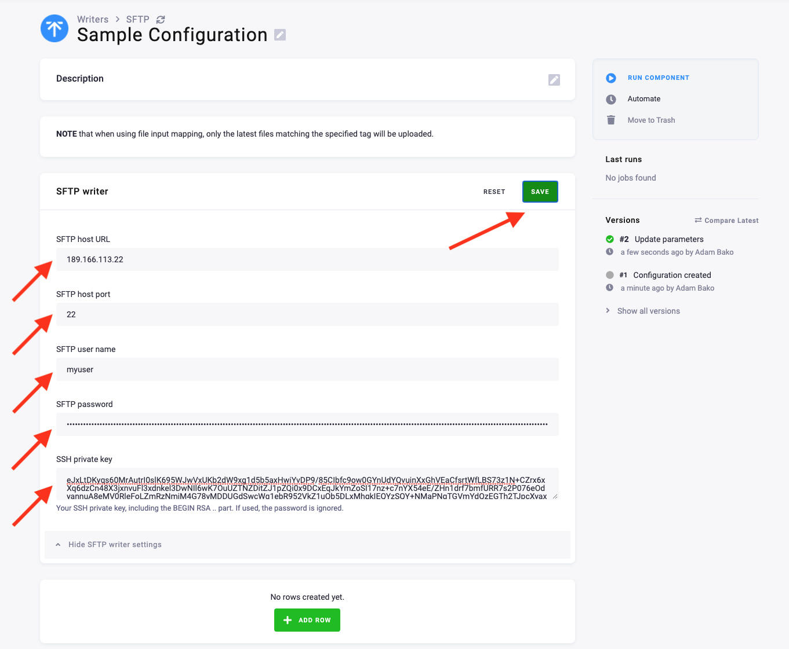
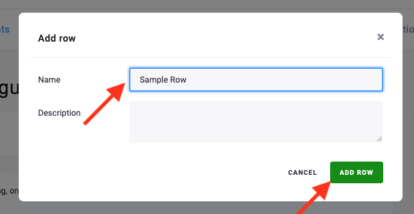
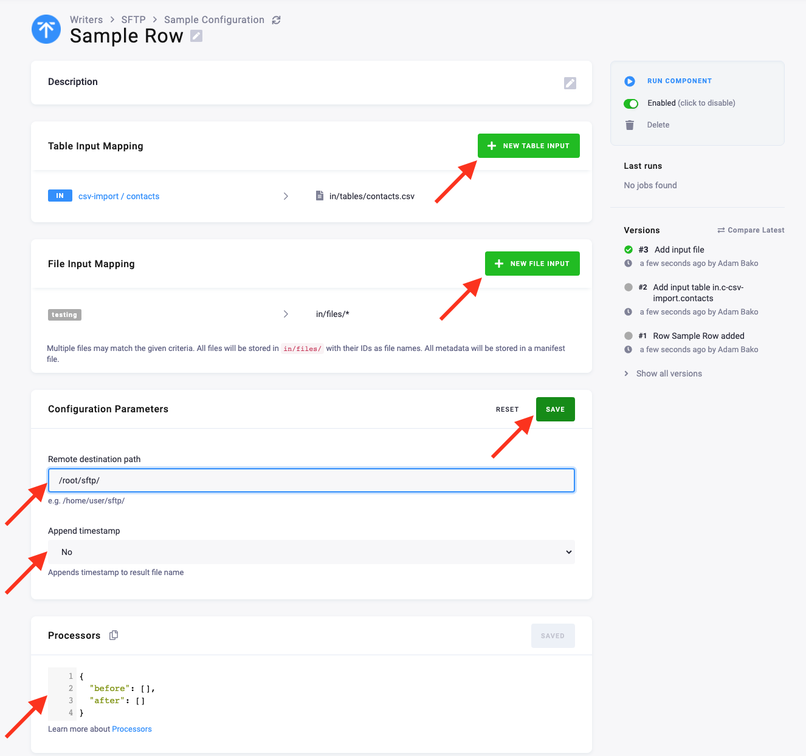

This data destination connector allows you to write tables and files to a remote SFTP server.

<!-- How-to-type page. Source: keboola/connection-docs history; classified 2026-10-13. -->

## Before you start

- An SFTP server and a user on it, with a password or an SSH key. For a key, you can paste a private key or let the
  connector generate a key pair; the user's account on the server must accept the public key.
- Write access to the remote destination path. Make sure the remote destination path exists on the server.
- Network access from Keboola to the server (port 22 by default): allow the [Keboola IP addresses](/components/ip-addresses/)
  of your stack in your firewall.

## Configuration

[Create a new configuration](/components/configurations/#create-a-configuration) 
of the SFTP data destination connector. 
Then provide the target SFTP server URL, port (default is 22), and authentication, either via 
a username and a password, or with a private key.

 

__Save__ the SFTP parameters and continue to the 
[configuration rows](/components/#configuration-rows) by clicking the 
**Add Row** button, which will prompt you to create a new row configuration.

 

__Add__ the new row and fill in the [tables](/transformations/mappings/input/#table-input-mapping) 
and [files](/transformations/mappings/input/#file-input-mapping) you want to write to the SFTP server.
Add new tables with the **Add Table Input** button. Once added, the tables will show up in the Table Input Mapping.
Add new files with the **New File Input** button. You can add files using 
[file tags](/transformations/mappings/input/#file-input-mapping).

Next, configure the parameters by adding the remote destination path in the SFTP server. 

Then configure the append timestamp parameter. This will append the current timestamp to the filename. 
If you are uploading the same tables and want to have historical records, this would be your solution.

When these parameters are set, **save** the configuration.

If you want to add [processors](https://developers.keboola.com/extend/component/processors/) 
to the files or tables before the input, you can specify these in the processor configuration window.

 
<!-- VERIFY(Nikita): reshoot this screenshot; it still shows the old New Table Input button, now Add Table Input. -->

**Check:** click **Run Component**. The job ends with **Success**, and the files appear in the remote destination path,
with a timestamp in their names if you turned that on.

