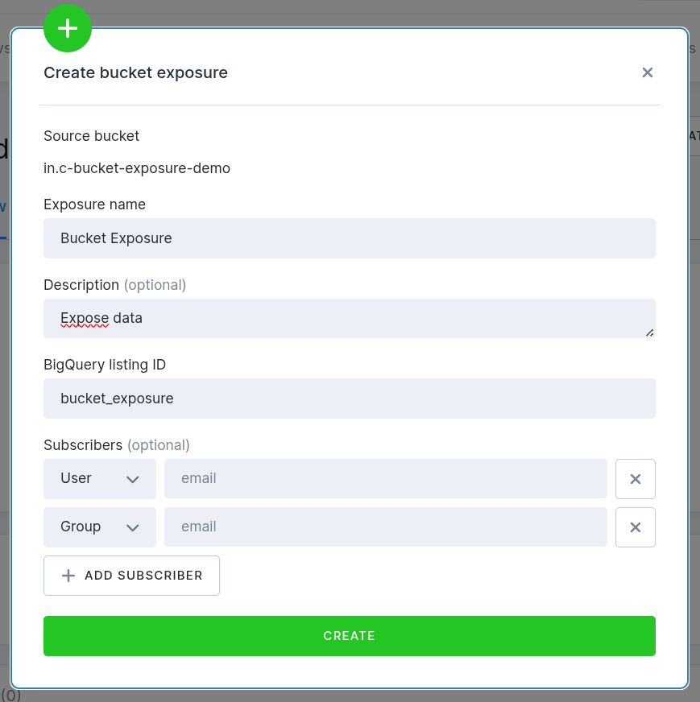
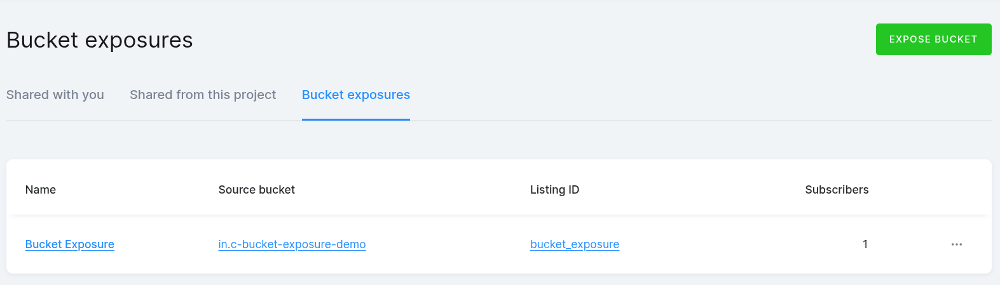
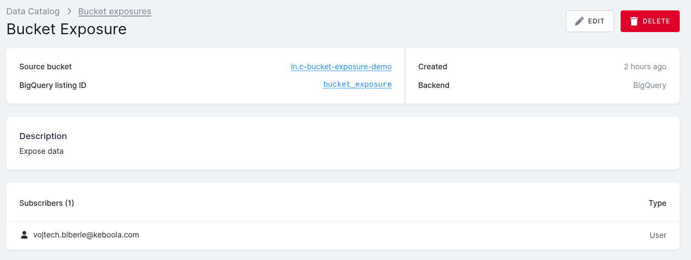

Share a bucket through [Bucket Exposure](/storage/bucket-exposure/) from the bucket detail in **Storage**, then change or remove the exposure under **Data Catalog**. The dialog described here is the BigQuery one. On a Snowflake project it asks for other fields: see [Snowflake grant mode](/storage/bucket-exposure/snowflake-grant/) and [Snowflake share mode](/storage/bucket-exposure/snowflake-share/).

<!-- How-to-type page. Source: the "Creating an Exposure" and "Managing Your Exposures" sections of the Bucket Exposure page as it stood on main before the split. Structure checked 2026-11-19, facts not re-verified. -->

## Before you start

- **Bucket Exposure enabled for the project.** It is in beta; Keboola Support turns it on, as the note at the top of the [Bucket Exposure overview](/storage/bucket-exposure/) says.
- **A project on BigQuery for the dialog fields below.** A Snowflake bucket opens the same dialog with other fields: see [grant mode](/storage/bucket-exposure/snowflake-grant/) or [share mode](/storage/bucket-exposure/snowflake-share/), which link back here for the shared tasks.
- **An organization member, or a project admin with the Share role**, the same people who can [share a bucket](/catalog/share-and-link/) inside Keboola, using a token that can manage the bucket (your master token can).
  <!-- Checked 2026-11-27 in the Storage API spec: POST /v2/storage/buckets/{bucketId}/listing serves BigQuery and Snowflake exposures with one gate (MANAGE privilege on the bucket, and an admin in the bucket's organization or with the share role), also on PATCH and DELETE. -->
- **The bucket** you want to share, in **Storage**.
- **The subscribers' Google accounts or Google Groups**, if you want to add them now. You can also add them later.

## Create an exposure

**Goal:** make one bucket available to subscribers in BigQuery Analytics Hub.

1. Open the bucket you want to share in **Storage**. On the bucket detail page, either click
   the **Disabled (click to enable)** link next to *Bucket exposure*, or open the **⋯** menu
   in the top right and choose **Create bucket exposure**.

   

2. A dialog opens. Fill in:

   

   - **Exposure name** — what your consumers will see when they look up the dataset in
     BigQuery. Use a friendly name like *Sales Dataset Q1* or *Customer Segments — Production*.
   - **Description** *(optional)* — a short explanation of what the data is. Your consumers
     will see this too.
   - **BigQuery listing ID** — a technical identifier (lowercase letters, digits and
     underscores). This **cannot be changed later**, so pick something stable. If you're not
     sure, it's safe to derive it from the exposure name, e.g. `sales_dataset_q1`.
   - **Subscribers** *(optional)* — the people or groups who should have access. For each
     entry, pick whether it is a **User** (a single Google account, e.g.
     `john.doe@example.com`) or a **Group** (a Google Group, e.g.
     `analytics-team@example.com`). You can add subscribers later from the exposure detail.

3. Click **Create**.

**Result:** The exposure is created in the background — you will see a job in
Keboola tracking its progress. Once the job finishes, the bucket is live in BigQuery
Analytics Hub and your subscribers can start using it.

**Check:** **Data Catalog → Bucket exposures** lists the exposure with its source bucket, listing ID and number of subscribers.
<!-- VERIFY(Nikita): the Bucket exposures tab under Data Catalog comes from the listing screenshot; the 2026-11-20 UI check on catalog/share-and-link.md found filter buttons All, Linked and Mine. Confirm where the exposure list lives now. -->

## Find an exposure

**Goal:** see every exposure of the project and open the detail of one.

1. Go to **Data Catalog → Bucket exposures**. All your exposures live there.

   

   Each row shows the friendly name, the source bucket, the BigQuery listing ID, and the
   number of subscribers.

2. Click a row to see details.

   

**Result:** The detail page lists everyone who has access and gives you **Edit** and **Delete** buttons.

**Check:** the detail page shows the **Source bucket**, the **BigQuery listing ID** and, under **Subscribers**, each subscriber with its type.

## Edit an exposure

**Goal:** change the exposure name, description, or the list of subscribers.

1. Click **Edit** on the detail page.

   

2. Change the exposure name, description, or the list of subscribers, and click **Save**.
   The **BigQuery listing ID** is shown but cannot be edited — changing it would break the
   connection for everyone already subscribed.

**Result:** Adding or removing a subscriber takes effect immediately — new people gain
access right away, removed people lose access right away.

**Check:** under **Subscribers**, the detail page lists the people and groups you saved, and only those.

## Delete an exposure

**Goal:** remove the exposure entirely.

1. Click **Delete** on the detail page.

**Result:** All current subscribers immediately lose access to the data in BigQuery.

If you delete the **bucket itself** in Storage, the exposure is cleaned up automatically —
you don't need to remove it manually first.

**Check:** the exposure is no longer listed under **Data Catalog → Bucket exposures**.

---

**Next:** [Snowflake grant mode →](/storage/bucket-exposure/snowflake-grant/)
