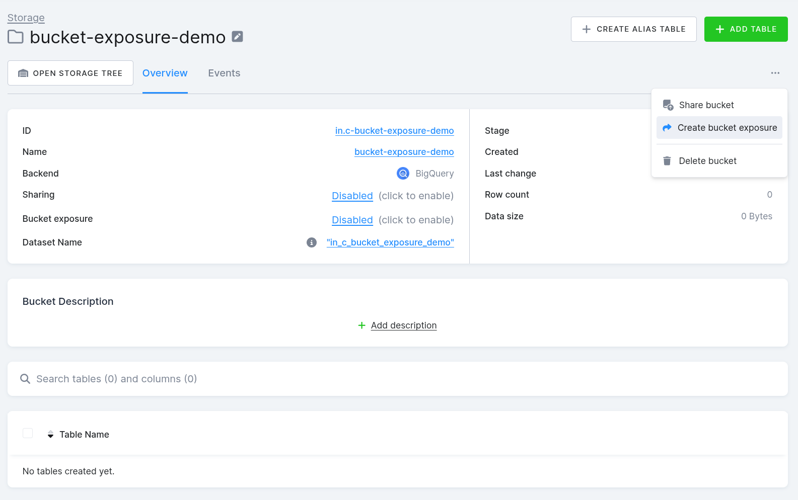
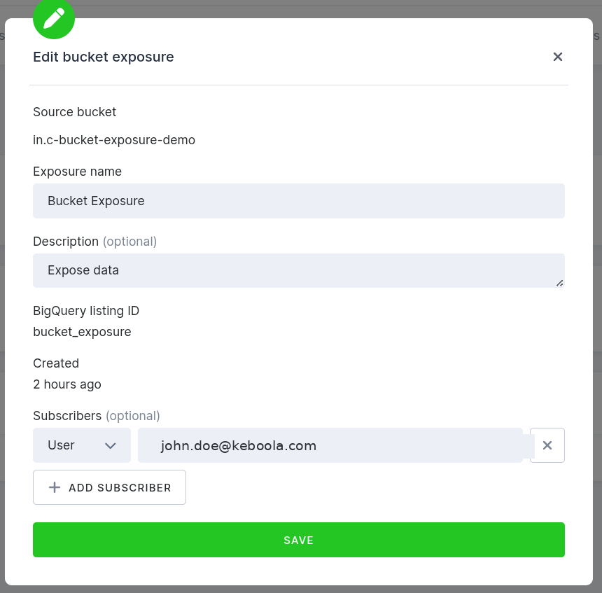

This page shows how to create a [bucket exposure](/storage/bucket-exposure/) and how to edit or delete it later.

## Creating an Exposure

Open the bucket you want to share in **Storage**. On the bucket detail page, either click
the **Disabled (click to enable)** link next to *Bucket exposure*, or open the **⋯** menu
in the top right and choose **Create bucket exposure**.

A dialog opens. Fill in:

- **Exposure name** — what your consumers will see when they look up the dataset in
  BigQuery. Use a friendly name like *Sales Dataset Q1* or *Customer Segments — Production*.
- **Description** *(optional)* — a short explanation of what the data is. Your consumers
  will see this too.
- **BigQuery listing ID** — a technical identifier (lowercase letters, digits and
  underscores). This **cannot be changed later**, so pick something stable. If you're not
  sure, it's safe to derive it from the exposure name, e.g. `sales_dataset_q1`.
- **Subscribers** *(optional)* — the people or groups who should have access. For each
  entry, pick whether it is a **User** (a single Google account, e.g.
  `john.doe@example.com`) or a **Group** (a Google Group, e.g.
  `analytics-team@example.com`). You can add subscribers later from the exposure detail.

Click **Create**. The exposure is created in the background — you will see a job in
Keboola tracking its progress. Once the job finishes, the bucket is live in BigQuery
Analytics Hub and your subscribers can start using it.

:::note
**Who can create an exposure?** Anyone with **manage** access to the bucket — the same
permission required to share a bucket inside Keboola.
:::

## Managing Your Exposures

All your exposures live under **Data Catalog → Bucket exposures**.

Each row shows the friendly name, the source bucket, the BigQuery listing ID, and the
number of subscribers. Click a row to see details.

The detail page lists everyone who has access and gives you **Edit** and **Delete** buttons.

### Editing an Exposure

Click **Edit** on the detail page to change the exposure name, description, or the list of
subscribers. Adding or removing a subscriber takes effect immediately — new people gain
access right away, removed people lose access right away.

The **BigQuery listing ID** is shown but cannot be edited — changing it would break the
connection for everyone already subscribed.

### Deleting an Exposure

Click **Delete** on the detail page to remove the exposure entirely. All current
subscribers immediately lose access to the data in BigQuery.

If you delete the **bucket itself** in Storage, the exposure is cleaned up automatically —
you don't need to remove it manually first.

---

**Next:** [Snowflake grant mode →](/storage/bucket-exposure/snowflake-grant/)
