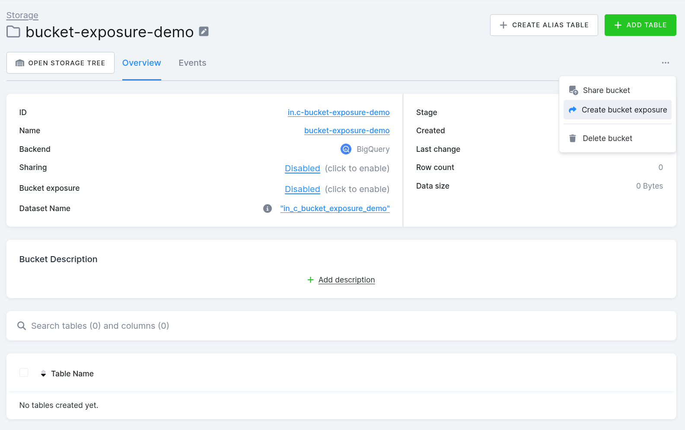
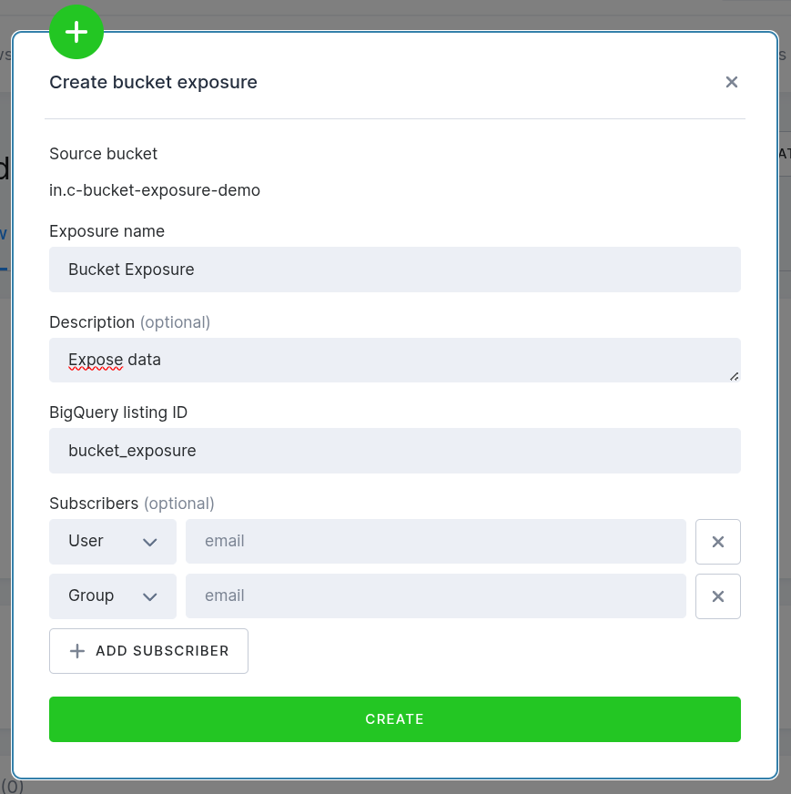
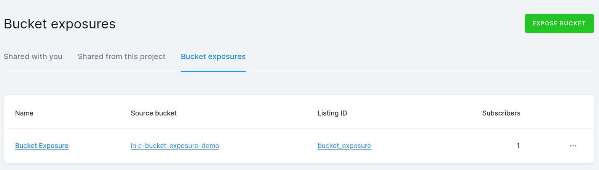
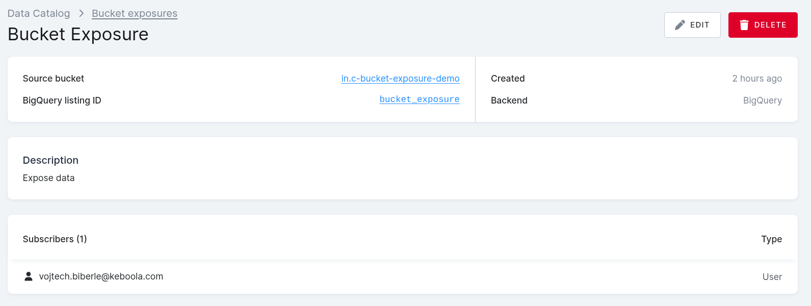
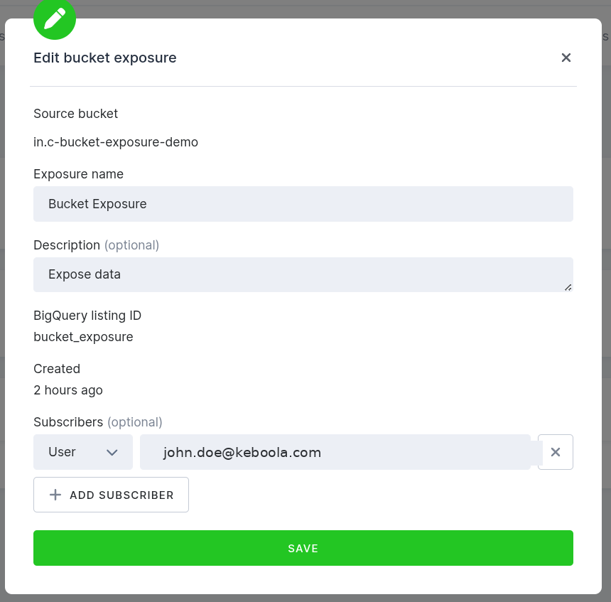

:::caution
Important: This feature is currently available in BETA for BigQuery projects and for
Snowflake projects on your own Snowflake account ([BYODB](/storage/byodb/)) or on an
account Keboola runs for your organization alone.
Contact Keboola support to have it enabled for your project.
:::


**Bucket Exposure** lets you share data from a Keboola bucket with people outside your
Keboola project — directly inside their own Google BigQuery environment. No exports, no
data copies, no manual handoffs.

You pick a bucket, give it a friendly name, and list who should have access. Those people
or teams see the data appear in their BigQuery, and they can query it just like any other
dataset. The data is **always live**: as soon as it changes in Keboola, the new version is
visible to them.

On **Snowflake**, an exposure either gives existing roles in your own Snowflake account read
access to the bucket ([Snowflake Grant Mode](#snowflake-grant-mode)), or shares the bucket with
other Snowflake accounts ([Snowflake Share Mode](#snowflake-share-mode)).

## When to Use Bucket Exposure

Bucket Exposure is the right choice when:

- You want to share **prepared, governed data** with a partner, a client, or another team
  in your organization — and they work in **BigQuery**, not in Keboola.
- You want a **single source of truth**: instead of emailing CSVs or running nightly
  exports, your consumers always see the latest version of the data.
- You want **control and visibility**: you decide who has access, you can revoke it at any
  time from Keboola, and every change is auditable.

Typical scenarios:

- The **Marketing team** maintains a curated customer segmentation in Keboola. The
  **BI team** consumes it directly in their BigQuery workspace, in real time.
- A **data provider** sells a cleaned, enriched dataset to **paying customers**. Each
  customer gets access to the same dataset in their own GCP project — no replication, no
  staging buckets.
- A **finance team** needs to give their **external auditors** a read-only view of
  specific reconciliation data, with the ability to revoke access at the end of the audit.

## How It Differs From Other Sharing Features

| Feature | What it does | Who can access |
|---------|--------------|----------------|
| [**Data Catalog**](/catalog/) | Share a bucket with another **Keboola project** in the same organization. | Keboola users only. |
| [**External Datasets**](/storage/byodb/external-buckets/) | Register a BigQuery dataset **you already own** as a bucket inside Keboola. | Keboola users only. |
| **Bucket Exposure** | Share a Keboola-owned bucket **out into BigQuery** for people who don't use Keboola. | Anyone with a Google account or Google Group. |

Bucket Exposure and Data Catalog sharing are independent — you can do both on the same
bucket if you want.

## Creating an Exposure

Open the bucket you want to share in **Storage**. On the bucket detail page, either click
the **Disabled (click to enable)** link next to *Bucket exposure*, or open the **⋯** menu
in the top right and choose **Create bucket exposure**.



A dialog opens. Fill in:



- **Exposure name** — what your consumers will see when they look up the dataset in
  BigQuery. Use a friendly name like *Sales Dataset Q1* or *Customer Segments — Production*.
- **Description** *(optional)* — a short explanation of what the data is. Your consumers
  will see this too.
- **BigQuery listing ID** — a technical identifier (lowercase letters, digits and
  underscores). This **cannot be changed later**, so pick something stable. If you're not
  sure, it's safe to derive it from the exposure name, e.g. `sales_dataset_q1`.
- **Subscribers** *(optional)* — the people or groups who should have access. For each
  entry, pick whether it is a **User** (a single Google account, e.g.
  `john.doe@example.com`) or a **Group** (a Google Group, e.g.
  `analytics-team@example.com`). You can add subscribers later from the exposure detail.

Click **Create**. The exposure is created in the background — you will see a job in
Keboola tracking its progress. Once the job finishes, the bucket is live in BigQuery
Analytics Hub and your subscribers can start using it.

:::note
**Who can create an exposure?** Anyone with **manage** access to the bucket — the same
permission required to share a bucket inside Keboola.
:::

## Managing Your Exposures

All your exposures live under **Data Catalog → Bucket exposures**.



Each row shows the friendly name, the source bucket, the BigQuery listing ID, and the
number of subscribers. Click a row to see details.



The detail page lists everyone who has access and gives you **Edit** and **Delete** buttons.

### Editing an Exposure

Click **Edit** on the detail page to change the exposure name, description, or the list of
subscribers. Adding or removing a subscriber takes effect immediately — new people gain
access right away, removed people lose access right away.



The **BigQuery listing ID** is shown but cannot be edited — changing it would break the
connection for everyone already subscribed.

### Deleting an Exposure

Click **Delete** on the detail page to remove the exposure entirely. All current
subscribers immediately lose access to the data in BigQuery.

If you delete the **bucket itself** in Storage, the exposure is cleaned up automatically —
you don't need to remove it manually first.

## What Your Subscribers See

Your subscribers do **not** need a Keboola account. Everything happens for them inside the
**Google Cloud Console**:

1. They open **BigQuery → Analytics Hub** in the GCP Console.
2. They go to **Search listings** and find your exposure by name.
3. They click **Subscribe**, pick a destination project, and choose a name for the linked
   dataset.
4. A **linked dataset** appears in their BigQuery project. From their point of view, it
   behaves like any normal BigQuery dataset — they can query it, join it with their own
   tables, use it in dashboards, etc. — except they cannot modify it.

The data they see is always live. Whenever the data in your Keboola bucket changes (a new
load, a transformation, a deletion), their queries reflect it on the next run. There is no
copy of the data on their side — it stays in your project.

## Things to Keep in Mind

- **One exposure per bucket.** Each bucket can have at most one exposure. If you need to
  share different slices of data with different audiences, create separate buckets.
- **Read-only.** Subscribers can query but never write. They cannot change, delete, or
  re-share the data.
- **Regular buckets only.** You can expose buckets that Keboola owns. You cannot expose
  [linked buckets](/catalog/) (already shared from another Keboola project) or
  [external datasets](/storage/byodb/external-buckets/) (registered from BigQuery).
- **BigQuery, and Snowflake on your own account.** On Snowflake, an exposure grants roles
  in your account read access ([Snowflake Grant Mode](#snowflake-grant-mode)) or shares the
  bucket with other Snowflake accounts ([Snowflake Share Mode](#snowflake-share-mode)).
- **Manage subscribers from Keboola.** If you or someone else edits the listing's
  permissions directly in the GCP Console, those changes will be overwritten the next time
  the exposure is updated from Keboola. Keboola is the single source of truth.
- **Costs.** There is no extra storage cost — the data is not copied. Your subscribers
  pay for the queries they run in their own GCP project; you continue to pay for the
  storage in yours.

## Snowflake Grant Mode

On a Snowflake project, Bucket Exposure gives **roles that already exist in your Snowflake
account** read access to one bucket. Use it when a tool outside Keboola — a Databricks
federated query, a BI tool, your own data warehouse users — should read one bucket directly,
instead of copying the data out with a writer or giving it the project's read-only role,
which sees the whole project.

Grant mode is available only when the project's Snowflake backend is **your own account**
([BYODB](/storage/byodb/)), or an account Keboola runs for your organization alone. It is not
available on Keboola's shared Snowflake accounts or in Snowflake Partner Connect projects.

### What a Grantee Role Gets

For every role in the list, Keboola runs these grants as the project's role:

- `USAGE` on the project database and on the bucket's schema.
- `SELECT` on every table and view in the bucket.
- `SELECT` on **future** tables and views in the bucket, so tables created, replaced or
  restored later are readable without another change.

The data stays where it is. Queries run on the warehouse of whoever runs them, under their
role, and you see them in your account's query history.

### Creating a Snowflake Exposure

Open the bucket in **Storage** and create the exposure as described in
[Creating an Exposure](#creating-an-exposure). On a Snowflake bucket, the dialog asks for:

- **Exposure name** and **Description** *(optional)* — shown in Keboola only.
- **Snowflake mode** — shown only when [share mode](#snowflake-share-mode) is enabled for the
  project. Choose **Grant to roles**.
- **Grantee roles** *(optional)* — the roles that should read the bucket, one per line.

Grantee roles must follow these rules:

- The role must **already exist** in the account. Keboola does not create roles. If a role
  is missing, the job fails, names the role, and grants nothing.
- Use **unquoted** role names: letters, digits, `_` and `$`, starting with a letter or `_`
  (not with a digit or `$`).
  Names are converted to upper case, which matches every role created without quotes.
  Quoted, case-sensitive role names such as `"analyst"` are not supported.
- At most 100 roles per exposure.
- These roles are refused: `PUBLIC`, the Snowflake system roles (`ACCOUNTADMIN`, `ORGADMIN`,
  `SECURITYADMIN`, `SYSADMIN`, `USERADMIN`, `GLOBALORGADMIN`), the roles Keboola creates in
  the account (project, read-only, workspace and share roles, all named with the stack's
  prefix), and the backend's administrative role.

After the job finishes, the exposure detail shows the **Snowflake object**: the granted
schema as `"<DATABASE>"."<SCHEMA>"`. Give that name and the role to the people who will
query the data.

### Changing Grantee Roles

Click **Edit** and change the list. The list you save replaces the stored one: Keboola
grants access to every listed role and revokes it from every role you removed.

If a job fails part-way (for example because one role does not exist), the other roles are
still processed and the error names the roles that failed. Fix the list and save again; the
next save also finishes any revoke that the failed job did not run.

After you create a missing role in Snowflake, save the exposure again with the list
unchanged: every save re-applies the grants to all listed roles.

### What a Revoke Removes and What Stays

Removing a role, deleting the exposure, or deleting the bucket revokes from that role:

- `SELECT` on every table and view in the bucket,
- the future grants on the bucket's schema,
- `USAGE` on the bucket's schema.

:::caution[Revoke is not selective]
The revoke covers the whole bucket schema. If you or an administrator also granted that role
privileges on the same schema by hand, outside Keboola, those grants are removed too.
:::

**`USAGE` on the project database stays.** Keboola never revokes it, because another
exposure in the same project may still need it. A removed role can therefore see that the
project database exists, but it cannot read any table or view in the exposed bucket. The
database, and the grant with it, is removed when the project is purged.

### Checking Access in Snowflake

To see what a role can read, run in Snowflake as the role itself or as an administrator role
such as `SECURITYADMIN`:

```sql
SHOW GRANTS TO ROLE DATABRICKS_READER;
SHOW FUTURE GRANTS TO ROLE DATABRICKS_READER;
```

While the role is a grantee, the first statement lists `USAGE` on the project database and
on the bucket schema and `SELECT` on each table and view in the bucket; the second lists the
future `SELECT` grants on tables and views in the schema. After you remove the role, the
only grant this exposure leaves behind is `USAGE` on the project database.

### Things to Keep in Mind on Snowflake

- **Ending access means deleting the exposure.** Disabling or deleting a project does not
  revoke grants until the project is purged. Delete the exposure first if access must end now.
- **Persisted aliases are exposed as views.** Grantees can read the alias's rows and its
  view definition, which names the source table and the alias filter.
- **Aliases that read outside the project are not allowed.** A bucket cannot be exposed
  while it holds an alias whose source chain leaves the project's database — through a
  linked bucket from another project or an external source, directly or through another
  alias. Such an alias cannot be added to an exposed bucket either.
- **Consumers' queries are theirs.** Grantees run queries on their own warehouses; the
  queries are not tagged by Keboola.
- **Subscriptions are BigQuery only.** The *Subscriptions* view of an exposure does not
  apply to Snowflake.
- **One mode per exposure.** You pick grant mode or share mode when you create the exposure,
  and you cannot change it later. To switch, delete the exposure and create a new one.

## Snowflake Share Mode

Share mode publishes one bucket to **other Snowflake accounts** through Snowflake Secure Data
Sharing. Use it when a team or a partner works in its own Snowflake account and should query
the bucket there, without a writer that copies the data.

Share mode has the same backend requirement as [grant mode](#snowflake-grant-mode): your own
Snowflake account ([BYODB](/storage/byodb/)) or an account Keboola runs for your organization
alone. It also needs its own project feature, because each share makes the bucket readable
from another account. Contact Keboola support to have it enabled.

### What a Consumer Account Gets

Each consumer account gets **its own share**. The share contains:

- `USAGE` on the project database,
- the database role `BUCKET_SHARE_<number>`, which holds `USAGE` on the bucket's schema and
  `SELECT` on every table and view in the bucket. `<number>` is the bucket's internal numeric
  ID, the same number that ends the share name prefix.

The consumer sees only the exposed bucket's schema in the project database. The data is not
copied: the consumer queries your tables on its own warehouse, and the result is always the
current data in the bucket.

### Which Accounts Can Consume a Share

Snowflake refuses to add some accounts to a share. Keboola does not override these limits:

- **The account must exist.** An identifier that names no account is refused.
- **Same region and cloud.** A consumer account must be in the same Snowflake region and on the
  same cloud as the project's Snowflake account.
- **Business Critical.** If the project's Snowflake account is on the Business Critical
  edition, the consumer account must be Business Critical too.

If Snowflake refuses an account, the job fails and its error names the account:

- When you **create** the exposure, no account gets a share and the exposure is not created.
  Fix the list and create it again. If Keboola cannot drop the shares it already set up, the
  exposure is kept and shown as not provisioned; deleting it drops the leftover shares.
- When you **edit** the exposure, the other added accounts still get their shares. The refused
  account stays in the list, so every later save fails on it until you remove it.

### Creating a Share-Mode Exposure

Open the bucket in **Storage** and create the exposure as described in
[Creating an Exposure](#creating-an-exposure). On a Snowflake bucket in a project with share
mode enabled, the dialog asks for:

- **Exposure name** and **Description** *(optional)* — shown in Keboola only.
- **Snowflake mode** — choose **Share with accounts**.
- **Consumer accounts** *(optional)* — the accounts that should read the bucket, one per line.

Consumer accounts must follow these rules:

- Use the `<ORGANIZATION>.<ACCOUNT>` form, for example `ACME.ANALYTICS_PROD`. Account locators
  (such as `xy12345`) are not accepted. Names are converted to upper case.
- At most 100 accounts per exposure.
- Check each identifier carefully. A typo that matches another organization's account in the
  same region and cloud shares the bucket with that account.

To find the identifier of an account, run this in that account:

```sql
SELECT CURRENT_ORGANIZATION_NAME() || '.' || CURRENT_ACCOUNT_NAME();
```

After the job finishes, the exposure detail shows the **Share name prefix**, such as
`KBC_EU_CENTRAL_1_BUCKET_SHARE_4521`. The share of each account is named exactly
`<prefix>_` followed by 16 hexadecimal characters.

Creating a share-mode exposure grants the project's Snowflake role the `CREATE SHARE` and
`MANAGE SHARE TARGET` privileges on the account. The grant stays after the exposure is deleted.

Keboola makes this grant with the backend's administrative role, which therefore needs both
privileges `WITH GRANT OPTION`. If your Snowflake account was connected to Keboola before they
were part of the setup, the job fails with an error that names that role:

- On **your own account** ([BYODB](/storage/byodb/)), an `ACCOUNTADMIN` of the account runs the
  two `GRANT ... WITH GRANT OPTION` statements the error shows, then you create the exposure
  again.
- On an account **Keboola runs for your organization**, contact Keboola support.

### What the Consumer Does

The consumer needs a role that can import shares, such as `ACCOUNTADMIN`. In the consumer
account:

1. Find the share. It is listed with `kind` `INBOUND`, your account in the `owner_account`
   column (`<ORGANIZATION>.<ACCOUNT>`), and a `name` that starts with the share name prefix:

   ```sql
   SHOW SHARES;
   ```

   A reader (managed) account does not list inbound shares here. In that case, give the
   consumer the full share name from your own `SHOW SHARES` output (see
   [Checking Shares in Snowflake](#checking-shares-in-snowflake)).

2. Create a database from the share, naming it as `<owner_account>.<name>`:

   ```sql
   CREATE DATABASE KEBOOLA_SALES FROM SHARE ACME.KEBOOLA_PROD.KBC_EU_CENTRAL_1_BUCKET_SHARE_4521_0123456789ABCDEF;
   ```

3. Find the database role the share carries. It is named `BUCKET_SHARE_<number>`, with the
   number that ends the share name prefix:

   ```sql
   SHOW DATABASE ROLES IN DATABASE KEBOOLA_SALES;
   ```

4. With the role that created the database, grant that database role to the roles that should
   read the data:

   ```sql
   GRANT DATABASE ROLE KEBOOLA_SALES.BUCKET_SHARE_4521 TO ROLE ANALYST;
   ```

The database holds the exposed bucket's schema with its tables and views. It is read-only.

### Adding Tables and Repairing a Share

Snowflake does not add new tables to a share on its own. Keboola adds the bucket's tables and
views to the shares when the exposure is created, every time you save it, and after a table or
persisted alias is created or replaced in the bucket.

If adding a new table to the shares fails, the table operation still succeeds, and the bucket's
events show a warning that the share sync failed.

To repair the shares, open the exposure, click **Edit** and **Save** with the account list
unchanged. A save that succeeds adds all current tables and views of the bucket to the shares.
While the list holds an account that Snowflake refuses, every save fails before this step (see
[Which Accounts Can Consume a Share](#which-accounts-can-consume-a-share)); remove that account
first.

### Changing Consumer Accounts

Click **Edit** and change the list. The list you save replaces the stored one:

- An **added** account gets its own share. Accounts that already have a share keep it
  untouched.
- A **removed** account's share is dropped. A database the consumer created from it stops
  working at once.

Adding an account needs share mode enabled for the project. Removing accounts, saving the list
unchanged and deleting the exposure work without it.

### Deleting a Share-Mode Exposure

Deleting the exposure, or the bucket, drops the share of every consumer account. Databases the
consumers created from the shares stop working at once. Data that a consumer already copied
into its own tables stays with the consumer.

### Checking Shares in Snowflake

To see the shares of an exposure, run in your account as a role that can see them, such as the
project's role or `ACCOUNTADMIN`:

```sql
SHOW SHARES LIKE 'KBC_EU_CENTRAL_1_BUCKET_SHARE_4521%';
```

In `LIKE`, `_` matches any character, so the result can also list shares of other buckets, such
as `..._BUCKET_SHARE_45210_...`. The exposure's shares are the rows whose `name` is exactly the
share name prefix, `_` and 16 hexadecimal characters; ignore the others.

Each outbound share lists its consumer account in the `to` column, and its `name` is the share
name the consumer uses. Whether a consumer has
created a database from the share is visible only in the consumer's account.

### Things to Keep in Mind in Share Mode

- **View definitions are visible.** Persisted aliases are shared as regular views, not secure
  views. A consumer can read the view definition, which names the source bucket's schema, the
  source table and the alias filter.
- **Aliases that read outside the project are not allowed**, as in grant mode.
- **Consumers pay for their queries.** Queries run on the consumer's warehouse. You keep
  paying for the storage.
- **Deleting does not recall copies.** Deleting the exposure ends access to the shared data,
  but not to data a consumer has already copied.

## FAQ

**Q: Is the data copied to my subscriber's project?**
No. Analytics Hub uses zero-copy sharing. Your subscribers see a live link to the original
data — there is no duplication and no extra storage to pay for.

**Q: Is the shared data always up to date?**
Yes. Subscribers always see the latest version. There is no refresh, no sync, no delay.

**Q: Can I share the same bucket with different groups at different access levels?**
Not directly. Each exposure has a single subscriber list and everyone on it gets the same
read-only access. If you need different access tiers, split the data into separate
buckets, each with its own exposure.

**Q: What happens if I delete the bucket?**
The exposure is removed automatically and your subscribers lose access. No leftover state
in BigQuery.

**Q: Can I take away access from a single subscriber?**
Yes. Open the exposure detail, click **Edit**, remove the subscriber from the list, and
save. The change is immediate.

**Q: Will this work for Snowflake projects?**
Yes, for projects on your own Snowflake account. The exposure either gives roles in that
account read access to the bucket ([Snowflake Grant Mode](#snowflake-grant-mode)) or shares
the bucket with other Snowflake accounts in the same region and cloud
([Snowflake Share Mode](#snowflake-share-mode)).

**Q: What do my subscribers need on their side?**
A Google account or a Google Group that you've added as a subscriber, and access to any
GCP project where they can create a linked dataset. They do not need any Keboola license
or special Analytics Hub permissions — Keboola grants them everything they need to view
the listing and subscribe to it.
