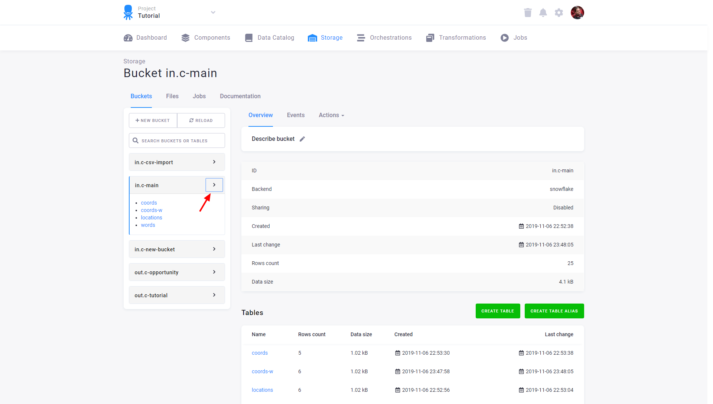

Buckets are containers for tables in Storage. They are further organized into the following two **stages**:

<!-- How-to-type page. Source: the Buckets page on main; body unchanged, checked against it 2026-11-19. Not yet in recipe form. -->

1. **in** — for input data (usually data source connector results)
2. **out** — for processed data (usually results of transformations or applications)

The distinction between the input and output stages is purely conventional differentiation between raw and processed data.
When creating a new bucket, select one of the stages. If the dialog also asks for a [database backend](/storage/#storage-backend-types-and-features), pick one based on its properties.
For information on how to load data into Storage, see the corresponding part of our [tutorial](/getting-started/load/).
<!-- VERIFY(Jordan Burger): the Create Bucket dialog in project 264 (2026-10-20) has only Name and Stage, no backend choice. Does a backend field appear in projects with more than one backend? If not, drop the backend sentence above. -->

## Before you start

- **A Keboola project.** No project yet? [Create or join a project](/getting-started/project/).
- **A project role that can change Storage.** The ReadOnly role cannot import or modify data in Storage: see [User roles](/management/project/users/#user-roles).

## Create a bucket

To create a bucket, click **Create bucket** on the **Storage** page, enter a name, choose the stage, and click **Create bucket** in the dialog:

<video autoplay loop muted playsinline controls poster="/storage/buckets/create-bucket-poster.png" aria-label="The Storage page with the Create bucket button marked, then the Create Bucket dialog with the name my-tutorial-bucket, stage IN, and its Create bucket button marked (an example project: the bucket names, counts and dates vary)">
  <source src="/storage/buckets/create-bucket.mp4" type="video/mp4" />
</video>

**Check:** the **Storage** page lists the new bucket with an **In** or **Out** badge for its stage.

## Open a bucket's details

To review information about an existing bucket, hover over the bucket name and select **Bucket detail**:

**Check:** the bucket detail shows the bucket's **ID**, made of the stage, `c-` and the name, such as `in.c-my-tutorial-bucket`.

Apart from being used for organizing tables, buckets can also be used for [sharing tables](/catalog/).

**Next:** [Files in Storage →](/storage/files/)
