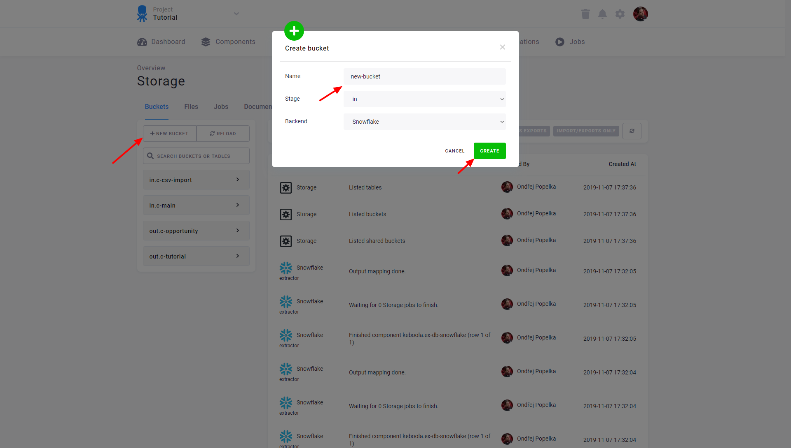

Buckets are containers for tables in Storage. They are further organized into the following two **stages**:

1. **in** — for input data (usually data source connector results)
2. **out** — for processed data (usually results of transformations or applications)

The distinction between the input and output stages is purely conventional differentiation between raw and processed data.
When creating a new bucket, select one of the stages and a suitable [database backend](/storage/#storage-backend-types-and-features) based on its properties.
For information on how to load data into Storage, see the corresponding part of our [tutorial](/getting-started/load/).

To review information about an existing bucket, hover over the bucket name and select **Bucket detail**:

Apart from being used for organizing tables, buckets can also be used for [sharing tables](/catalog/).
