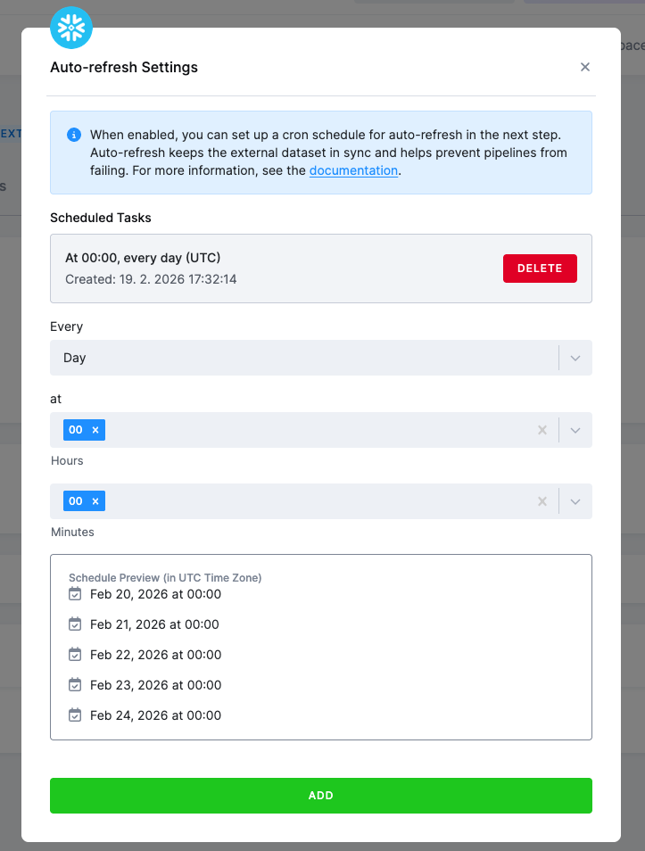

This page shows how to register an [external dataset](/storage/byodb/external-buckets/) and how to refresh, query, share and remove it.

## Creating an External Dataset
An external dataset can be registered in the Storage of a project. Go to **Storage > Register External Dataset**. The dialog will differ based on the 
backend you are using.

### Snowflake
Fill in the **name** of the new bucket, **database** name, and **schema** name. Click **Next Step**. Keboola will then generate a code that you can use to 
grant Keboola correct access to the schema in your Snowflake. Once access has been granted, click **Register Dataset** to start using it.

:::note
**Note:** This set of permissions grants the Keboola service account read-only access to the data.
:::

:::caution
[Sharing data via Snowflake](https://docs.snowflake.com/en/guides-overview-sharing) is currently supported only through [Direct Share](https://docs.snowflake.com/en/guides-overview-sharing#direct-share) and requires granting privileges on objects directly to a share. Learn more in [Secure Data Sharing](/storage/byodb/snowflake-secure-data-sharing/).
:::

### BigQuery
Fill in the **name** of the new dataset and **dataset** name. Click **Next Step**. Keboola will generate a code that you can use to grant Keboola 
correct access to the dataset in BigQuery. Once access has been granted, click **Register Dataset** to start using it.

:::note
**Note:** By adding the Keboola service account as a subscriber, you enable read-only access to the data.
:::

### Using an External Dataset

When you register an external dataset, we analyze the metadata of the objects in it and register all tables and views as tables in the Keboola Storage bucket. 
If you later add additional tables or views, you must manually **refresh** the Storage bucket using the **Refresh** action in the bucket detail to make them 
visible in Keboola. 


#### Auto-Refresh

You can enable **Auto-refresh** for external buckets using a cron scheduler. Auto-refresh ensures that your external dataset remains synced with the source schema and prevents pipelines from failing due to outdated metadata.

To configure Auto-refresh, navigate to the bucket detail and click on the **Auto-Refresh** tab. Here you can set up a cron schedule that determines how often the bucket metadata will be refreshed automatically.




### External Dataset in a Snowflake SQL Transformation
External datasets cannot be used in an input mapping as they are not copied into your transformation 
workspace. You need to reference them in your transformation using a fully qualified name.

In the following example, it is assumed that you've created an external dataset called `users-reporting` that references the `sales_emea` schema in the database 
`REPORTING`. The schema contains a table called `users`. Now you want to create a new table `MQL_USERS` that contains only users sourced from 
marketing-qualified leads. You can do that using the following SQL:

```sql
CREATE TABLE "MQL_USERS" AS SELECT * 
FROM "REPORTING"."sales_emea"."users"
WHERE "source" = 'mql';
```

:::caution
**Note:** The query uses the **fully qualified name** of the table in the `FROM` clause.
:::

### External Dataset in a BigQuery SQL Transformation
For BigQuery, an external dataset is mapped to an actual dataset, `users_reporting` (the name you filled in the dialog), in your project—in this case, project `sapi-9752`. You can reference the contents of the dataset in your SQL transformation using a fully qualified name: 

```sql
CREATE TABLE `MQL_USERS` AS SELECT *
FROM `users_reporting`.`users`
WHERE `source` = "mql";
```

:::caution
**Note:** The dataset name is the name of the bucket you provided in the dialog (`users-reporting`), not the original dataset created in BigQuery 
(`sales_emea`). However, there are no technical limitations; they can have the same name. 
:::

## Sharing an External Dataset
It is possible to share an external dataset using the same process as [any other Storage bucket](/catalog/#enable-sharing). Once the bucket is shared, the refresh operation is only available in the source project (the project where the external dataset was registered). Currently, it is possible to share entire buckets, not specific tables within them.

### Snowflake
Sharing a Snowflake external dataset works out of the box — no additional configuration is required beyond the standard bucket sharing flow.

### BigQuery
Sharing a BigQuery external dataset is supported, but requires additional IAM permissions to be granted on your Analytics Hub listing. This is because BigQuery Analytics Hub does not allow re-sharing a linked (subscribed) dataset — instead, the target project must subscribe directly to your original listing. Keboola handles this automatically, but needs permission to grant subscriber access on your behalf.

To enable sharing, grant one of the following to the Keboola service account on your Analytics Hub listing, in addition to the `roles/analyticshub.subscriber` already required for registration:

**Option 1 — Custom role (recommended, least privilege):**
Create a custom IAM role in your GCP project with exactly these two permissions:
- `analyticshub.listings.getIamPolicy`
- `analyticshub.listings.setIamPolicy`

The scope of this custom role depends on where your external datasets live:
- If all external datasets come from **a single GCP project**, create the custom role at the **project level** and grant it to the Keboola service account on that project.
- If external datasets come from **multiple GCP projects** across your organization, create the custom role at the **organization level** so it can be applied across projects.

**Option 2 — Built-in `roles/analyticshub.listingAdmin` (simpler, broader permissions):**
Grant the built-in `roles/analyticshub.listingAdmin` role to the Keboola service account on your listing. This role includes the required permissions, but also covers additional capabilities (such as updating or deleting the listing) that Keboola does not use.

:::note
**Note:** Sharing permissions can be granted at any time after initial registration, but the registration process navigates you to provide such permissions to enable sharing. If not provided during the registration (e.g. for the previously registered datasets) Keboola detects the change on the next refresh and enables sharing from that point on. Revoking the permission will prevent new shares; projects that are already linked remain unaffected.
:::

:::note
**Note:** To configure the Keboola platform to recognize your custom role, please contact support. A platform-level configuration is required to surface the role name in the registration guide.
:::

## Removing an External Dataset
Removing an external dataset is as simple as removing any other Storage bucket. Simply delete it in the UI or via API. The Storage bucket will be removed from 
the project, but the schema in the database will remain untouched. Any rights that you have granted to Keboola during the registration will be revoked. 

If you wish to remove the schema, you must do so manually in your warehouse. 

---

**Next:** [Snowflake Secure Data Sharing →](/storage/byodb/snowflake-secure-data-sharing/)
