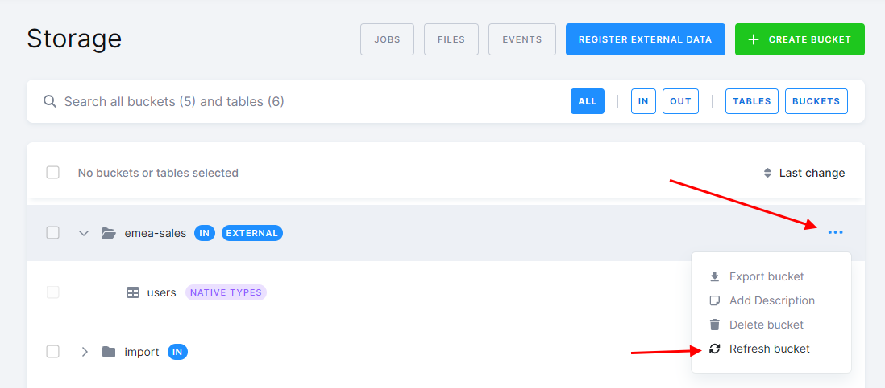
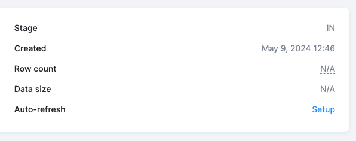

import { Tabs, TabItem } from '@astrojs/starlight/components';

These are the tasks around an [external dataset](/storage/byodb/external-buckets/): register a schema or dataset from your own warehouse, refresh it, query it, share it and remove it. Where Snowflake and BigQuery differ, pick your backend in a tab. The other tab groups on the page switch with it.

{/* How-to-type page. Source: the "Creating", "Using", "Sharing" and "Removing" sections of the External Datasets page as it stood on main before the split. Structure checked 2026-11-19, facts not re-verified. */}

## Register an external dataset

**Goal:** make a schema or dataset of your warehouse available as a read-only bucket in the project.

An external dataset can be registered in the Storage of a project. The dialog will differ based on the backend you are using.

<Tabs syncKey="backend">
  <TabItem label="Snowflake">
    1. Go to **Storage > Register External Data**.
    2. Fill in the **name** of the new bucket, **database** name, and **schema** name. Click **Next Step**.
    3. Keboola then shows `GRANT` statements for your database and schema. Log in to Snowflake (for example, open a worksheet) with a role that can grant `USAGE` on the database and schema and `SELECT` on all and future tables and views in the schema, and run the statements.
    4. Once access has been granted, click **Register Dataset** to start using it.

    {/* Checked 2026-11-20: role and statements from the registration dialog screenshot 3-snflk.png (older dialog; re-check against the current one). */}

    :::note
    **Note:** This set of permissions grants the Keboola service account read-only access to the data.
    :::

    :::caution
    [Sharing data via Snowflake](https://docs.snowflake.com/en/guides-overview-sharing) is currently supported only through [Direct Share](https://docs.snowflake.com/en/guides-overview-sharing#direct-share) and requires granting privileges on objects directly to a share. Learn more in [Secure Data Sharing](/storage/byodb/snowflake-secure-data-sharing/).
    :::
  </TabItem>
  <TabItem label="BigQuery">
    1. Go to **Storage > Register External Data**.
    2. Fill in the **name** of the new dataset and **dataset** name. Click **Next Step**.
    3. Keboola then shows how to share the dataset with it through Analytics Hub. In your GCP project, open **BigQuery → Analytics Hub** (enable the Analytics Hub API if needed). Create an exchange in the same region or multi-region as the Keboola project, using the display name the dialog gives, and add the Keboola service account the dialog shows as a subscriber. In that exchange, create a listing whose shared dataset is the dataset you are registering. Open the listing detail, copy its URL from the browser and paste it into the dialog's **URL** field.
    4. Once access has been granted, click **Register Dataset** to start using it.

    {/* VERIFY(Nikita): name the GCP role the reader needs to create the Analytics Hub exchange and listing. */}

    :::note
    **Note:** By adding the Keboola service account as a subscriber, you enable read-only access to the data.
    :::

    External tables in the dataset work only when they are BigLake tables. See [BigLake tables](/storage/byodb/external-buckets/#biglake-tables).
  </TabItem>
</Tabs>

**Result:** When you register an external dataset, we analyze the metadata of the objects in it and register all tables and views as tables in the Keboola Storage bucket.

## Refresh an external dataset

**Goal:** make tables or views that were added after the registration visible in Keboola.

If you later add additional tables or views, you must manually **refresh** the Storage bucket using the **Refresh** action in the bucket detail to make them visible in Keboola.

1. Open the bucket detail of the external dataset.
2. Use the **Refresh** action.

   

**Result:** The added tables and views are visible in Keboola. For table and column descriptions, see [Using an external dataset](/storage/byodb/external-buckets/#using-an-external-dataset).

## Refresh on a schedule

**Goal:** keep the bucket in sync with the source schema without refreshing it by hand.

You can enable **Auto-refresh** for external buckets using a cron scheduler. Auto-refresh ensures that your external dataset remains synced with the source schema and prevents pipelines from failing due to outdated metadata.

1. To configure Auto-refresh, open the bucket detail and click **Setup** next to *Auto-refresh*.

   

2. In **Auto-refresh Settings**, choose how often under **Every** (for example *Day*) and the time under **at** (**Hours**, **Minutes**). Times are in UTC; **Schedule Preview** lists the next runs. Click **Add**. The schedule appears under **Scheduled Tasks**, where **Delete** removes it.

   

**Result:** The bucket metadata is refreshed automatically on the schedule you set.

## Keep read-only input mapping access to recreated tables

**Goal:** keep the [read-only input mapping](/workspace/#read-only-input-mapping) able to read a table that was deleted and created again in the source schema.

A refresh of the bucket restores the access each time (see [Limitations](/storage/byodb/external-buckets/#limitations)). To permanently resolve this issue, you can manually grant the read-only input mapping role future access to your tables and views:

1. Run these statements in Snowflake:

   ```
   GRANT SELECT ON FUTURE TABLES IN SCHEMA "REPORTING"."sales_schema" TO ROLE KEBOOLA_8_RO;
   GRANT SELECT ON FUTURE VIEWS IN SCHEMA "REPORTING"."sales_schema" TO ROLE KEBOOLA_8_RO;
   GRANT SELECT ON FUTURE EXTERNAL TABLES IN SCHEMA "REPORTING"."sales_schema" TO ROLE KEBOOLA_8_RO;
   ```

2. Replace `"REPORTING"."sales_schema"` with your database and schema, and `KEBOOLA_8_RO` with the read-only role of your project. Ensure the role name follows the pattern `KEBOOLA_<PROJECT_ID>_RO` given in [Read-only access to project storage](/storage/byodb/#read-only-access-to-project-storage) and is suffixed with `_RO`.

   {/* VERIFY(Nikita): the sentence above used to point at "the pattern in the picture", and no picture was on the page. It now gives the pattern from the BYODB page. An unused registration screenshot in this page's figures folder (3-snflk.png) shows a role named KEBOOLA_8. The BYODB page also says Keboola resources are prefixed SAPI_ on the connection.keboola.com stack: check the read-only role name there. */}

**Result:** The read-only role can read tables and views created in the schema later, so a recreated table stays readable.

## Query an external dataset in a SQL transformation

**Goal:** read a table of an external dataset in a transformation.

<Tabs syncKey="backend">
  <TabItem label="Snowflake">
    External datasets can be used in an input mapping (see [Using an external dataset](/storage/byodb/external-buckets/#using-an-external-dataset)). You can also reference them in your transformation by a fully qualified name, as in this example.

    In the following example, it is assumed that you've created an external dataset called `users_reporting` that references the `sales_emea` schema in the database 
    `REPORTING`. The schema contains a table called `users`. Now you want to create a new table `MQL_USERS` that contains only users sourced from 
    marketing-qualified leads. You can do that using the following SQL:

    ```sql
    CREATE TABLE "MQL_USERS" AS SELECT * 
    FROM "REPORTING"."sales_emea"."users"
    WHERE "source" = 'mql';
    ```

    :::caution
    **Note:** The query uses the **fully qualified name** of the table in the `FROM` clause.
    :::
  </TabItem>
  <TabItem label="BigQuery">
    For BigQuery, an external dataset is mapped to an actual dataset, `users_reporting` (the name you filled in the dialog), in your project—in this case, project `sapi-9752`. You can reference the contents of the dataset in your SQL transformation by the dataset name and the table name:

    ```sql
    CREATE TABLE `MQL_USERS` AS SELECT *
    FROM `users_reporting`.`users`
    WHERE `source` = "mql";
    ```

    :::caution
    **Note:** The dataset name is the name of the bucket you provided in the dialog (`users_reporting`), not the original dataset created in BigQuery 
    (`sales_emea`). However, there are no technical limitations; they can have the same name. 
    :::

    {/* Checked 2026-11-20: example uses an underscore-only bucket name, so dataset = bucket name holds; dash-to-underscore conversion is suggested by mcp-server workspace.py, not confirmed for external buckets. */}
  </TabItem>
</Tabs>

**Result:** The transformation creates the table `MQL_USERS` from the rows it reads in the external dataset.

## Share an external dataset

**Goal:** let other projects read the external dataset.

It is possible to share an external dataset using the same process as [any other Storage bucket](/catalog/#enable-sharing).

<Tabs syncKey="backend">
  <TabItem label="Snowflake">
    Sharing a Snowflake external dataset works out of the box — no additional configuration is required beyond the standard bucket sharing flow.
  </TabItem>
  <TabItem label="BigQuery">
    Sharing a BigQuery external dataset is supported, but requires additional IAM permissions to be granted on your Analytics Hub listing. This is because BigQuery Analytics Hub does not allow re-sharing a linked (subscribed) dataset — instead, the target project must subscribe directly to your original listing. Keboola handles this automatically, but needs permission to grant subscriber access on your behalf.

    To enable sharing, grant one of the following to the Keboola service account on your Analytics Hub listing, in addition to the `roles/analyticshub.subscriber` already required for registration:

    **Option 1 — Custom role (recommended, least privilege):**
    Create a custom IAM role in your GCP project with exactly these two permissions:
    - `analyticshub.listings.getIamPolicy`
    - `analyticshub.listings.setIamPolicy`

    The scope of this custom role depends on where your external datasets live:
    - If all external datasets come from **a single GCP project**, create the custom role at the **project level** and grant it to the Keboola service account on that project.
    - If external datasets come from **multiple GCP projects** across your organization, create the custom role at the **organization level** so it can be applied across projects.

    **Option 2 — Built-in `roles/analyticshub.listingAdmin` (simpler, broader permissions):**
    Grant the built-in `roles/analyticshub.listingAdmin` role to the Keboola service account on your listing. This role includes the required permissions, but also covers additional capabilities (such as updating or deleting the listing) that Keboola does not use.

    :::note
    **Note:** Sharing permissions can be granted at any time after initial registration, but the registration process navigates you to provide such permissions to enable sharing. If not provided during the registration (e.g. for the previously registered datasets) Keboola detects the change on the next refresh and enables sharing from that point on. Revoking the permission will prevent new shares; projects that are already linked remain unaffected.
    :::

    :::note
    **Note:** To configure the Keboola platform to recognize your custom role, please contact support. A platform-level configuration is required to surface the role name in the registration guide.
    :::

    {/* VERIFY(Nikita): say what to send support for a custom role (its name, the GCP project or organization) and whether the reader has to wait for support before sharing. */}
  </TabItem>
</Tabs>

**Result:** Once the bucket is shared, the refresh operation is only available in the source project (the project where the external dataset was registered). Currently, it is possible to share entire buckets, not specific tables within them.

## Remove an external dataset

**Goal:** take the external dataset out of the project.

Removing an external dataset is as simple as removing any other Storage bucket.

1. In **Storage**, open the **⋯** menu of the bucket and choose **Delete bucket**, or call the Storage API: `DELETE /v2/storage/buckets/{bucket_id}`.

**Result:** The Storage bucket will be removed from the project, but the schema in the database will remain untouched. Any rights that you have granted to Keboola during the registration will be revoked.

If you wish to remove the schema, you must do so manually in your warehouse.

---

**Next:** [Import a Snowflake share →](/storage/byodb/snowflake-secure-data-sharing/)
