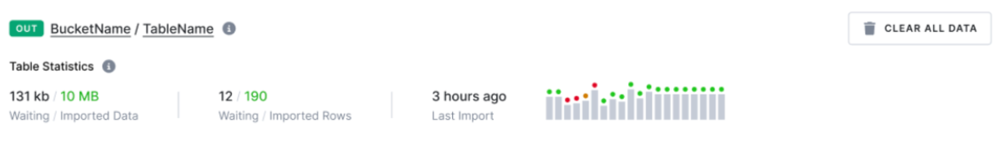

Create a data stream in the app, configure it, and connect the systems that send events to it.

### Create a Data Stream
Follow these steps to create a data stream:

- Navigate to **Storage > Data Streams** and click **Create Data Stream**.
- **Choose a source type** — either **HTTP** (generic webhook) or **OpenTelemetry (OTLP)**.
- **Name the data stream**, e.g., "my-first-data-stream." The name of the table will be filled automatically based on the stream name, but you can change it if needed.
- Once the stream is created, you can **add a description** for better orientation within the project.

### Configure an HTTP Data Stream
#### Data stream URL
For every data stream, a unique "Data Stream URL" is generated. You can use it in your application to send events. This URL cannot be changed.

#### Table statistics
This dashboard shows the status of data waiting for import vs. imported data.

#### Table settings
In your table settings, you can:

- Change the name of the stream.
- Add a column or define your own structure using the PATH or JSONNET template. [Learn more](/storage/data-streams/reference/#template-jsonnet)
- Edit column names (available only if you create a new table within the stream).
- Delete a column (available only if you create a new table within the stream).

:::caution
**Important:** Changing the table's name will create a new table, and the stream will import data into that table.
:::

#### Sample codes for integration
For easier use, we've prepared a few examples of how to send data to a stream using Python, Javascript, and Bash.

#### Import conditions
In this section, you can set a few conditions for importing data. Whichever condition is met first triggers an import into the destination table — you can set the interval, the size of the imported data, or the number of imported records. [Learn more](/storage/data-streams/reference/#conditions)

#### Payload test
Here, you can simulate your payload and test it instantly with a table preview to see how the data will be imported before deploying it into production. The same check is available over the API through the [payload test endpoint](/storage/data-streams/reference/#test-a-payload).

## Delivery Guarantees

Depending on your use case, you may require different delivery guarantees for your stream. Follow the guidelines below to ensure the desired outcome.

### At Most Once

To ensure that no record is delivered twice, make sure the client doesn't retry when sending the records. In this case, it's beneficial to use the setting endpoints to set `"storage.level.local.encoding.sync.wait"` to `false` to increase throughput.

### At Least Once

To ensure that every record is delivered at least once, the client needs to implement retries when sending the records. Also, use the setting endpoints to confirm that `"storage.level.local.encoding.sync.wait"` is set to `true` (default behavior). Note that this setting guarantees that the record is written to the local disk.

## Kafka Integration
To connect Keboola with [Apache Kafka®](https://kafka.apache.org/) and ingest data from Kafka topics via data streams, use the Kafka Connect HTTP Sink Connector
to establish a communication channel between Kafka and Keboola.

The Kafka Connect HTTP Sink Connector acts as a bridge, seamlessly integrating Kafka with Keboola's Data Stream HTTP API. Here's a breakdown of the process:

- Data Consumption: The connector continuously reads data records from one or more Kafka topics.
- Batching: Events can be efficiently grouped based on a predefined maximum size (batch.max.size).
- API Interaction: Data is sent as a POST request in JSON format to Keboola's Data Stream API URL.

**Key Points to Remember:**

- This integration relies on the Kafka Connect HTTP Sink Connector, which requires configuration on the Kafka side.
- Data records from Kafka topics are transformed into strings before being sent to Keboola.
- The target Keboola API URL corresponds to the data stream created in Keboola.
- Only POST HTTP methods are supported for data ingestion.

**Next:** [OpenTelemetry (OTLP) →](/storage/data-streams/opentelemetry/)
