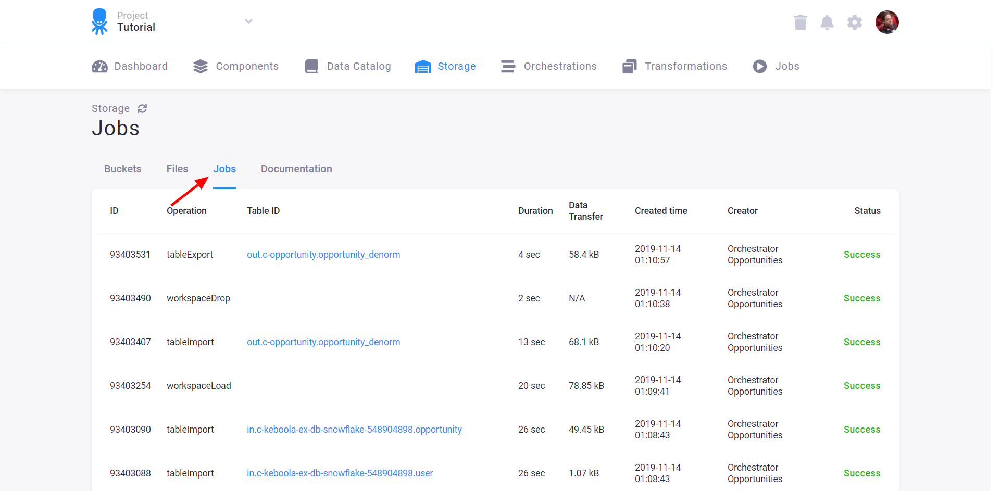

Storage jobs are not to be confused with [component jobs](/management/jobs/). Storage jobs represent a low level view of
all data loaded to and unloaded from the [Table Storage](/storage/tables/). This page shows how to open that view and find the file a job loaded.

<!-- How-to-type page. Source: the former Storage jobs page on main; text carried over and checked against it 2026-11-19. -->

Working with the Storage jobs is rarely necessary
for end-users. We provide this view mainly to maintain complete transparency of what is happening in your project.

:::caution[Only one job writes to a table at a time]
The view of Storage jobs can be useful in very busy projects, or in cases where you see a component [job](/management/jobs/) 
being stuck on the message `Waiting for X Storage jobs to finish.`. There is a core limitation of Storage Tables — only one job may 
write to a table at a time. So when you see jobs taking longer than usual or waiting for Storage Jobs to finish, you might want to 
check the Storage Jobs to understand what is happening. You can see how many jobs are processing if they are writing to same 
tables, and then, for example, adjust flow triggers to avoid concurrency issues.
:::

## Open the Storage jobs view

**Goal:** the list of every load into and unload from your tables, and the detail of one job.

Keboola records all data uploaded into your project.

1. Go to **Storage** and click the **Jobs** tab:
   <!-- VERIFY(Nikita): the screenshots on this page show an older UI. A newer screenshot on the Files page names the tab "Storage Jobs". Check the current tab name. -->

   

2. When you click an **importTable** job, you'll see the Storage job detail:
   <!-- VERIFY(Nikita): the screenshots show the operation as "tableImport", not "importTable". Check which name the UI uses. -->

   

**Result:** the job detail is open, with the status, times, operation, table and file of the job.

## Find the file a job loaded

**Goal:** the data file behind a table import, to download it, import it into other tables, or revert to an older table version.

1. Open the detail of the import job, as described above.
2. Clicking **File ID** will take you to the **Files** section in **Storage**, where all data pushed into your Keboola project is stored.

   

**Result:** the file is listed in [Files](/storage/files/). You can download the data and import it into other tables, or you can revert to an older table version.

A comprehensive [video guide](https://www.youtube.com/watch?v=qIkSgzVmJa0) on this subject is available on our YouTube channel.

**Next:** [Bucket exposure →](/storage/bucket-exposure/)
