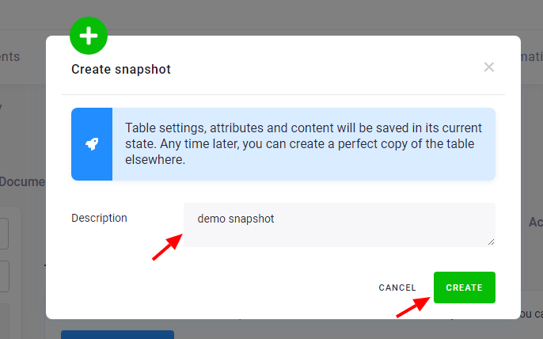

There are two methods available for backing up and restoring data: time travel restore, available for the Snowflake and BigQuery backends, and snapshots, available for all backends. This page shows both. Each starts from the table detail of the table you want to restore or copy.

<!-- How-to-type page. Source: the former backups page on main; text carried over and checked against it 2026-11-19. Tab, menu and button names in the steps were checked in the UI of project 264 on 2026-11-20; the screenshots date from 2019. -->

<!-- TODO(human-review, Nikita): this screenshot shows the "Snapshot and Restore" tab, which no longer exists (checked 2026-11-20 in project 264: the table detail has a Snapshots tab, and time travel is under ⋮ → Restore). Replace or drop it. -->

## Before you start

- **The table you want to restore or copy**, and a bucket for the new table.
- **A project role that can change data in Storage.** The ReadOnly role can't; see [User roles](/management/project/users/#user-roles).
- **For time travel only:** a project on Snowflake or BigQuery that is not a [Pay As You Go](/management/payg-project/) project. Snapshots work on every backend, but not on external buckets.

## Restore a table with time travel

**Goal:** a new table that is an exact replica of an existing table as it was at a point in time you choose.

Projects with a Snowflake or BigQuery backend can create an exact replica of a table at any point in time up to the [limit set](/management/project/) for the project.
<!-- VERIFY(Nikita, Storage team): how far back time travel reaches differs by backend. On Snowflake it follows the project's data-retention setting; on BigQuery the ceiling is the dataset's own time-travel window, which BigQuery caps at 7 days (2-7 configurable). Confirm what a BigQuery project is actually allowed before documenting a number here. -->

1. Open the table detail, click **⋮** (**More actions**, top right) and select **Restore**. The dialog
   **Restore Table Using Time Travel** opens.
   <!-- Checked 2026-11-20 in the UI of project 264: time travel is no longer a tab; ⋮ → Restore opens the dialog Restore Table Using Time Travel with Replication Date*, Table Name* and Destination Bucket*, and the button Create table. The dialog notes that the limit is the project's data retention and that data types must be re-created. -->
2. In **Replication Date**, pick the time point (format `YYYY-MM-DDTHH:mm`). The table will be replicated as it was at that time point.
3. Check the **Table Name** (prefilled as `<table>_<YYYYMMDDHHMMSS>`) and select the **Destination Bucket** for the new table.
4. Click **Create table**.

<!-- TODO(human-review, Nikita): screenshot from 2019; replace it with the current Restore Table Using Time Travel dialog. -->

**Result:** a new table in the bucket you selected, with the data as it was at the selected time point. Data types are
not carried over: re-create them on the new table.

**Check:** the destination bucket lists the new table under the name you set in **Table Name**.

:::caution[The restore time uses your current time zone]
The time input is interpreted as the wall clock in your current local timezone.

There are some edge cases. When daylight saving time (DST) starts or finishes between the restore time and the current time, then the restore time is based on the current time for your timezone.

**Example:**

You live in Prague (timezone Europe/Prague). You want to restore a table from `midnight of 2023-03-23` (that is `2023-03-23 00:00 +0100` because you were not using DST on that date), and 
the current local time is `2023-03-27 00:00 +0200` (because you are now using DST). If you input the restore time as `03/23/2023 00:00`, that will be interpreted in the current timezone 
as `2023-03-23 00:00 +0200`, which is an hour earlier than you intended. To fix this, you need to take account of the change to DST and add an hour to the restore time to give `03/23/2023 01:00`. 
That will be correctly interpreted as `2023-03-23 01:00 +0200`, which is equivalent to `2023-03-23 00:00 +0100`, the time you want to restore from.
:::

## Copy a table with a snapshot

**Goal:** a copy of a table's contents, taken now, that you can turn into a new table right away or later.

To physically copy a table, utilize the **Create Snapshot** feature. This feature creates a copy of the table contents at the time the snapshot is created.
From it you can create a new table, right away or later; a snapshot does not restore the original table in place.
<!-- Checked 2026-11-20: Storage API creates a table from a snapshot (tables-async with snapshotId); no in-place restore endpoint exists. Live in project 264: creating a table from a snapshot under the source table's name fails ("already has the same display name"); under a new name it succeeds. -->

Table snapshots are useful when **experimenting** with data source connectors and transformations, or when **refactoring** your project. You can create a copy of your output table, conduct experiments, 
and then compare the new output table with the original to ensure your output remains consistent.
To rename a table, change its display name ([Update a table](https://api.keboola.com/?service=storage#put-/v2/storage/branch/-branchId-/tables/-tableId-)); its table ID stays the same.
<!-- Checked 2026-11-20: Storage API renames a table through its display name, the only updatable table property (OpenAPI TableUpdateRequest). UI control not checked. -->

1. Open the table detail, click **⋮** (**More actions**, top right) and select **Create snapshot**.
2. In the **Create Snapshot** dialog, optionally enter a **Description**, and click **Create snapshot**.
   <!-- Checked 2026-11-20 in the UI of project 264: ⋮ → Create snapshot → dialog Create Snapshot with Description (optional) → Create snapshot. The Snapshots tab is a list only (columns Snapshot / Created; empty state "No snapshots created yet"). -->

   

3. To create a table from a snapshot, open the **Snapshots** tab of the table detail and, in the snapshot's row, click **Restore** (the curved-arrow icon). In the **Create Table from Snapshot** dialog, select the **Destination Bucket**, check the **Table Name** (prefilled as `<table>_<snapshot ID>`) and click **Create table**. New tables can be created from any snapshot.
   <!-- Checked 2026-11-20 in the UI of project 264 on a temporary table: the Snapshots row has the icons Restore (curved arrow) and Delete (bin); Restore opens Create Table from Snapshot <ID> ("Restores a table from this snapshot.") with Destination Bucket*, Table Name* (default <table>_<snapshot ID>) and Create table, closed with ×. -->
   <!-- TODO(human-review, Nikita): both screenshots in these steps date from 2019; replace them with the current ⋮ → Create snapshot dialog and the Snapshots tab. -->

   

**Result:** the snapshot is in the list on the **Snapshots** tab, and a table created from it holds the contents the table had when the snapshot was taken.

**Check:** the **Snapshots** tab lists the snapshot with its creation time, and the destination bucket lists the table `<table>_<snapshot ID>` (or the name you set).

**Next:** [Buckets →](/storage/buckets/)
