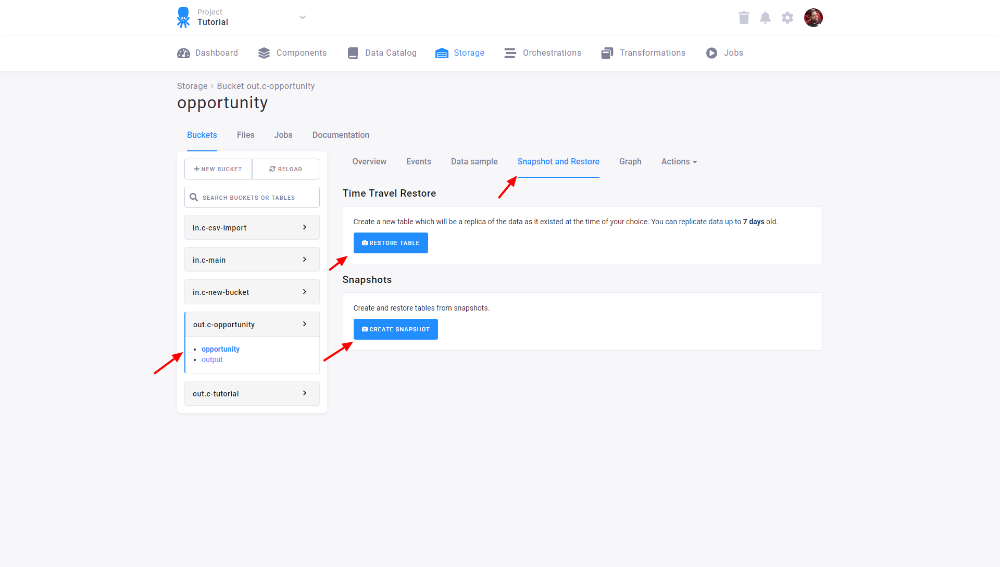
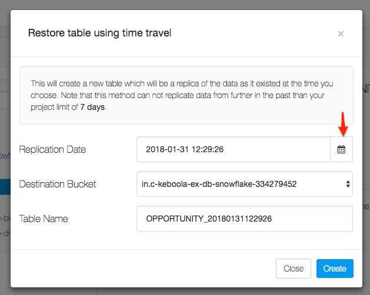
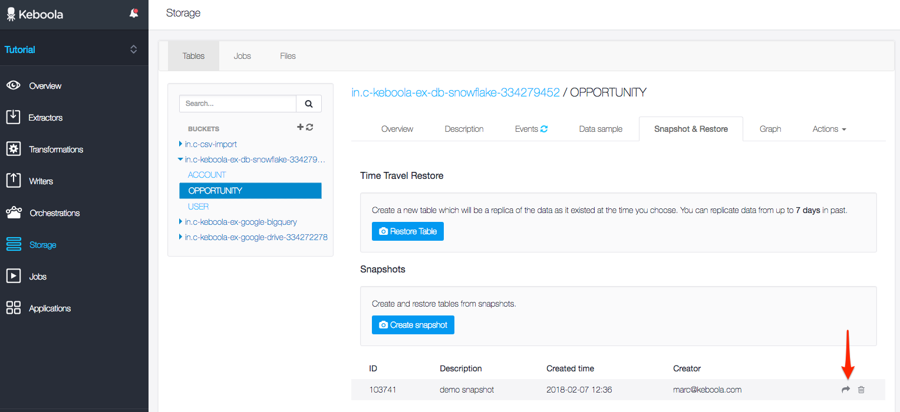

There are two methods available for backing up and restoring data: time travel restore, available only for the Snowflake backend, and snapshots, available for all backends. This page shows both. Each starts from the table detail of the table you want to restore or copy.

<!-- How-to-type page. Source: the former backups page on main; text carried over and checked against it 2026-11-19. Tab and button names in the steps are read from the screenshots, which date from 2019. -->

## Restore a table with time travel

**Goal:** a new table that is an exact replica of an existing table as it was at a point in time you choose.

Every project with a Snowflake backend can create an exact replica of a table at any point in time up to the [limit set](/management/project/) for the project.

1. Open the table detail, go to the **Snapshot and Restore** tab and, under **Time Travel Restore**, click **Restore table**.
   <!-- VERIFY(Nikita): the tab and button names in steps 1 and 4 come from the 2019 screenshots. Check them in the current UI. -->
2. Use the calendar to select a time point. The table will be replicated as it was at that time point.
3. Select the bucket to use for the newly created table, and give it a name.
4. Click **Create**.

**Result:** a new table in the bucket you selected, with the data as it was at the selected time point.

:::caution[The restore time uses your current time zone]
The time input is interpreted as the wall clock in your current local timezone.

There are some edge cases. When daylight saving time (DST) starts or finishes between the restore time and the current time, then the restore time is based on the current time for your timezone.

**Example:**

You live in Prague (timezone Europe/Prague). You want to restore a table from `midnight of 2023-03-23` (that is `2023-03-23 00:00 +0100` because you were not using DST on that date), and 
the current local time is `2023-03-27 00:00 +0200` (because you are now using DST). If you input the restore time as `03/23/2023 00:00`, that will be interpreted in the current timezone 
as `2023-03-23 00:00 +0200`, which is an hour earlier than you intended. To fix this, you need to take account of the change to DST and add an hour to the restore time to give `03/23/2023 01:00`. 
That will be correctly interpreted as `2023-03-23 01:00 +0200`, which is equivalent to `2023-03-23 00:00 +0100`, the time you want to restore from.
:::

## Copy a table with a snapshot

**Goal:** a copy of a table's contents, taken now, that you can turn into a new table right away or later.

To physically copy a table, utilize the **Create Snapshot** feature. This feature creates a copy of the table contents at the time the snapshot is created.
From it you can create a new table, right away or later; a snapshot does not restore the original table in place.
<!-- Checked 2026-11-20: Storage API creates a table from a snapshot (tables-async with snapshotId); no in-place restore endpoint exists. Live in project 264: creating a table from a snapshot under the source table's name fails ("already has the same display name"); under a new name it succeeds. -->

Table snapshots are useful when **experimenting** with data source connectors and transformations, or when **refactoring** your project. You can create a copy of your output table, conduct experiments, 
and then compare the new output table with the original to ensure your output remains consistent.
To rename a table, change its display name ([Update a table](https://api.keboola.com/?service=storage#put-/v2/storage/branch/-branchId-/tables/-tableId-)); its table ID stays the same.
<!-- Checked 2026-11-20: Storage API renames a table through its display name, the only updatable table property (OpenAPI TableUpdateRequest). UI control not checked. -->

1. Open the table detail, go to the **Snapshot and Restore** tab and, under **Snapshots**, click **Create snapshot**.
   <!-- VERIFY(Nikita): the tab, button and icon names in steps 1 to 3 come from the 2019 screenshots. Check them in the current UI. -->
2. Enter a description and click **Create**.

   

3. To create a table from a snapshot, find it in the list of snapshots on the same tab and click its restore icon. New tables can be created from any snapshot.

   

**Result:** the snapshot is in the list on the **Snapshot and Restore** tab, and a table created from it holds the contents the table had when the snapshot was taken.

**Next:** [Buckets →](/storage/buckets/)
