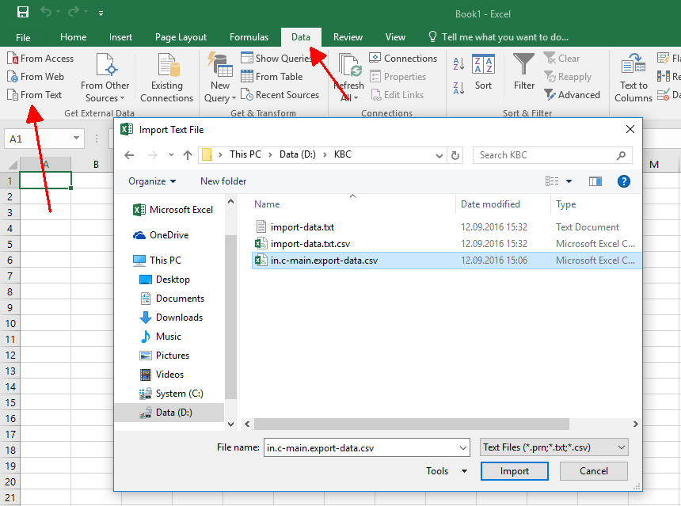

Two tasks for moving data between Microsoft Excel and Storage. The format Storage accepts and the format it produces are listed in [CSV files](/storage/tables/csv-files/).

<!-- How-to-type page. Source: the Excel sections of the former CSV files page on main; text carried over and checked against it 2026-11-19. The Excel and Notepad steps were not re-run. -->

<!-- VERIFY(Nikita): both tasks describe an older Excel on Windows. Current Excel can save as "CSV UTF-8 (Comma delimited)" and imports with Data > From Text/CSV. The old import wizard sets the encoding in a "File origin" field, where this page says "Unicode UTF-8". Check whether the Notepad conversion and the import wizard steps should be replaced. -->

## Before you start

- **Microsoft Excel on Windows.** The export task also uses Windows Notepad.
- **To load a sheet:** a [bucket](/storage/buckets/) for the new table, and a project role that can change data in Storage (not ReadOnly; see [User roles](/management/project/users/#user-roles)).
- **To open a table in Excel:** the table exported from Storage with the **CSV** file format (the export dialog defaults to GZIP); see [Export a table as one file](/storage/files/#export-a-table-as-one-file).

## Export an Excel sheet as a file for Storage

**Goal:** a UTF-8 file made from an Excel sheet that Storage imports correctly.

Because Microsoft Excel does not support UTF-8 encoding very well, it is a bit tricky to
export data correctly. There are a
[number of options](https://stackoverflow.com/questions/4221176/excel-to-csv-with-utf8-encoding),
but without using any non-standard Windows tools, the quickest is this:

1. Save the Excel sheet as `Unicode Text (*.txt)` format:

   

   This will produce a tab-delimited file in UTF-16 encoding, which you can convert in Windows Notepad.

2. Open the file in Notepad and, without making any modifications, save it with `UTF-8` encoding (and .csv extension):

   

3. Import the resulting file into Keboola Storage as a tab-delimited file: open the bucket, click **Add Table**, and on
   the **Upload CSV File** tab select the file under **CSV file** (drag and drop or **Select File**). Enter a
   **Table Name**, replace the **Delimiter** (`,` by default) with a tab, and click **Create table**.
   <!-- Checked 2026-11-20 in the UI of project 264: bucket → Add Table → dialog Create New Table in Bucket … → tab Upload CSV File with CSV file* (drag and drop or Select File, max 2 GB), Table Name*, Delimiter* (default ","), Enclosure (default '"'), Primary Key (optional) → Create table. The dialog notes that uploaded tables are non-typed; for a typed table, use the Create New Table tab first. Not checked: how a tab is typed into the Delimiter field. -->

   

**Result:** the sheet is in Storage as a table, loaded from a UTF-8 file with the tab as its delimiter.

**Check:** the new table is in the bucket, with the sheet's columns, and its data shows accented and other non-ASCII characters as they were in Excel.

*Note: as long as your data does not contain any non-[ASCII](https://en.wikipedia.org/wiki/ASCII#Character_set) characters, you can simply save them as CSV.*

## Open a CSV file from Storage in Excel

**Goal:** a table exported from Storage, open in an Excel workbook.

The easiest way to import the CSV file exported from Keboola into Microsoft Excel is this:

1. Start Excel and open a **blank workbook**.
2. Use the **Data** -- **From Text** function and select the exported file:

   

3. An import wizard will start. On its first screen, select the **delimited** file and **Unicode UTF-8** encoding:

   

4. On the next screen, make sure that *only* the **comma** delimiter is selected:

   

**Check:** the exported table is in the workbook, one CSV column per Excel column, and non-ASCII characters look as they do in Storage.

However, using this method, Excel is not able to import new lines contained in table cells.
If you need to do that, you have to use a more [complicated approach](https://stackoverflow.com/questions/2668678/importing-csv-with-line-breaks-in-excel-2007).

**Next:** [Back up and restore tables →](/storage/tables/backups/)
