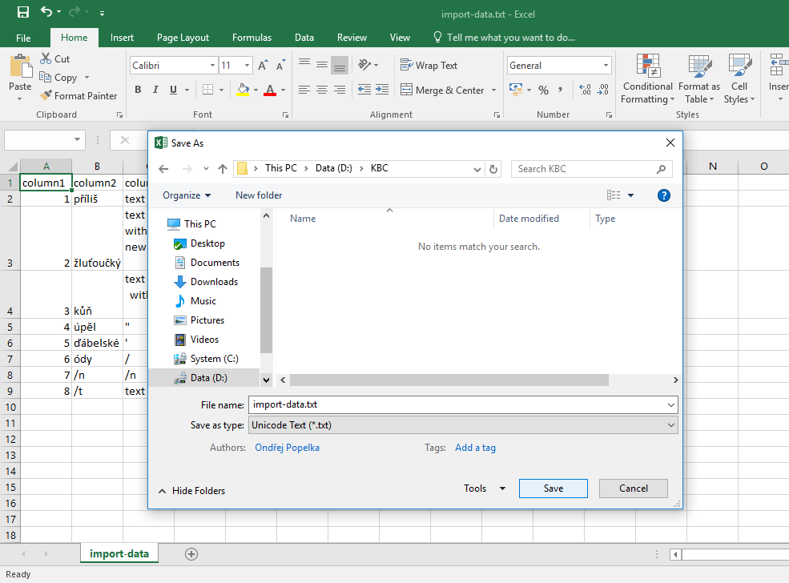
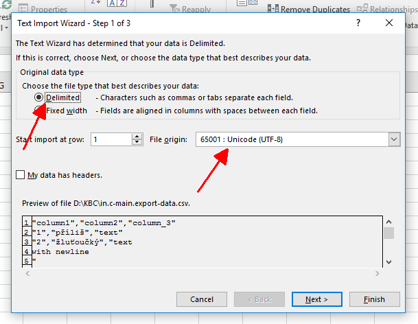
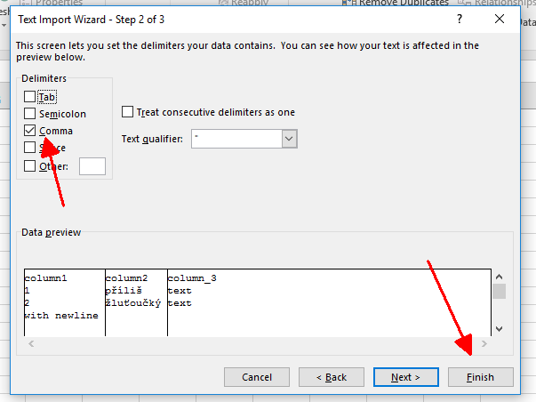

How to move data between Microsoft Excel and Storage in the [CSV format](/storage/tables/csv-files/) that Storage uses.

## Exporting from Microsoft Excel
Because Microsoft Excel does not support UTF-8 encoding very well, it is a bit tricky to
export data correctly. There are a
[number of options](https://stackoverflow.com/questions/4221176/excel-to-csv-with-utf8-encoding),
but without using any non-standard Windows tools, the quickest is to save the Excel sheet as `Unicode Text (*.txt)`
format:

This will produce a tab-delimited file in UTF-16 encoding, which you can convert in Windows
Notepad. Simply open the file, and without making any modifications, save it with `UTF-8` encoding (and .csv extension):

The resulting file `import-data.txt.csv` can now be imported into Keboola Storage as a tab delimited file.

*Note: as long as your data does not contain any non-[ASCII](https://en.wikipedia.org/wiki/ASCII#Character_set) characters, you can simply save them as CSV.*

## Opening in Microsoft Excel
The easiest way to import the CSV file exported from Keboola into Microsoft Excel is by starting Excel and opening 
a **blank workbook**. Then use the **Data** -- **From Text** function and select the exported file:

An import wizard will start. On its first screen, select the **delimited** file and **Unicode UTF-8** encoding:

On the next screen, make sure that *only* the **comma** delimiter is selected:

However, using this method, Excel is not able to import new lines contained in table cells. 
If you need to do that, you have to use a more [complicated approach](https://stackoverflow.com/questions/2668678/importing-csv-with-line-breaks-in-excel-2007).

**Next:** [Backups and restorations →](/storage/tables/backups/)
