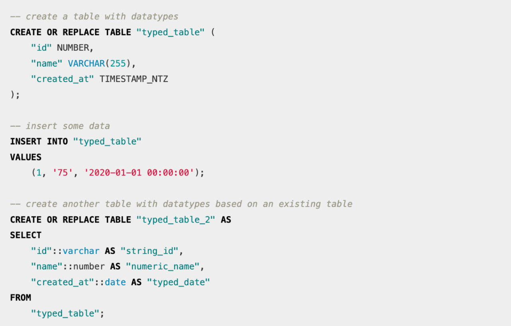

The **Native Data Types** feature streamlines the process of **propagating data types** from the source to the storage. With Keboola Native Data Types, the system automatically maintains data types throughout the pipeline, eliminating the need for manual intervention and reducing errors in data processing. 

For example, when a user imports a large dataset with predefined data types, such as NUMERIC, BOOLEAN, and DATE, these types are preserved automatically. Without Native Data Types, the data would have been imported as VARCHAR, requiring the user to manually update the types in transformation. 

Non-typed tables without native data types are labeled in the UI with a badge: **non-typed**.

## Key Benefits
These are the key benefits of using the Native Data Types feature:
- **Automatic Data Type Preservation:** Data types from the source are automatically respected, reducing the need for manual adjustments in Storage.
- **Faster Data Handling:** Native data types enable more efficient data manipulation, as well as faster loading and unloading, improving overall performance.
- **Simplified Transformations:** Read-only data access eliminates the need for casting, making data operations smoother and more streamlined.
- **Flexible Configurations:** Users can decide whether data types should be automatically fetched for each configuration when creating a table.
- **Improved Workspace Loading:** Loading data into a workspace is significantly faster than loading into a table without native data types, eliminating the need for additional casting.
- **Typed Columns in Workspaces:** Tables **accessed in a workspace** via the [read-only input mapping](/workspace/#read-only-input-mapping) already have typed columns, ensuring seamless data handling.

## Current Drawbacks
Using the Native Data Types feature also has its drawbacks:
- The data type of a column in a typed table cannot be changed after creation. To change a type, you must create a new column or recreate the table. See [How to Change Column Types](/storage/tables/data-types/#changing-types-of-existing-typed-columns). Some other alterations, such as increasing the length or precision of a column, are possible; see [Changing Column Definitions](#changing-column-definitions).
- Keboola does not perform any type conversion during data loading. Your data must exactly match the column type defined in the table within Storage.
- Loading data with incompatible types will result in a failure.

## How It Works
By default, all new tables are created as typed tables if the component supports this feature. Non-typed tables are labeled in the Storage UI with the label NON-TYPED. 

You can configure the data type behavior in the UI component configuration settings. If the component supports this feature, you will see the option **Automatic data types** in the right menu, which can be toggled ON and OFF. 
- **When enabled:** The component creates a typed table that respects the data types from the source (e.g., DATETIME, BOOLEAN). 
- **When disabled:** A typed table is created with all columns as VARCHAR, and data types are stored as metadata.
  
In transformations, this option is not available. Instead, you define the data types in your query (if you need the table to be typed). If no types are defined, the table will default to storing data in VARCHAR format.

**Important:** Existing tables will not be affected by this feature. Also, if you do not see the **Automatic data types** option in the sidebar, it means the component does not support this feature.

### How to Create a Typed Table
The Native Data Types feature allows tables to be created with data types that match the original source or storage backend. Here’s how you can create typed tables:
- **Manually via API**  
You can manually create typed tables using the [tables-definition endpoint](https://keboola.docs.apiary.io/#reference/tables/create-table-definition/create-new-table-definition). Ensure that the data types align with the storage backend (e.g., Snowflake, BigQuery) used in your project. Alternatively, [base types](/storage/tables/data-types/#base-types) can be used for compatibility.
- **Using a Component**  
Extractors and transformations that match the storage backend (e.g., Snowflake SQL transformation on a Snowflake storage backend) will automatically create typed tables in Storage:
  - **Matching Storage Backend:** Database extractors and transformations create storage tables using the same data types as the backend.
  - **Mismatching Storage Backend:** Extractors use base types to ensure compatibility. [Learn more.](/storage/tables/data-types/#base-types)

:::caution
**Important:** When a table is created, it defaults to the lengths and precisions specific to the Storage backend. For instance, in Snowflake, the NUMBER base type defaults to NUMBER(38,9), which might differ from the source database column type, such as NUMBER(10,2). To avoid this limitation, follow the steps below.
:::

To avoid the limitation:
- Manually create the table in advance using the [Table Definition API](https://keboola.docs.apiary.io/#reference/tables/create-table-definition/create-new-table-definition), specifying the correct lengths and precisions.
- Subsequent jobs writing data to this table will respect your defined schema as long as it matches the expected structure.
- Be cautious when dropping and recreating tables. If a job creates a table, it will default to the base type with backend-specific defaults, which might not align with your source.

**Example:**  
To ensure typed tables are imported correctly into Storage, define your table in a Snowflake SQL transformation, adhering to the desired schema and data types:

## Incremental Loading
The behavior of incremental loading differs between **typed** and **non-typed tables**:

- **Typed tables:** Only the columns in the table's **primary key** are compared to detect changes.
- **Non-typed tables:** The entire row is compared, and rows are updated if **any value** has changed.

For more information, refer to our documentation on [incremental loading](/storage/tables/incremental-loading/#difference-between-tables-with-native-datatypes-and-string-tables).

**Next:** [Data types reference →](/storage/tables/data-types/reference/)
