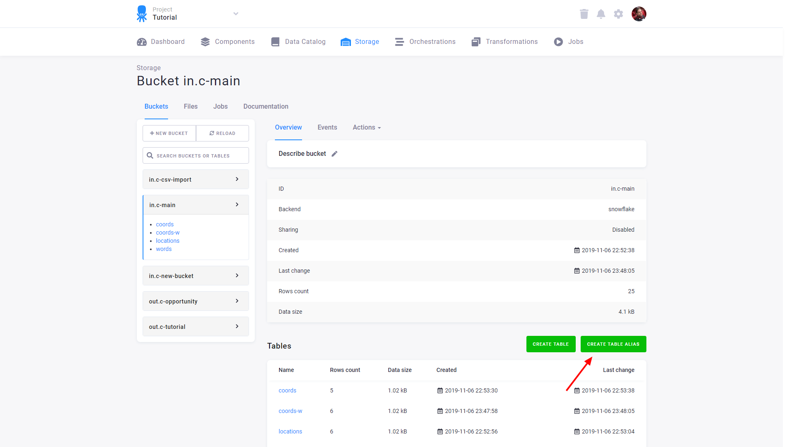
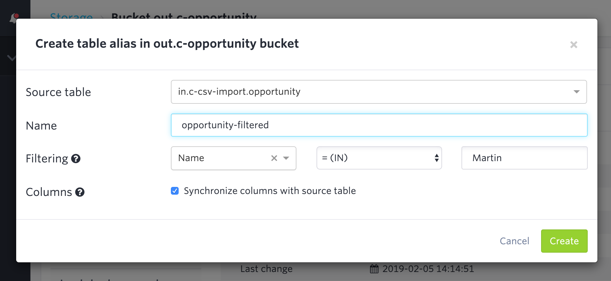
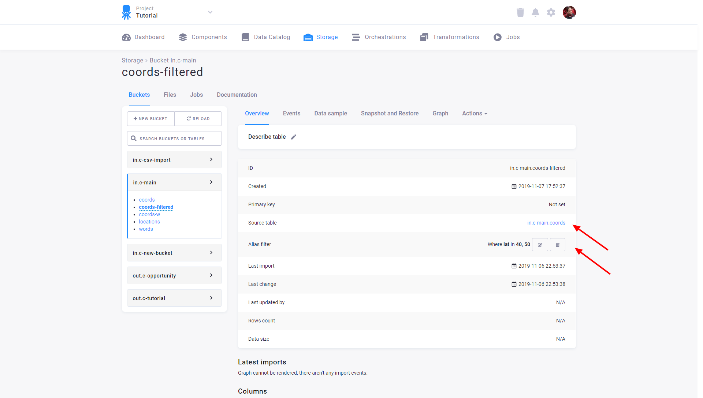
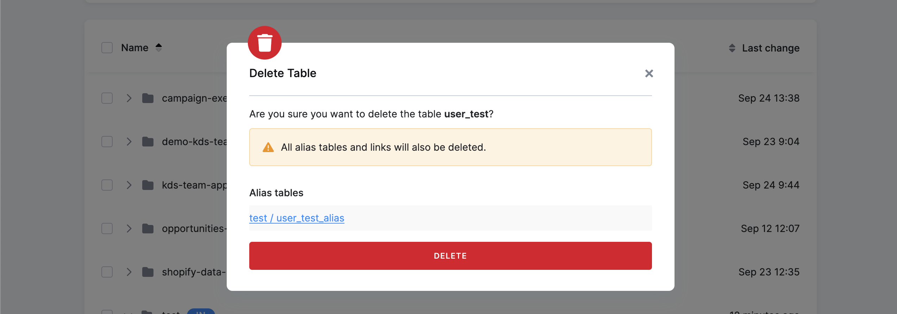

The *Table Storage* for your project is available under the **Tables** tab in the Storage section.
All data tables are organized into [buckets](/storage/buckets/) that can also be
used to [share tables](/catalog/) between projects.

The actual data tables and the buckets are created primarily by Keboola components (data source connectors, transformations,
and applications), or they are imported from CSV files. If you want to import data into an already
**existing table**, the imported table must contain all the columns of the existing table, even if the existing
table is empty. If any columns are missing, you will receive an error message similar to the following:

    Some columns are missing in the CSV file. Missing columns: lat,long. Expected columns: lat,long.
    Please check if the expected "," delimiter is used in the CSV file.

The imported file **may** also contain additional columns not present in the existing
table. In that case, the columns from the imported table will be added to the existing table.

Table and column names can contain only alphanumeric characters. Dash and 
underscores are allowed. Column names must not start or end with dash `-` or underscore 
character `_`.

When you select a table from any bucket in Storage, detailed information about the table will be displayed
at the top of the screen. This is what we refer to as the **table detail** throughout our documentation.

## Aliases
Apart from actual tables, it is also possible to create aliases. They behave similarly to 
[database views](https://en.wikipedia.org/wiki/View_(SQL)).

An alias does not contain any actual data; it is simply a link to some already existing data.
Therefore, an alias cannot be written to, and its size does not count toward your project quota.

Alias tables are automatically materialized as physical database VIEWs. This makes them fully accessible in workspaces and 
transformations via [read-only storage access](/transformations/mappings/#read-only-input-mapping) — no input mapping configuration is required. 
Filtered aliases are also supported; the filter condition is enforced as a `WHERE` clause in the VIEW. 
In [linked buckets](/catalog/), alias VIEWs from the source project are automatically mirrored to the destination project, 
making them immediately queryable there as well.

To create an alias table, go to the table detail, click the three dots on the right side of the screen, and select the 'Create alias table' option.

An alias table can be filtered by a simple condition.

The table detail of an alias table contains additional information, including a reference to the source table from which it was created and any filters applied to the alias. Note that you can adjust the alias filters even after the alias table has been created.

When attempting to delete a table with alias tables elsewhere in Storage, you will be prompted with a notification as part of the deletion process. The notification will detail the aliases (including links) connected to the table. You must confirm that you understand the aliases will be deleted as well before proceeding.

By default, alias columns are automatically synchronized with the source table. Columns added to the source
table will be added to the alias automatically.
You can prevent this by disabling *Synchronize columns with source table*.

Aliases with automatically synchronized columns and without a filter can be chained.

## Metadata
Each [Table Storage](/storage/) object (bucket, table, column) has an associated key-value
store. This can be used to store arbitrary metadata (information about the data itself). Apart from
arbitrary user-defined metadata, there is also some information stored automatically. For example,
each bucket and table has information about which configuration of which component created them.
One important use case of metadata is [Column Data Types](/storage/tables/data-types/).
