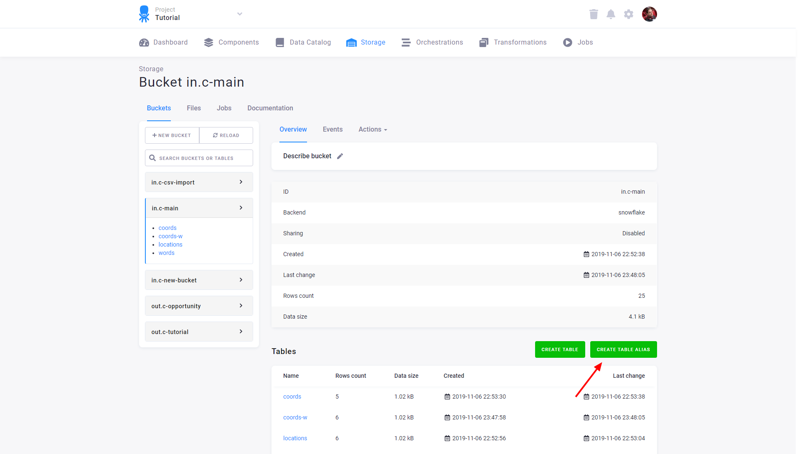
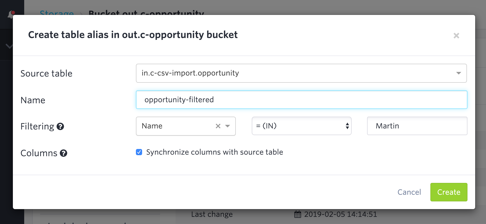
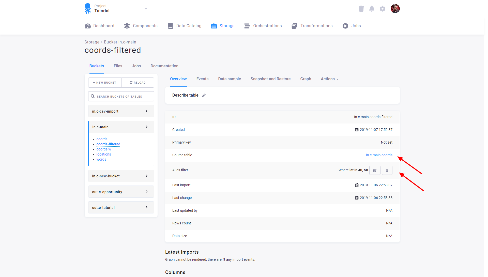
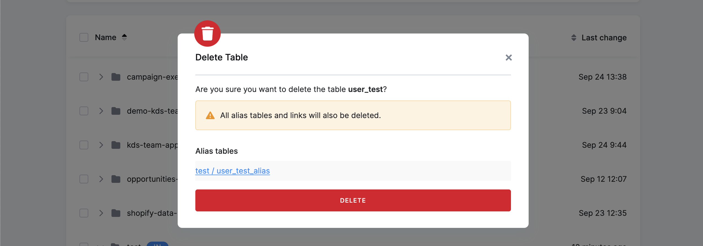
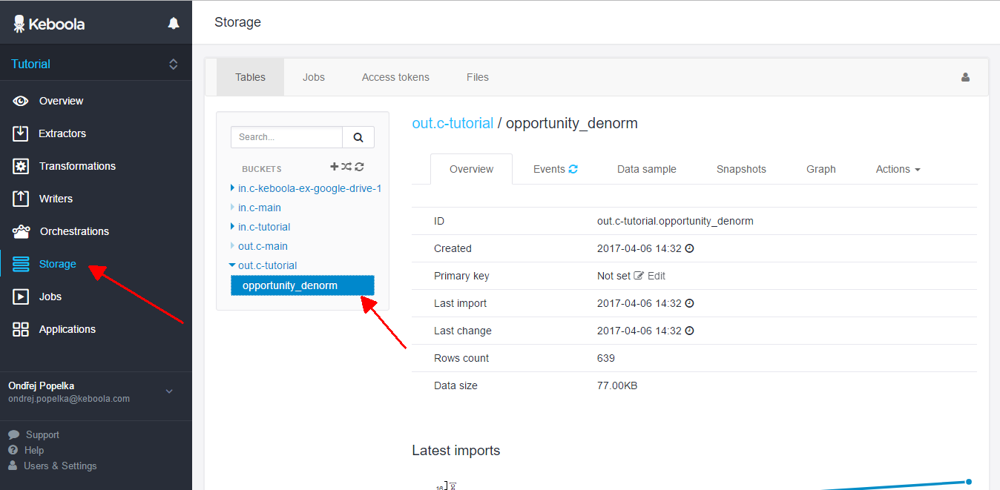
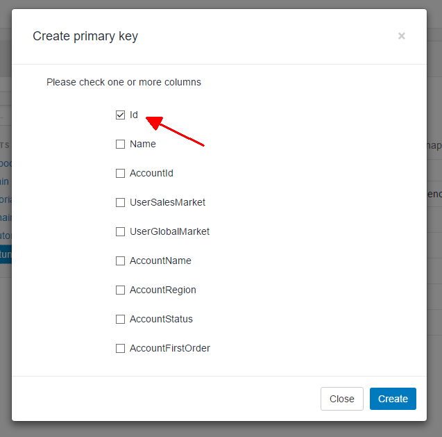
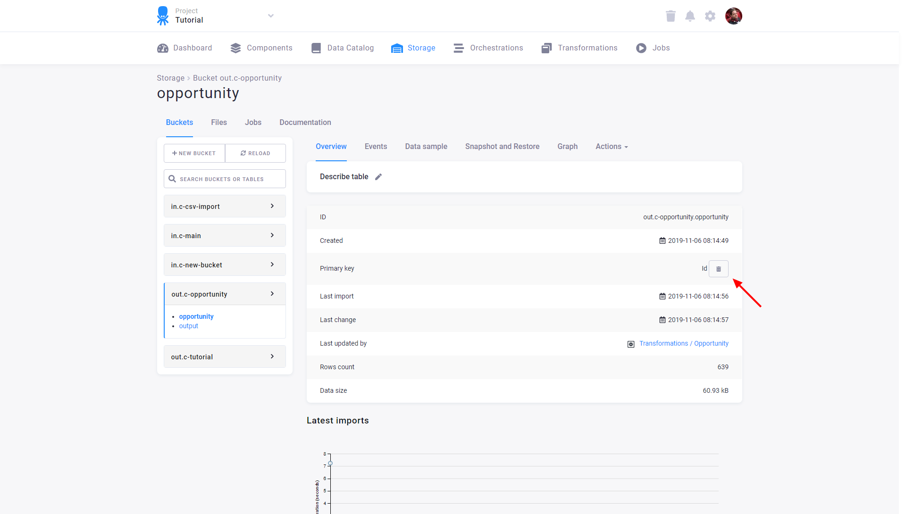

Step-by-step tasks for an existing Storage table, all from its table detail. What tables, aliases and primary keys
are is explained in [Tables in Storage](/storage/tables/) and
[Primary keys and incremental loading](/storage/tables/incremental-loading/).

<!-- How-to-type page. Split from the former single tables page (PRDCT-486). The Storage tab and Delete rows labels were checked live in #1010; the rest is carried over from main 2026-11-12. -->

Every task starts the same way: open **Storage → Tables & Buckets**, open the bucket, and select the table. Its
**table detail** opens at the top of the screen, with a three-dots menu on the right.

## Create an alias table

**Goal:** a read-only view of an existing table, optionally filtered, that does not count toward your project quota.

1. Open the table (**Storage → Tables & Buckets** → bucket → table). In the table detail, click the three dots on the right side of the screen and select **Create alias table**.

   

2. Optionally, filter the alias by a simple condition.

   

**Result:** the table detail of the alias contains a reference to the source table and the filters applied. You can
adjust the alias filters even after the alias table has been created.

:::note
When you later delete a table that has aliases elsewhere in Storage, the deletion dialog lists the aliases (with
links). You must confirm that you understand the aliases will be deleted as well before proceeding.

:::

## Set or remove a primary key

**Goal:** a primary key on one or more columns, so loads deduplicate rows and incremental loads update existing rows.

A primary key can also come from the [output mapping](/transformations/mappings/output/) of a transformation
or application; the two must match. A column that already contains duplicates can't become a primary key. Both
errors are described in [Primary keys](/storage/tables/incremental-loading/#primary-keys).

1. Open the table (**Storage → Tables & Buckets** → bucket → table). In the table detail, start creating the primary key:

   

2. Select the columns you wish to add to the primary key:

   

To remove an existing primary key, click the **bin** icon:

**Result:** the table has the new primary key, or none. Be aware that creating or removing the primary key can take
some time on large tables.

## Truncate a table

**Goal:** an empty table that keeps its schema.

Truncating removes all records from a table while preserving its schema (column structure and metadata). Primary
keys and metadata remain without change. It is highly efficient especially when replacing an entire dataset. Use it
for:
- Replacing data completely (e.g., daily refresh of customer records).
- Ensuring clean data ingestion without duplication.
- Automating scheduled table resets (e.g., overwriting temporary datasets).

1. Open the table (**Storage → Tables & Buckets** → bucket → table). In the table detail, click the three dots on the right side of the screen. A drop-down menu will display.
2. Select **Truncate table**. A warning information will display.
3. Confirm by clicking the **Truncate table** button.

**Result:** the table has no rows; its columns, primary key and metadata are unchanged.

## Delete rows

**Goal:** remove only the records that match your filters and keep the rest of the table intact.

Unlike truncating, deleting rows selectively removes only matching records. You can apply multiple filters in a
single execution, such as:
- Rows changed within a specific period.
- Rows containing a specific value in a given column.

Typical uses are removing outdated records (e.g., inactive customers), correcting erroneous data entries, and
synchronizing data with external systems (e.g., deleting stale records).

1. Open the table (**Storage → Tables & Buckets** → bucket → table). In the table detail, click the three dots on the right side of the screen to open a drop-down menu.
2. Select **Delete rows**. A pop-up will appear.
3. Set up the filters to specify which rows should be deleted. Before deleting the rows, Keboola displays a preview
   of the records that will be removed based on your filters.
4. Click **Delete rows** to confirm.

**Result:** the matching rows are gone from the table.

To delete rows before each incremental load of a transformation instead, use the
**Delete rows** option of the [transformation output mapping](/transformations/mappings/output/), with Incremental
loading enabled.

**Next:** [Primary keys and incremental loading →](/storage/tables/incremental-loading/)
