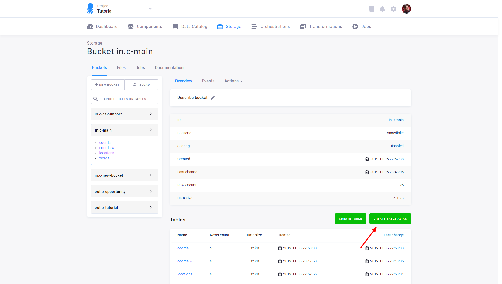
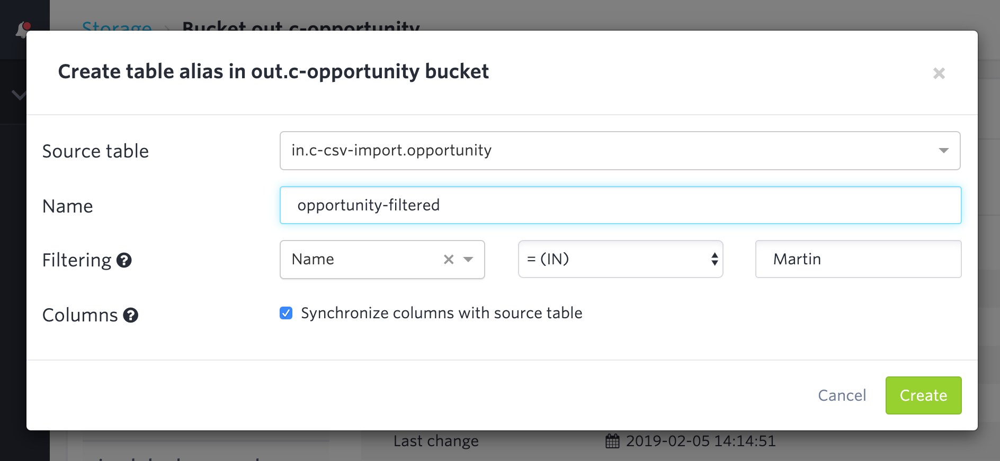
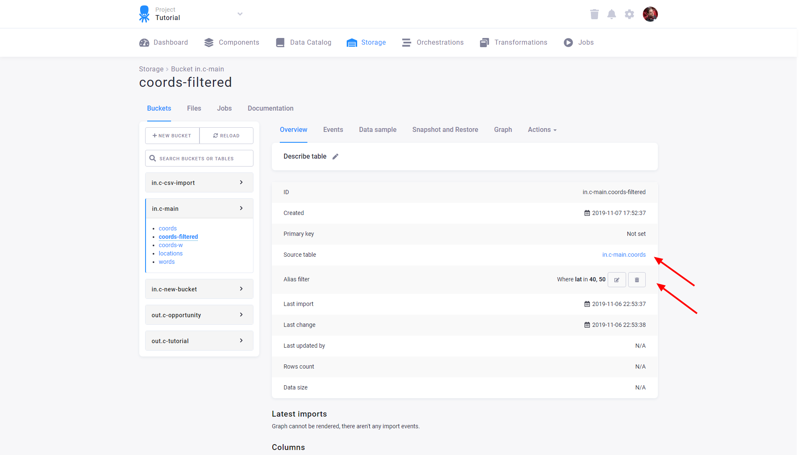
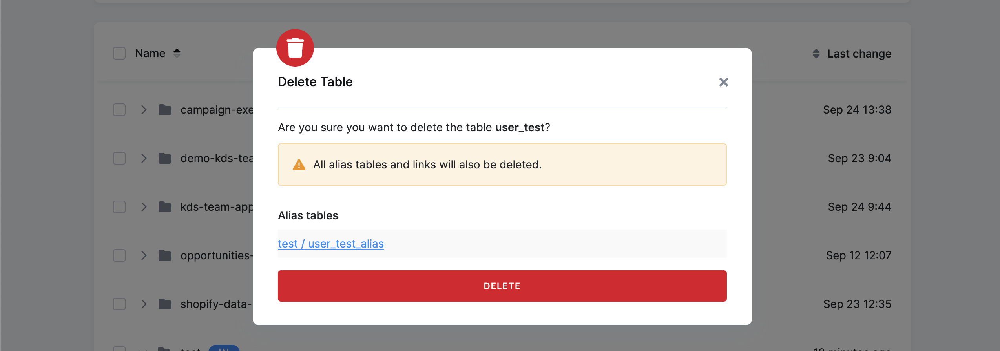
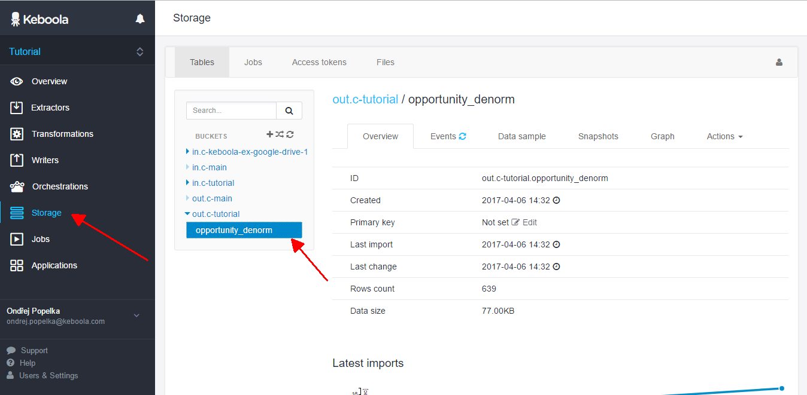
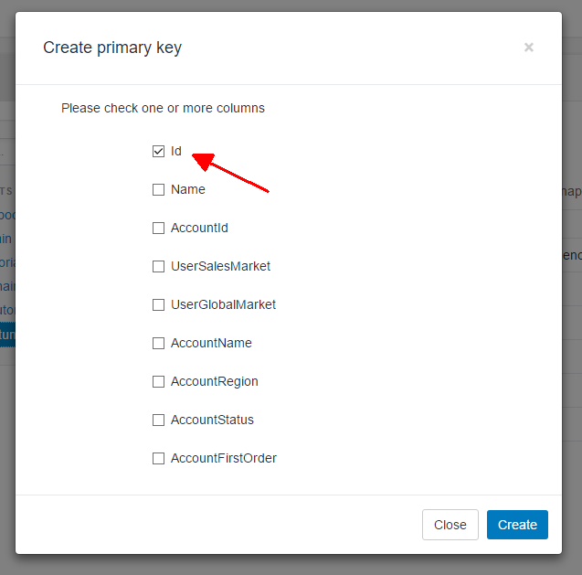
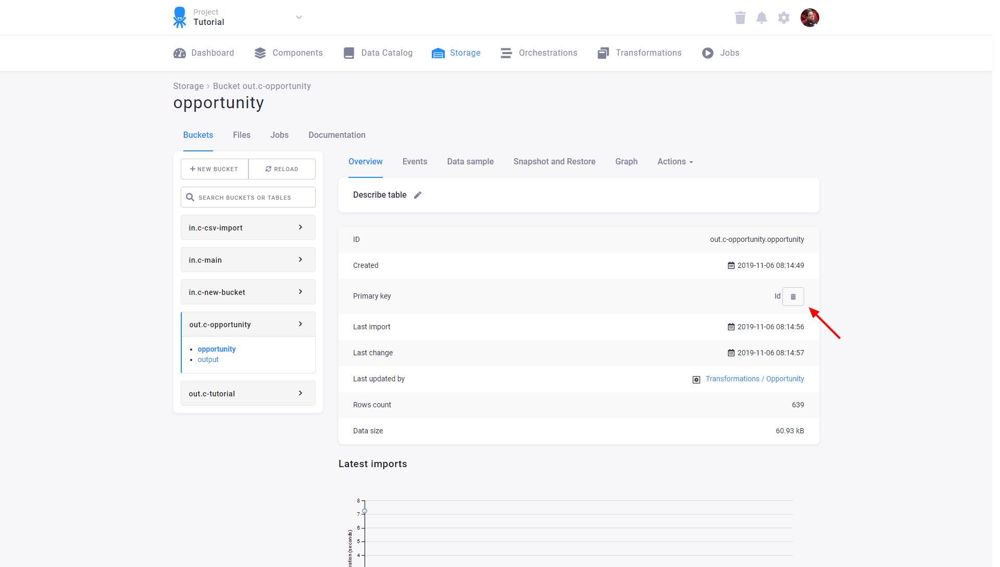
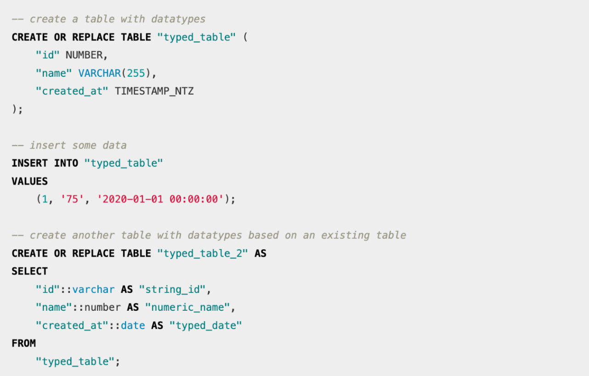
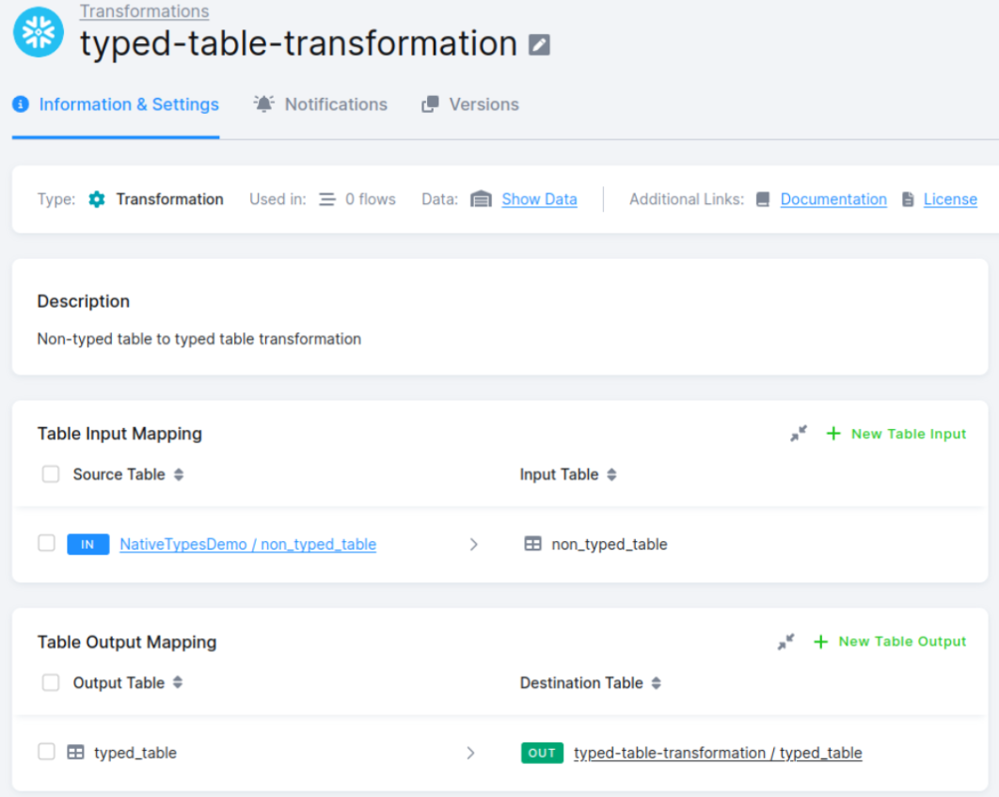

Step-by-step tasks for an existing Storage table. The first four start from its table detail; the last three deal with
column data types. What tables, aliases and primary keys are is explained in [Tables in Storage](/storage/tables/) and
[Primary keys and incremental loading](/storage/tables/incremental-loading/), and typed tables in
[Native data types](/storage/tables/data-types/).

<!-- How-to-type page. Split from the former single tables page. The Storage tab and Delete rows labels were checked live in #1010; the rest is carried over from main 2026-11-12. The three data type tasks come from the former data types page, carried over 2026-11-19. -->

The first four tasks start the same way: open **Storage → Tables & Buckets**, open the bucket, and select the table. Its
**table detail** opens at the top of the screen, with a three-dots menu on the right.

## Create an alias table

**Goal:** a read-only view of an existing table, optionally filtered, that does not count toward your project quota.

1. Open the table (**Storage → Tables & Buckets** → bucket → table). In the table detail, click the three dots on the right side of the screen and select **Create alias table**.

   

2. Optionally, filter the alias by a simple condition.

   

**Result:** the table detail of the alias contains a reference to the source table and the filters applied. You can
adjust the alias filters even after the alias table has been created.



:::note
When you later delete a table that has aliases elsewhere in Storage, the deletion dialog lists the aliases (with
links). You must confirm that you understand the aliases will be deleted as well before proceeding.


:::

## Set or remove a primary key

**Goal:** a primary key on one or more columns, so loads deduplicate rows and incremental loads update existing rows.

A primary key can also come from the [output mapping](/transformations/mappings/#output-mapping) of a transformation
or application; the two must match. A column that already contains duplicates can't become a primary key. Both
errors are described in [Primary keys](/storage/tables/incremental-loading/#primary-keys).

1. Open the table (**Storage → Tables & Buckets** → bucket → table). In the table detail, start creating the primary key:

   

2. Select the columns you wish to add to the primary key:

   

To remove an existing primary key, click the **bin** icon:



**Result:** the table has the new primary key, or none. Be aware that creating or removing the primary key can take
some time on large tables.

## Truncate a table

**Goal:** an empty table that keeps its schema.

Truncating removes all records from a table while preserving its schema (column structure and metadata). Primary
keys and metadata remain without change. It is highly efficient especially when replacing an entire dataset. Use it
to replace data completely (e.g., a daily refresh of customer records), to ensure clean data ingestion without
duplication, or to automate scheduled table resets (e.g., overwriting temporary datasets).

1. Open the table (**Storage → Tables & Buckets** → bucket → table). In the table detail, click the three dots on the right side of the screen. A drop-down menu will display.
2. Select **Truncate table**. A warning information will display.
3. Confirm by clicking the **Truncate table** button.

**Result:** the table has no rows; its columns, primary key and metadata are unchanged.

## Delete rows

**Goal:** remove only the records that match your filters and keep the rest of the table intact.

Unlike truncating, deleting rows selectively removes only matching records, and one execution can apply multiple
filters, such as rows changed within a specific period or rows containing a specific value in a given column.

Typical uses are removing outdated records (e.g., inactive customers), correcting erroneous data entries, and
synchronizing data with external systems (e.g., deleting stale records).

1. Open the table (**Storage → Tables & Buckets** → bucket → table). In the table detail, click the three dots on the right side of the screen to open a drop-down menu.
2. Select **Delete rows**. A pop-up will appear.
3. Set up the filters to specify which rows should be deleted. Before deleting the rows, Keboola displays a preview
   of the records that will be removed based on your filters.
4. Click **Delete rows** to confirm.

**Result:** the matching rows are gone from the table.

To delete rows before each incremental load of a transformation instead, use the
**Delete rows** option of the [transformation output mapping](/transformations/mappings/#output-mapping), with Incremental
loading enabled.

## Keep the lengths and precisions of a typed table

**Goal:** a typed table whose columns keep the lengths and precisions you define, such as NUMBER(10,2), instead of the
Storage backend defaults.

When a job creates a table, it defaults to the lengths and precisions specific to the Storage backend (see
[Native data types](/storage/tables/data-types/#how-typed-tables-are-created)). To avoid the limitation:

1. Manually create the table in advance using the [Table Definition API](https://api.keboola.com/?service=storage#post-/v2/storage/branch/-branchId-/buckets/-bucketId-/tables-definition), specifying the correct lengths and precisions.

   **Example:** To ensure typed tables are imported correctly into Storage, define your table in a Snowflake SQL transformation, adhering to the desired schema and data types:

   

2. Run the jobs that write to the table. Subsequent jobs writing data to this table will respect your defined schema as long as it matches the expected structure.

:::caution
Be cautious when dropping and recreating tables. If a job creates a table, it will default to the base type with backend-specific defaults, which might not align with your source.
:::

**Result:** the table keeps the lengths and precisions you defined, as long as the data written to it matches that structure.

## Change a column type in a typed table

**Goal:** a column of a typed table holds its data in a different data type.

You **cannot change the type of a column in a typed table once it has been created**. However, there are multiple workarounds to address this limitation.
Some other alterations, such as increasing the length or precision of a column, are possible without a workaround; see
[Changing column definitions](/storage/tables/data-types/reference/#changing-column-definitions).

**For tables using full load:** Drop the table and create a new one with the correct types ([Table Definition API](https://api.keboola.com/?service=storage#post-/v2/storage/branch/-branchId-/buckets/-bucketId-/tables-definition)). Then, load the data into the newly created table.

**For tables loaded incrementally:** You will need to create a new column with the desired type and migrate the data step by step.
Assume you have a column `date` of type `VARCHAR` in a typed table, and you want to change it to `TIMESTAMP`.

1. Add a new column named `date_timestamp` of type `TIMESTAMP` to the table ([Add column to table](https://api.keboola.com/?service=storage#post-/v2/storage/branch/-branchId-/tables/-id-/columns), with `definition` and `basetype`).
   <!-- Checked 2026-11-20: add column, delete column and table definition endpoints, Storage API OpenAPI. UI controls not checked. -->
2. Update all jobs filling the table to populate both the new column (`date_timestamp`) and the existing column (`date`).
3. Run an ad-hoc transformation that reads the table, fills `date_timestamp` from `date` for the existing rows, and writes every column back to the same table: in its output mapping, set the table as **Destination**, check **Incremental**, and set the table's **Primary key**, so each row replaces the row with the same key. Without a primary key, the rows are appended instead.
   <!-- Checked 2026-11-20: write-back via incremental output mapping with primary key, transformations/mappings and incremental-loading pages. SQL not given. -->
4. Gradually update all configurations and references to use `date_timestamp` instead of `date`.
5. Once all references are updated and the old column is no longer in use, you can safely remove the `date` column ([Delete column from table](https://api.keboola.com/?service=storage#delete-/v2/storage/branch/-branchId-/tables/-tableId-/columns/-columnName-)).

:::caution
**Important:** Always verify other configurations that depend on the table to avoid schema mismatches. Also, pay special attention to writers (data destination connectors), particularly if the table already exists in the destination system. Mismatched schemas between the source and destination can lead to errors.
:::

**Result:** for a full-load table, a new table with the correct types holds the data. For a table loaded incrementally,
the `date_timestamp` column of type `TIMESTAMP` holds the data of every row, all configurations use it, and the `date`
column is removed.

## Create a typed table from a non-typed table

**Goal:** a new typed table with the data of an existing non-typed table.

If you have a non-typed table, `non_typed_table`, with undefined data types and want to convert it into a typed table, follow these steps:

1. **Set up the transformation.**
   - Create a new transformation in Keboola. The query in step 2 is for a Snowflake SQL transformation.
   - Choose `non_typed_table` as the input table in the input mapping section (you can also rely on [read-only input mapping](/transformations/#read-only-input-mapping)).
   - In the output mapping section, add a table output with `typed_table` (the table your query creates) as the output table, and a Storage destination table that does not exist yet; otherwise, it will not be created as a typed table. In the screenshot, the destination is `typed_table` in the bucket `typed-table-transformation`.
     <!-- Checked 2026-11-20: output table typed_table → destination typed-table-transformation / typed_table, screenshot typed-table-transformation.png. -->

   

2. **Define the query.** In the queries section, write an SQL query to transform the column types. Use proper casting for each column to match the desired data types.

   For example, if you need to format a date column, include the appropriate SQL casting or formatting function in your query.

   ```sql
   CREATE TABLE "typed_table" AS
       SELECT 
           CAST(ntt."id" AS VARCHAR(64)) AS "id",
           CAST(ntt."id_profile" AS INTEGER) AS "id_profile",
           TO_TIMESTAMP(ntt."date", 'DD.MM.YYYY"T"HH24:MI:SS') AS "date",
           CAST(ntt."amount" AS INTEGER) AS "amount"
       FROM "non_typed_table" AS ntt;
   ```

3. **Run the transformation.** Execute the transformation and wait for it to complete.
4. **Verify the schema.** Once the transformation is finished, open the table detail of `typed_table` and go to the
   **Schema** tab. The **Data type** column shows each column's type, for example `STRING (19), Nullable`.
   <!-- Checked 2026-11-20 in the UI of project 264: a typed table's detail has the tabs Overview / Schema / Events / Data Sample / Snapshots / Usage; Schema lists Column / Data type / Description and has an Add column button. -->

**Result:** `typed_table` is a new typed table. It should now include the appropriate data types.

***Note:** [Incremental loading](/storage/tables/incremental-loading/#incremental-loading) cannot be used when creating a typed table in this manner.*

**Next:** [Primary keys and incremental loading →](/storage/tables/incremental-loading/)
