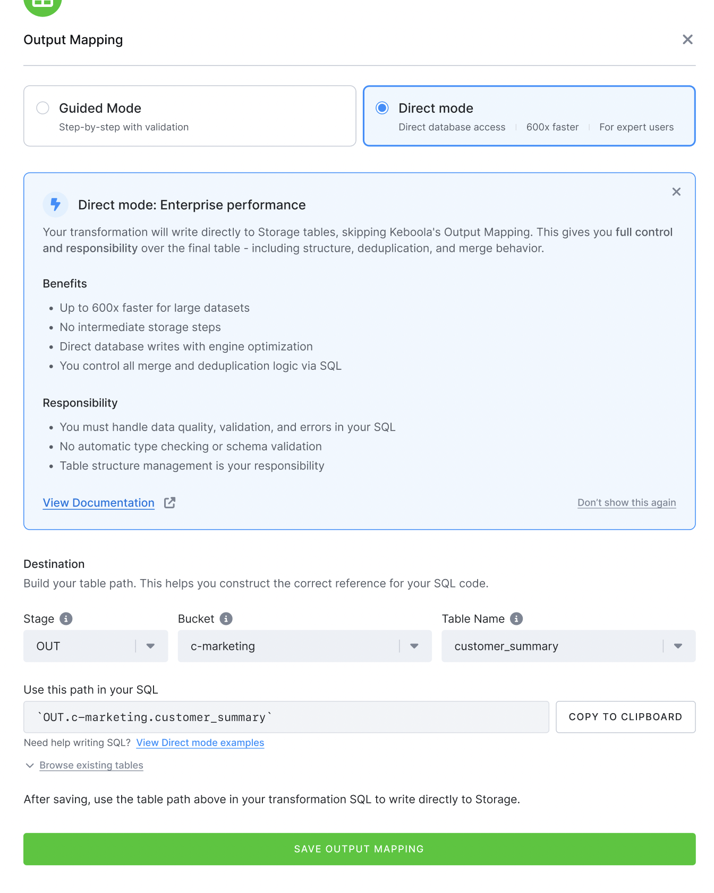

Direct Mode output mapping lets a transformation, app or workspace write straight into Storage tables, without the copy-and-import step of standard output mapping.

### Direct Mode Output Mapping
Direct Mode Output Mapping lets your transformation write directly to Storage tables instead of going through
the standard copy-based output mapping process. With Direct Mode output mapping enabled, the transformation
user receives write privileges on specific Storage tables. Any `INSERT`, `UPDATE`, `DELETE`,
or `TRUNCATE` you run in your transformation SQL can be applied immediately to the destination table — there is no
separate import step.

This feature is available as a **private beta** and must be enabled by [Keboola Support](/management/support/).



#### When to Use Direct Mode Output Mapping
Direct Mode output mapping is designed for **advanced users with high data maturity** who are comfortable writing
production-quality SQL and managing data consistency themselves. Typical use cases include:

- **Large incremental loads** — Standard output mapping on a 150 GB table with a single-row append can take over
  an hour due to deduplication and copy overhead. Direct Mode output mapping reduces this to seconds.
- **Minimal overhead workflows** — When the standard mapping pipeline (copy to staging, deduplicate, import)
  creates unnecessary overhead for your workload.

**Performance comparison** (incremental load — 1 row added to a 150 GB table):

| Method | Approximate Time |
|--------|-----------------|
| Standard output mapping (Upsert) | ~160 min |
| Simplified output mapping (Insert) | ~55 min |
| **Direct Mode output mapping** | **~11 seconds** |

#### Supported Backends
Direct Mode output mapping is available for any component that uses a **Snowflake** or **BigQuery** workspace,
including [transformations](/transformations/), [apps](/data-apps/), and
[workspaces](/workspace/) — both standalone Snowflake/BigQuery workspaces and workspaces opened in the
[SQL Editor](/workspace/sql-editor/).

#### How It Works
When a component with Direct Mode output mapping runs:

1. The workspace role/service account receives **write privileges** on the specified Storage tables.
2. Your transformation SQL operates directly on Storage tables using their read-only storage paths
   (e.g., `"KBC_USE4_33"."in.c-raw-data"."my-table"`).
3. After the transformation finishes, Keboola runs a **refresh job** that updates table metadata,
   row counts, and statistics. No data is copied — the changes are already in place.

In a **workspace**, there is no job to wait for: the write privileges are granted as soon as you save the
Direct Mode output mapping, so you can write to the Storage table from your very next query. Removing the
mapping revokes the privileges again.

The workspace receives these privileges on each granted table:
- `SELECT`, `INSERT`, `UPDATE`, `DELETE`, `TRUNCATE` (Snowflake)
- `bigquery.tables.getData`, `bigquery.tables.updateData`, `bigquery.tables.get` (BigQuery)

The workspace **cannot**:
- Create new tables in the bucket
- Drop or alter existing tables
- Write to tables not listed in the output mapping

#### Configuration
In Snowflake and BigQuery transformations and workspaces, add an output mapping and switch the mode from
**Guided Mode** to **Direct Mode**. Pick an existing Storage table as the destination; the dialog then shows the
full table path to copy into your SQL.

The mode cannot be switched on an existing mapping — delete the mapping and create a new one instead.

Under the hood, Direct Mode is the `unload_strategy` field on the output table in the configuration JSON:

```json
{
  "storage": {
    "output": {
      "tables": [
        {
          "destination": "out.c-my-bucket.my_table",
          "unload_strategy": "direct-grant"
        }
      ]
    }
  }
}
```

The `unload_strategy` field accepts two values:
- `direct-grant` — Write directly to the Storage table (Direct Mode output mapping).
- `copy` — Standard output mapping (default when the field is omitted).

You can mix both strategies in a single transformation — some tables can use Direct Mode output mapping while
others use the standard copy strategy.

#### Workspaces
In a workspace, Direct Mode output mapping replaces the **Unload Data** round trip — you write to the Storage
table directly from the workspace instead of loading data into Storage afterwards.

In a **standalone Snowflake or BigQuery workspace**, open the **Output Mapping** section in the workspace detail,
add an output, and select **Direct Mode**.

In the **[SQL Editor](/workspace/sql-editor/)**, you can also create the destination table on the fly:

1. In the **Working Tables** section, click the three dots next to a working table and select **Create writable table**.
2. Set the destination bucket and table name, adjust the column definitions and the primary key.
3. Click **CREATE WRITABLE TABLE**.

Keboola creates the Storage table (creating the bucket first if it does not exist yet) and registers it as a
Direct Mode output mapping. The source working table itself is not modified or copied — only its column
structure is used as the template for the new Storage table.

The new table appears in the **Writable tables** section of the Storage Explorer with the **DG** badge, and the
workspace can write to it right away. Use the three-dots menu there to remove the mapping (and with it the
workspace's write access).

#### Good Practices

**Write idempotent SQL.** Because there is no automatic rollback on failure, your SQL should be safe
to re-run. Use patterns like `MERGE` or `DELETE` + `INSERT` within a transaction:

```sql
BEGIN;
DELETE FROM "in.c-my-bucket"."sales"
  WHERE date = CURRENT_DATE();
INSERT INTO "in.c-my-bucket"."sales"
  SELECT * FROM "my_staging_table"
  WHERE date = CURRENT_DATE();
COMMIT;
```

**Handle deduplication yourself.** Use `MERGE` statements or explicit `DELETE` before `INSERT`
to avoid duplicate rows:

```sql
MERGE INTO "in.c-my-bucket"."customers" AS target
USING "my_staging_table" AS source
ON target."id" = source."id"
WHEN MATCHED THEN UPDATE SET
  target."name" = source."name",
  target."email" = source."email"
WHEN NOT MATCHED THEN INSERT ("id", "name", "email")
  VALUES (source."id", source."name", source."email");
```

**Test in a non-production environment first.** Direct Mode output mapping writes affect data immediately.
Validate your transformation logic thoroughly before pointing it at production tables.

**Use the read-only storage path for table references.** In your SQL, reference tables by their
full Storage path (e.g., `"SCHEMA"."in.c-bucket"."table"`), not by workspace-local names.

#### Bad Practices

**Do not rely on automatic deduplication.** Unlike standard output mapping, Keboola does **not**
deduplicate data based on primary keys. Primary keys on Snowflake and BigQuery are not enforced by the
backend, so a primary key defined in Storage will not prevent duplicates on direct writes.
Running a plain `INSERT` repeatedly will create duplicate rows:

```sql
-- BAD: This will create duplicates on every run
INSERT INTO "in.c-my-bucket"."customers"
  SELECT * FROM "my_staging_table";
```

**Do not assume type checking.** Keboola does not verify that column data types in your SQL match
the Storage table metadata. Mismatched types may cause errors or silent data inconsistencies.

**Do not use DDL statements.** You cannot `CREATE TABLE`, `DROP TABLE`, `ALTER TABLE`, or
`SWAP TABLE` on Storage tables through Direct Mode output mapping. Schema changes must be done through
[Storage](/storage/tables/).

**Direct Mode output mapping in development branches requires the [Branched storage](/components/branches/) feature.** Without the Branched storage Development branches
share the same Snowflake schema as production. Writing via Direct Mode output mapping in a development branch
**will modify production data**. 

#### Limitations

- **No automatic deduplication** — Primary keys on Snowflake and BigQuery are not enforced by the
  backend, so they will not prevent duplicates on direct writes. You must handle deduplication in your SQL.
- **No type checking or casting** — Column types are not validated against Storage metadata.
- **No schema changes** — You cannot alter table structure (add/remove/rename columns). Use
  [Storage](/storage/tables/) for schema modifications.
- **No automatic rollback** — If a transformation fails mid-execution, the table may be left in a
  partially written state. Wrap related operations in transactions to mitigate this.
- **Limited auditability** — Only an import event is created on success, compared to the more
  detailed event trail of standard output mapping.
- **Development branch isolation requires [Branched storage](/components/branches/) feature** — Without the feature Dev branch writes affect production data
  on Snowflake. Use caution when testing.
- **Read-only, external, and linked buckets are not supported** — Direct Mode output mapping cannot write
  to buckets that are read-only, external schemas, or linked from another project.

**Next:** [Shared code →](/transformations/shared-code/)
