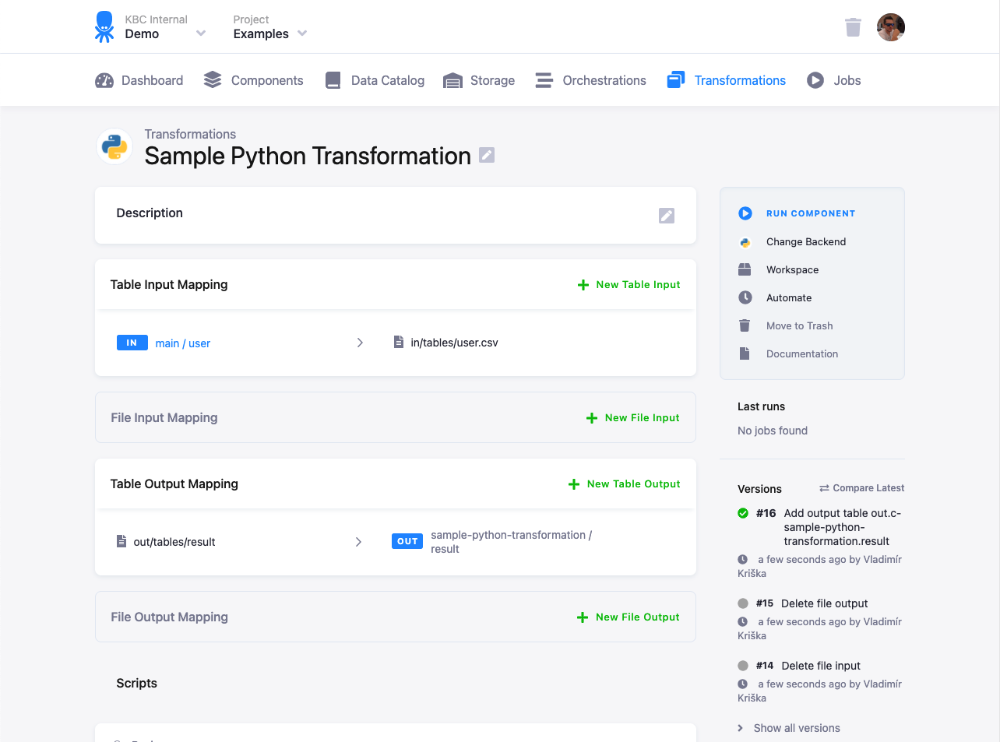
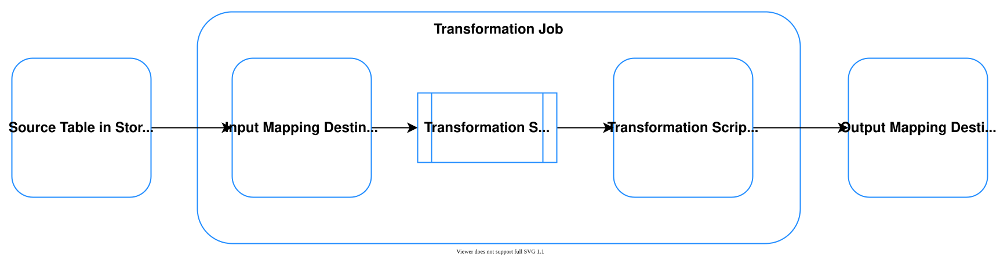

Input and output mapping are how a transformation gets data from Storage and puts results back. This page explains
the idea and the choices you have. For every option see [Input mapping options](/transformations/mappings/input/)
and [Output mapping options](/transformations/mappings/output/); to set a mapping up step by step, see the
[Getting Started tutorial](/getting-started/transform/).

<!-- Explanation-type page. Split from the former single mappings page (PRDCT-376), text carried over from main 2026-11-12. -->

## What mapping does

When manipulating your data, there is no need to worry about accidentally modifying the wrong tables.
**Mapping separates the source data from your transformation script**. It creates a secure staging area
with data copied from specified tables and brings only specified tables and files back to Storage.
While the concept of mapping is most important for transformations, it actually applies to every
single [component](/components/).

The concept of mapping helps to make the transformations repeatable and protect the project [Storage](/storage/).
You can always rely on the following:
- Having an empty staging Storage (no need to clean up before transformations)
- Having an isolated staging Storage (no need to worry about interference with other transformations)
- Having a stateless transformation (no need to worry about having left-over variables and settings from something else)
- Resource cleanup (no need to worry about cleaning up temporary data after yourself)
- Resource conflict (no need to worry about naming data in the staging Storage)

While this makes some operations seemingly unnecessarily complicated, it ensures that transformations
are repeatable and you can't inadvertently overwrite data in the project Storage. For ad-hoc
operations, we recommend you use **[workspaces](/workspace/)**. For
bulk operations, consider taking advantage of **[variables](/components/variables/)**
and [programmatic automation](https://developers.keboola.com/automate/).

## Input mapping

The input mapping is the list of Storage tables and files your transformation reads. Both
[Storage tables](/storage/tables/) and [Storage files](/storage/files/) can be used; the common first choice is tables.
Depending on the transformation backend, a table input mapping does one of two things:

- **Database staging**: copies the selected tables to tables in a newly created database schema.
- **File staging**: exports the selected tables to CSV files in a designated staging storage. This is still a table
  mapping, not a [file input mapping](/transformations/mappings/input/#file-input-mapping).

Depending on the transformation type, you work either with database tables or with CSV files. The CSV files can sit
locally next to the transformation script or on a remote storage such as [Amazon S3](https://aws.amazon.com/s3/) or
[Azure Blob Storage](https://azure.microsoft.com/en-us/services/storage/blobs/).
The supported database type is [Snowflake](https://www.snowflake.com/).
<!-- VERIFY(Nikita): carried over from main. The same page documents BigQuery load types and BigQuery transformations
     stage into a database too, so "Snowflake only" looks stale; check which backends use database staging. -->
A file input mapping copies files from [file Storage](/storage/files/) instead: binary or malformed files that
can't become tables, or a pre-trained model your transformation uses.

Table names referenced by mappings are automatically quoted by Keboola. This is especially important for Snowflake,
which is case sensitive.

*Source* and *destination* always depend on the direction. The input mapping destination is the same table or file
that your transformation script reads as its source:

All options are in [Input mapping options](/transformations/mappings/input/).

## Read-only input mapping

You don't always need an input mapping. With a **read-only input mapping**, your transformation reads every bucket
and table in the project (linked buckets included) directly on the backend, so no tables are copied into a new
schema. It is enabled automatically in transformations and can drastically reduce the execution time. It helps with:

- slow transformations where a clone is not used,
- complex flows that move data from a data source to the workspace where other apps read it,
- cases where updating data in Storage through an output mapping causes several data movement operations.

How to address the tables is in
[Read-only input mapping](/transformations/mappings/input/#read-only-input-mapping).

## How tables are loaded

On Snowflake and BigQuery, Keboola loads each input table in one of three ways: `CLONE` moves no data and finishes in
near-constant time, `COPY` makes a full physical copy, and `VIEW` reads the data live from its source. The default,
`AUTO`, picks the fastest one the table allows. Filters, data types and incremental loading need `COPY`, so for a
huge table it can be faster to drop them, clone the table and filter inside the transformation. The details are in
[Loading type](/transformations/mappings/input/#loading-type-snowflake-and-bigquery).

## Output mapping

The output mapping takes results (tables and files) from your transformation and stores them back in Storage. It can
create, overwrite, and append any table. Any table or file *not* listed in the output mapping is temporary and is
deleted when the transformation job ends, so the script needs no cleanup of intermediate steps.

- With **database staging**, the listed tables are copied from the staging database into
  [Storage tables](/storage/tables/).
- With **file staging**, the listed CSV files are imported into Storage tables.
- A **file output mapping** stores other files, such as a trained model for another transformation, as
  [Storage files](/storage/files/).

All options are in [Output mapping options](/transformations/mappings/output/). Two output features change how the
load itself works:

- [Partition-aware import](/transformations/mappings/partition-aware-import/) makes incremental loads into a large
  partitioned BigQuery table read only the partitions they touch.
- [Direct Mode output mapping](/transformations/mappings/direct-mode/) lets the transformation write straight into
  Storage tables, with no copy or import step.

## This section

- [Input mapping options](/transformations/mappings/input/): table and file inputs, data types, load types, read-only
  input mapping and the `_timestamp` column.
- [Output mapping options](/transformations/mappings/output/): table and file outputs, incremental loads, primary
  keys and deleting rows.
- [Partition-aware import](/transformations/mappings/partition-aware-import/): cut the cost of incremental loads on
  BigQuery.
- [Direct Mode output mapping](/transformations/mappings/direct-mode/) and
  [how to set it up](/transformations/mappings/direct-mode/set-up/).

**Next:** [Input mapping options →](/transformations/mappings/input/)
