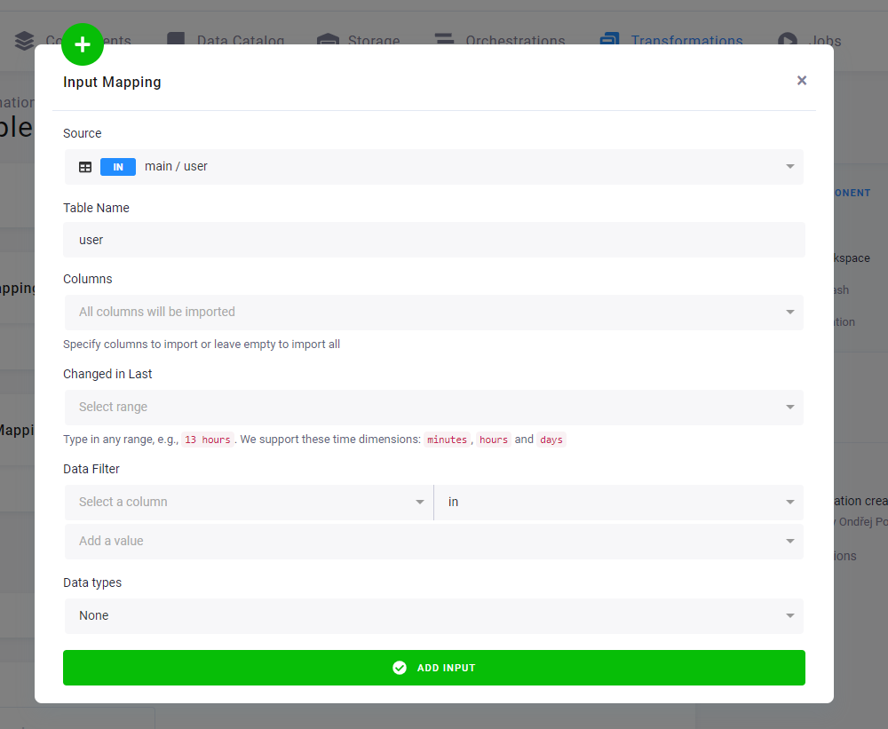
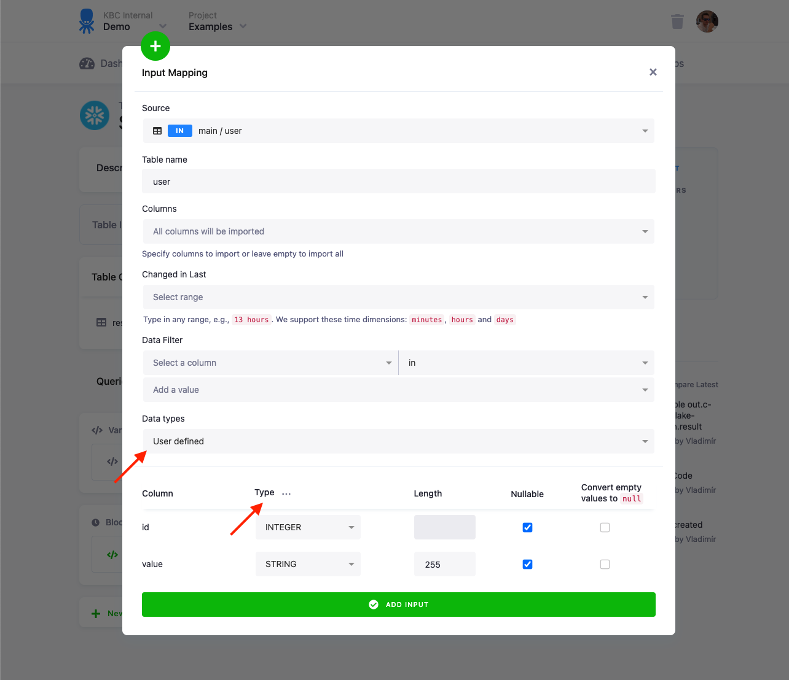
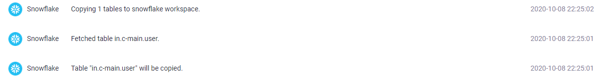
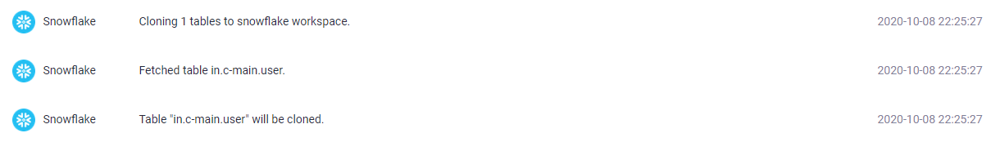
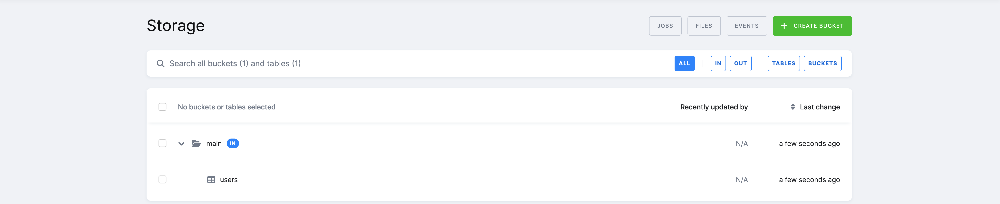
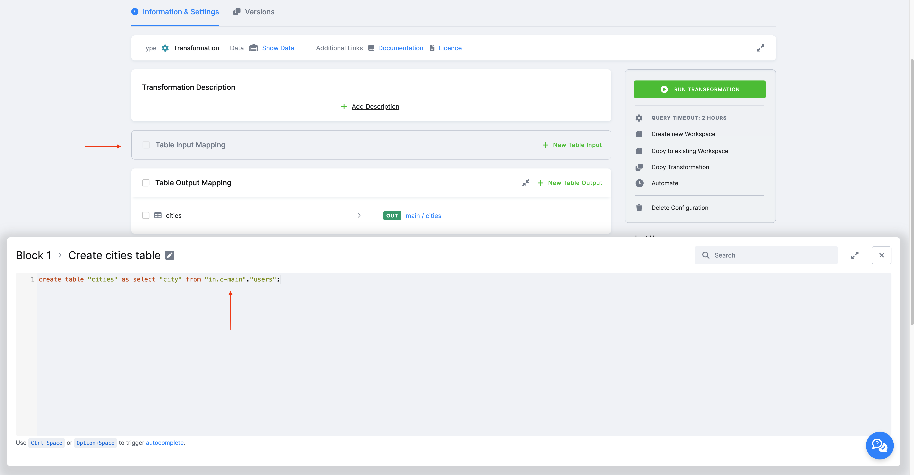
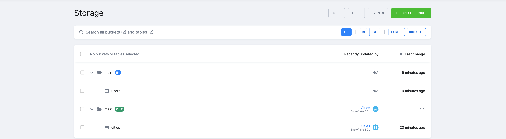
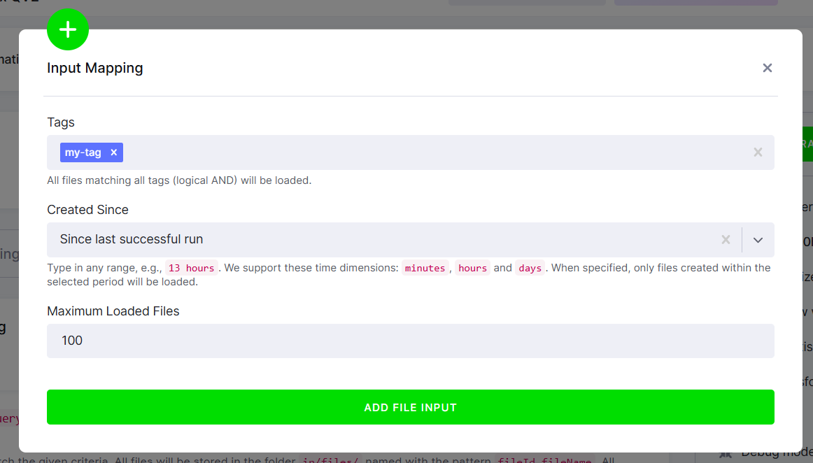

Every option of a transformation's input mapping: which Storage tables and files it reads and how they are loaded.
For what mapping is and why it exists, see [How input and output mapping work](/transformations/mappings/); for the
results side, see [Output mapping options](/transformations/mappings/output/).

<!-- Reference-type page. Split from the former single mappings page (PRDCT-376), text carried over from main 2026-11-12. -->

## Table input mapping

A table input mapping copies the selected Storage tables to the transformation's staging area, as database tables or
as CSV files depending on the backend (see [Input mapping](/transformations/mappings/#input-mapping)). If you have not
selected any tables and [read-only input mappings](#read-only-input-mapping) are enabled, you can access the tables
automatically in the workspace. In this case the tables are not copied.



*See an example of [setting up an input mapping](/getting-started/transform/#set-it-up) in our tutorial — in the **UI** tab.*

### Options

:::caution
When using table with native data types, following options will not be available.
:::

- **Source** — Select a table or a bucket in Storage as the source table for your transformation. If you select
a bucket, it is the equivalent of selecting all tables currently present in the bucket. It does not automatically
add future tables to the selection.
- **File name** / **Table Name** — Enter the destination name of the mapping that is the *Source* table/file
name to be used inside the transformation. This is an arbitrary name you'd like to use as a reference for the table
inside the transformation script (it fills in automatically, but it can be changed). For **File Staging**, it is a good
idea to add the `.csv` extension. For **Database Staging**, the table name is automatically quoted, which means you can
use an arbitrary name. It also means that they may be case sensitive, for instance, if the destination is in Snowflake staging.
- **Columns** — Select specific columns if you do not want to import them all;
this saves processing time for larger tables.
- **Changed in last** — If you use [incremental processing](/storage/tables/incremental-loading/#incremental-processing),
this comes in handy; import only rows changed or created within the selected time period.
The supported time dimensions are `minutes`, `hours`, and `days`.
- **Data filter** — Filter source rows to the rows that match this single-column multiple-values filter.
When used together with *Changed in last*, the returned rows must match both conditions.
- **Data types** — Configure [data types](#data-types).

### Data types

:::caution
When selecting user defined data types the transformation jobs can take longer than usual because new typed table will be created in the background before materializing in output into final output table
:::

The data types option allows you to configure settings of data types for the destination table. Data types are applicable only
for destinations in **database staging**. Select *User defined* to configure data types for individual columns. The types
are pre-configured with data types stored in the [table metadata](/storage/tables/data-types/). The **Type**, **Length**,
and **Nullable** options define the destination table structure in the staging database.

The option **Convert empty values to null** adds additional processing which is particularly important for non-string columns.
All data in Storage tables are stored in string columns, and empty values (be it true `NULL` values, or empty strings) are stored
as empty strings. When converting such values back to, for example, `INTEGER` or `TIMESTAMP`, they have to be converted to true
SQL `NULL` values to be successfully inserted.



The pre-set data types are only suggestions, you can change them to your liking. You can also use the three dots menu to bulk set
the types. Beware, however, that if a column contains values not matching the type, the entire load (and transformation) will
fail. In such a case, it's reasonable to revert to `VARCHAR` types -- for example, by setting **Data types** to **None**.

### Loading type (Snowflake and BigQuery)

When working with large tables, it may become important to understand how the tables are loaded into a staging
database. Keboola uses three loading strategies — `COPY`, `CLONE`, and `VIEW` — plus an `AUTO` mode (the default)
that picks the best available strategy for each table:

- **`CLONE`** — a highly optimized operation that loads an arbitrarily large table in near-constant time, because it
physically moves no data. `CLONE` can't be combined with filters, data type configurations, or incremental loading.
It is supported on **Snowflake** and **BigQuery** backends.
- **`COPY`** — a full physical copy of the data into the staging database. Always available; used when neither `CLONE`
nor `VIEW` can be applied (for example, when filters or data types are configured).
- **`VIEW`** — loads the table as a read-only view instead of copying any data; the data is read live from its source
location. Used for **linked, external, and alias tables**.

You can set the strategy per table with the **Load type** option in the input mapping (**Auto**, **Copy**, **Clone**, or **View**):


**How `AUTO` decides.** `AUTO` prefers `CLONE` whenever the table can be cloned. On **BigQuery**, tables that can't be
cloned — **linked, external, and alias tables** — are loaded as a read-only `VIEW`. When filters, data type
configurations, or incremental loading are used (which neither `CLONE` nor `VIEW` supports), `AUTO` falls back to `COPY`.
If you explicitly request `CLONE` for a table that can't be cloned (for example, a [linked-bucket](/catalog/) table on
BigQuery, or any table with incompatible options such as `incremental`), the request fails.

In the input mapping, tables that will be loaded as a read-only view are marked with a view icon:


:::note[Default load type on BigQuery]
On BigQuery, the default input-mapping load type is controlled by the **BigQuery Input Mapping – Default Load Type View**
feature. While this feature is enabled — the current state in most projects — input tables default to `VIEW`, just as
before. That's perfectly fine, and nothing changes for you.

To make `CLONE` the default in your project right now, **disable** the **BigQuery Input Mapping – Default Load Type View**
feature in your project's **Settings → Features**. New input loads will then default to `CLONE` (matching Snowflake) for
faster, more consistent loading, with the automatic `VIEW`/`COPY` fallbacks described above. You can always override the
strategy per table with the **Load type** option above.

Keboola is gradually disabling this feature across all BigQuery projects, with the rollout completing by **July 15, 2026**.
After that, `CLONE` becomes the default load type on BigQuery for everyone.
:::
<!-- VERIFY(Nikita): the rollout date above (July 15, 2026) has passed; check whether the feature is gone everywhere and
     the note can say CLONE is the BigQuery default, or whether the rollout slipped. -->

This might present a dilemma when loading huge tables. A logical approach when trying to speed up loading a large table would
be setting data types and adding filters to copy only the necessary ones. You might find out, however, that at some point, it's
actually faster to remove the filters and data types, take advantage of the `CLONE` loading type, and apply the filters
inside the transformation. Also, when you need more complex filters (filtering by multiple columns or ranges), it's best to
remove the filter completely from the input mapping, take advantage of the clone loading, and do the filtering inside of the
transformation.

You can verify the table loading type in the events — copy table:



Clone table:



The `CLONE` mapping will execute almost instantly for a table of any size (typically under 10 seconds)
as it physically does not move any data.

### _timestamp system column

A cloned table is an exact copy of the source table, including the `_timestamp` system column.
This column is used internally by Keboola for comparison with the value of the *Changed in last* filter.

The column type differs by backend: `TIMESTAMP_NTZ(9)` on Snowflake and `TIMESTAMP` on BigQuery.
The value contains the [last change of the row](/storage/tables/incremental-loading/#manual-incremental-processing).
You can use this column to set up [incremental processing](/storage/tables/incremental-loading/#incremental-processing),
i.e., to replace the role of the **Changed in Last** filter in the input mapping (which you can't use with a clone mapping).

**Important: The _timestamp column cannot be imported back to Storage.**

When you attempt to do so, you'll get the following error:

	Failed to process output mapping: Failed to load table "out.c-test.opportunity":
	Invalid columns: _timestamp: Only alphanumeric characters and underscores are allowed in the column name.
	Underscore is not allowed on the beginning.

If you are not using the `_timestamp` column in your transformation, you can either use the `dropTimestampColumn` option
in the input mapping to exclude it automatically, or drop it manually:

In Snowflake:

```sql
ALTER TABLE "my-table" DROP COLUMN "_timestamp";
```

In BigQuery:

```sql
ALTER TABLE my-table DROP COLUMN _timestamp;
```

The `_timestamp` column is not present on tables loaded using the copy method.

## Read-only input mapping

*Note: You must be using [new transformations](/transformations/) to see this feature.*

When **read-only input mappings** are enabled, you automatically have read access to all buckets and tables in the project (this also applies to linked buckets).
Alias tables are materialized as database VIEWs and are fully accessible via read-only input mappings — including filtered aliases and aliases from linked buckets.

There is no need to set anything for a **read-only input mapping** in **transformations**, all tables in Storage are automatically accessible in the transformation.
This also applies to linked buckets. *Note that buckets and tables belong
to another project, so you need to access the tables using the fully qualified identifier, including the database and schema, in the source project.*

Users can enable or disable read-only access to the storage in **user workspaces** and the **Snowflake data destination**. If read-only access is disabled, users must define an input mapping as they typically do.



You have read access to all the tables in your project's Storage directly on the underlying backend. However, this means you need to use the internal ID of a bucket (`in.c-main` instead of `main` as you see in the UI).



In the transformation code (Snowflake), we select from the table **"in.c-main"."users"** and create a new table: `create table "cities" as select "city" from "in.c-main"."users";`.
Depending on the backend, the SQL format is different. More info regarding access to individual tables depending on the backend can be found in the documentation of those individual backends ( [Snowflake](/transformations/snowflake-plain/#bucket-objects-for-read-only-input-mapping), [BigQuery](/transformations/bigquery/#bucket-objects-for-read-only-input-mapping) ).

As you can see, a **read-only input mapping** allows you to read a table created in Storage directly in the transformation.



## File input mapping

The file input mapping process exports the selected files from [file Storage](/storage/files/) and copies them to the
staging Storage. Depending on the transformation, this can be either a drive local to the transformation
or a remote storage such as [Amazon S3](https://aws.amazon.com/s3/) or
[Azure Blob Storage](https://azure.microsoft.com/en-us/services/storage/blobs/). A file input mapping cannot operate
with storage tables, but it comes in handy for processing files that cannot be converted to tables (binary files,
malformed files, etc.) or, for example, to work with pre-trained models that you can use in a transformation.



### Options

- **Tags** — [tags](/storage/files/#uploading-file) used to select files.
- **Changed Since** — the time range for selecting files. Either a static range (e.g. `30 minutes`) or *Since last successful run* for incremental processing (see below). With a static range, a file must satisfy **both** the tags **and** the range to be selected.
- **Query** *(deprecated, do not use)* — legacy option for a customized [Elastic query](https://www.elastic.co/guide/en/elasticsearch/reference/5.0/query-dsl-query-string-query.html#query-string-syntax).
- **Processed Tags** *(deprecated, do not use)* — legacy option that assigned tags to input files after the transformation finished, used to process files incrementally.

:::caution
*Processed Tags* and *Query* are deprecated and not compatible with [development branches](/getting-started/branches/). New configurations should not use them, and the UI no longer offers them. Existing configurations continue to work; affected projects will be contacted before any breaking change.
:::

### Incremental file processing

Incremental processing is active when **Changed Since** is set to *Since last successful run*. In this mode, the configuration stores a reference to the newest file matching the specified tags. The next run continues with files newer than that reference, so the transformation is automatically fed only the files that have not yet been processed.

To manipulate the state — for example, to run a backfill — use **Debug Mode → Update State** to reset it.

**Next:** [Output mapping options →](/transformations/mappings/output/)
