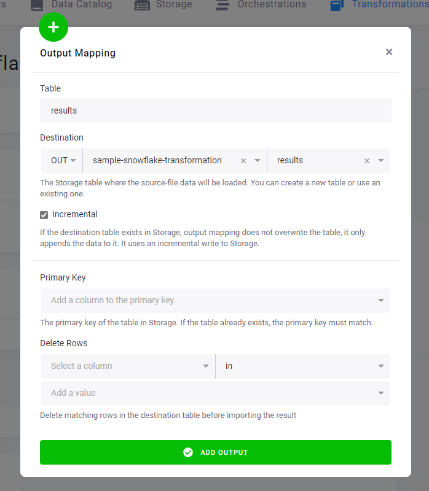
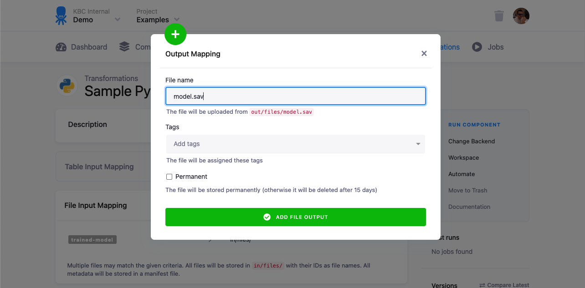

Every option of a transformation's output mapping: which results are written back to Storage tables and files, and
how. For what mapping is and why it exists, see [How input and output mapping work](/transformations/mappings/).

<!-- Reference-type page. Split from the former single mappings page (PRDCT-376), text carried over from main 2026-11-12. -->

## What the output mapping writes

An output mapping takes results (tables and files) from your transformation and stores them back in Storage.
It can create, overwrite, and append any table.
These tables are typically derived from the tables/files in the input mapping. In SQL transformations,
you can use any `CREATE TABLE`, `CREATE VIEW`, `INSERT`, `UPDATE` or `DELETE` queries to create the desired result.

The result of output mapping can be both [Storage tables](/storage/tables/) and [Storage files](/storage/files/).
The common first choice is to use the table output mapping. The rule is that any tables or files *not* specified in the output mapping
are considered temporary and are deleted when the transformation job ends. You can use this to your advantage and
simplify the transformation script implementation (no need to worry about cleanup or intermediary steps).

Keep in mind that every table or file specified in the output mapping must be physically present in the staging area.
A missing source table for the output mapping is an error. This is important when the results of a transformation are
empty — you have to ensure that an empty table or an empty file (with a header or
a [manifest](https://developers.keboola.com/extend/common-interface/manifest-files/#dataouttables-manifests)) is created.

## Table output mapping

Depending on the transformation backend, the table output mapping process can do the following:

- In case of **Database Staging** — copy the specified tables from the staging *database* into
the project [Storage tables](/storage/tables/).
- In case of **File Staging** — import the specified *CSV files* into project [Storage tables](/storage/tables/).

The supported staging database type is [Snowflake](https://www.snowflake.com/).
The supported staging for CSV files is a storage local to the transformation.
<!-- VERIFY(Nikita): carried over from main; "Snowflake" only looks stale next to BigQuery transformations and the
     BigQuery-only partition-aware import below. -->



*See an example of [setting up an output mapping](/getting-started/transform/#set-it-up) in our tutorial — in the **UI** tab.*

### Options

- **Table** — Enter the name of the table that should be created in the transformation.
- **Destination** — Select or type in the name of the [Storage](/storage/tables/) output table that will contain
the results of your transformation (i.e., contents of the Output Mapping *source* table).
	- If this table does not exist yet, it will be created once the transformation runs.
	- If this table already exists in Storage, the source table must match the structure of the destination table (all
	columns must be present, new columns will be added automatically).
- **Incremental** — Check this option to make sure that in case the *Destination* table already exists,
it is not overwritten, but resulting data is appended to it. However, any existing row having the same primary key
as a new row will be replaced. See the description of
[incremental loading](/storage/tables/#incremental-loading) for a detailed explanation and examples.
- **Primary key** — The [primary key](/storage/tables/#primary-keys) of the destination table; if the table already exists,
the primary key must match. Feel free to use a multi-column primary key.
- **Deduplication Strategy** — This allows to switch in Snowflake transformations from the default load Upsert to Insert. Upsert option uses deduplication based on primary keys and ensures data quality. By switching to Insert, the load performs faster but skips deduplication and type casting - meaning you are responsible for uniqueness and correct data types. As this option is for high data maturity users, you can ask our support to enable this for your project as Deduplication Strategy is under feature flag.
- **Delete rows** — When Incremental loading is enabled, you can delete specific rows from the destination table
before importing new data into the Storage. See [Delete rows](#delete-rows) below.
- **Partition-aware import** *(BigQuery only)* — When Incremental loading and a primary key are set, limits the
deduplication to the destination partitions the new rows belong to, so BigQuery does not read the whole destination
table. It requires a partitioned destination table; see [Partition-aware import](/transformations/mappings/partition-aware-import/).

**Important:** Multiple output mappings can be created for your transformation. Each source table can be used only once however.

### Delete rows

When Incremental loading is enabled, you can delete specific rows from the destination table before importing new
data into the Storage. This gives you precise control over incremental updates. There are 2 options you can use:

1. **Delete rows from values** - this option lets you manually specify values that identify rows to be removed from your destination table. This is particularly useful when the rows to delete are consistent, predictable, or rarely changing.
2. **Delete rows from transformation table** - this option enables you to define deletion criteria using live data generated in your transformation.
This method provides flexibility for more complex, data-driven scenarios, such as removing obsolete records based on recent transactions or other dynamic conditions. Please note that this option **is available in the production environment only** and **is not supported in development branches** (e.g. for testing or configuration changes in a development branch, the option will not be applied).

Deletion is performed using SQL `DELETE` statements:

- Each deletion query you configure creates a separate SQL `DELETE` statement:

  ```sql
  DELETE FROM table_name WHERE condition;
  ```

- Multiple filters within a single query combine into a single `DELETE` with `AND` conditions:

  ```sql
  DELETE FROM table_name WHERE condition1 AND condition2 AND ...;
  ```

- Multiple queries result in separate `DELETE` statements, functioning as logical `OR`:

  ```sql
  DELETE FROM table_name WHERE condition1;
  DELETE FROM table_name WHERE condition2;
  ```

In this scenario, rows matching **any** of the specified conditions across the queries will be deleted.

**Note:** This process enables advanced row-level deletion logic, suitable for dynamic datasets where conditions may change per run.

## File output mapping

A file output mapping is used to store files produced by the transformation as [Storage files](/storage/files/).
If you want to store CSV files as [Storage tables](/storage/tables/), use
[table output mapping](#table-output-mapping).

A file output mapping can be useful when your transformation produces, for example, trained models that
are to be used in another transformation.

Only the files stored directly in the `out/files/` directory can be mapped, subdirectories are not supported
(`out/files/file.txt` will work, `out/files/subdir/file.txt` won't).



### Options

- **Source** — Name of the source file for mapping
- **Tag** — Tags which will be applied to the target file uploaded in [Storage](/storage/tables/)
- **Permanent** - This option makes the file stay in the file Storage, until you delete it manually.
If unchecked, the target file will be deleted after 15 days.

**Next:** [Partition-aware import (BigQuery) →](/transformations/mappings/partition-aware-import/)
